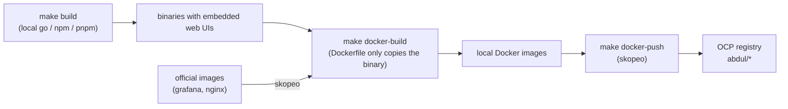

# Stock observability workspace

This directory holds every component of the stock observability stack. The top-level [Makefile](Makefile) builds all binaries locally, packages them into container images and pushes them to the OpenShift (OCP) internal registry.

| Directory | Component | Image | Source |
|---|---|---|---|
| [stock_exporter](stock_exporter) | Zerodha Kite market data exporter | `stock-exporter:<stock_exporter/VERSION>` | built locally |
| [stock_home](stock_home) | Product home page (Go API + Next.js UI) | `stock-home:<stock_home/VERSION>` | built locally |
| [prometheus](prometheus) | Prometheus + promtool (with web UI) | `prometheus:v<prometheus/VERSION>` | built locally |
| [alertmanager](alertmanager) | Alertmanager + amtool (with web UI) | `alertmanager:v<alertmanager/VERSION>` | built locally |
| [grafana](grafana) | Grafana | `grafana:13.2.3` | official release image (copied) |
| — | Portal reverse proxy (nginx) | `nginx-unprivileged:1.28-alpine` | official release image (copied) |
| [stock-observability](stock-observability) | Helm chart, Prometheus rules, Alertmanager config, Docker Compose | — | — |

Grafana is not built from [grafana](grafana): that checkout is an unreleased 13.3.0-pre, and its frontend build needs far more memory than this workstation has.

How images are produced:



Nothing is compiled inside Docker. The Dockerfiles only copy prebuilt binaries onto a small base image, so `docker build` downloads nothing through the proxy.

## Repository layout

This repository lives at [SAbdulRahuman/stock-observability](https://github.com/SAbdulRahuman/stock-observability). `stock_exporter`, `stock_home` and `deploy` are tracked here directly. The upstream projects are git submodules that point to forks in the [stock-observability](https://github.com/stock-observability) org, each pinned to a commit:

| Submodule | Fork of | Branch |
|---|---|---|
| alertmanager | prometheus/alertmanager | main |
| blackbox_exporter | prometheus/blackbox_exporter | master |
| client_golang | prometheus/client_golang | main |
| grafana | grafana/grafana (shallow) | main |
| node_exporter | prometheus/node_exporter | master |
| prometheus | prometheus/prometheus | main |
| proposals | prometheus/proposals | main |
| test-infra | prometheus/test-infra | master |

```bash
git clone --recurse-submodules git@github.com:SAbdulRahuman/stock-observability.git
git submodule update --init --recursive      # after a plain clone or a pull that moved a pin
```

Each submodule has two remotes: `origin` (the org fork) and `upstream` (the original project).

Move a component to a newer upstream commit:

```bash
gh repo sync stock-observability/prometheus  # or "Sync fork" on GitHub
git submodule update --remote prometheus     # check out the fork's latest commit
git add prometheus && git commit -m "Bump prometheus"
```

Changes to an upstream project go to a branch in its fork (`git -C prometheus push origin <branch>`). After that, commit the new submodule pointer here.

`prometheus` and `alertmanager` are built in place and set `ignore = dirty` in [.gitmodules](.gitmodules), so build outputs do not show up in `git status`.

## Prerequisites

| Tool | Used for |
|---|---|
| `go` (1.26+) | stock_exporter, stock_home, prometheus, alertmanager binaries |
| `node` (22+) and `npm` | stock_home, prometheus and alertmanager web UIs (`pnpm` is run through `npx`) |
| `docker` | `docker-build` |
| `skopeo` | base images, Grafana/nginx images, `docker-push` |
| `oc` (logged in) | registry token for `docker-push` |
| `helm` | `make deploy` |
| `openssl` | reading the proxy CA for the Elm compiler (Alertmanager UI) |

```bash
oc login https://api.ocp4poc.c4lab.local:6443
oc project abdul
```

## Quick start

```bash
cd ~/git/prometheus

make build          # 1. build all binaries, one service after another
make docker-build   # 2. build/copy all images into the local Docker daemon
make docker-push    # 3. push all images to the OCP registry (abdul namespace)
make deploy         # 4. optional: helm upgrade --install into abdul

make all            # 1 + 2 + 3
make help           # targets and the exact image tags
```

Check the result:

```bash
docker images | grep -E 'stock-|prometheus|alertmanager|grafana|nginx'
oc get is -n abdul
```

## What each step does

### `make build`

| Target | What happens | Output |
|---|---|---|
| `build-stock-exporter` | `make -C stock_exporter build` | `stock_exporter/stock_exporter` |
| `build-stock-home` | Next.js static export → embedded into the Go binary | `stock_home/stock_home` |
| `build-prometheus` | Mantine web UI with pnpm, `scripts/compress_assets.sh`, then `go build -tags netgo,builtinassets` | `prometheus/.build/linux-amd64/{prometheus,promtool}` |
| `build-alertmanager` | Elm and Mantine web UIs (`make ui-elm ui-mantine`), then `go build -tags netgo` | `alertmanager/.build/linux-amd64/{alertmanager,amtool}` |

Prometheus and Alertmanager are compiled with plain `go build` using the same build tags and version stamping as their release tool (promu), so promu does not have to be downloaded. `prometheus --version` and `alertmanager --version` report the version from their `VERSION` file.

### `make docker-build`

| Target | Dockerfile | Base image |
|---|---|---|
| `docker-build-stock-exporter` | [stock_exporter/Dockerfile.prebuilt](stock_exporter/Dockerfile.prebuilt) | `gcr.io/distroless/static-debian12:nonroot` |
| `docker-build-stock-home` | [stock_home/Dockerfile.prebuilt](stock_home/Dockerfile.prebuilt) | `gcr.io/distroless/static-debian12:nonroot` |
| `docker-build-prometheus` | upstream [prometheus/Dockerfile](prometheus/Dockerfile) (copies `.build/linux-amd64/*`) | `quay.io/prometheus/busybox-linux-amd64` |
| `docker-build-alertmanager` | upstream [alertmanager/Dockerfile](alertmanager/Dockerfile) | `quay.io/prometheus/busybox-linux-amd64` |
| `docker-build-grafana` | — (official image copied with skopeo) | — |
| `docker-build-nginx` | — (official image copied with skopeo) | — |

Base images are loaded into Docker with skopeo once (`make base-images`). Each `docker-build-*` stops with a clear message if its binary has not been built yet.

### `make docker-push`

Logs in to the registry with your `oc` token (piped, never printed), then pushes every image to `$(OCP_REGISTRY)/$(NAMESPACE)/<name>:<tag>`. Each image is written to `.build/push` first and uploaded from there, because streamed uploads of large layers are rejected with HTTP 400 by the registry route.

## Single service

Every step has a per-service target (`stock-exporter`, `stock-home`, `prometheus`, `alertmanager`, `grafana`, `nginx`):

```bash
make build-stock-home docker-build-stock-home docker-push-stock-home
make docker-build-grafana docker-push-grafana
```

After pushing a new image, roll it out with `make deploy` (the Helm chart re-pulls images that are rebuilt under the same tag).

## Variables

| Variable | Default | Meaning |
|---|---|---|
| `OCP_REGISTRY` | `default-route-openshift-image-registry.apps.ocp4poc.c4lab.local` | External route of the OCP image registry |
| `NAMESPACE` | `abdul` | Registry namespace (OpenShift project) |
| `TLS_VERIFY` | `false` | `false`: skip TLS verification for skopeo and npm, and trust the proxy CA for Elm |
| `GRAFANA_IMAGE` | `docker.io/grafana/grafana:13.2.3` | Grafana image to copy |
| `NGINX_IMAGE` | `docker.io/nginxinc/nginx-unprivileged:1.28-alpine` | Portal image to copy |
| `PNPM` | `npx --yes pnpm@10` | pnpm command for the Prometheus UI |
| `PROXY_CA_PROBE` | `package.elm-lang.org:443` | Host used to read the proxy CA for the Elm compiler |

Versions are not set here: bump the `VERSION` file of a component and rebuild. The tags must match the Helm values in [stock-observability/charts/stock-observability](stock-observability/charts/stock-observability); `make deploy` passes them automatically.

Example for another cluster/namespace with trusted certificates:

```bash
make docker-push OCP_REGISTRY=registry.example.com NAMESPACE=stock TLS_VERIFY=true
```

## Corporate proxy notes

The workstation reaches the internet through a TLS-intercepting proxy (Zscaler), and the lab registry uses a self-signed certificate. With the default `TLS_VERIFY=false`:

- skopeo uses `--src-tls-verify=false` / `--dest-tls-verify=false`.
- npm and pnpm run with `strict-ssl=false`, fewer parallel sockets and long timeouts.
- The Elm compiler (Alertmanager UI) cannot disable verification. The Makefile reads the proxy's CA certificate from a TLS connection to `PROXY_CA_PROBE` and gives Elm a CA bundle (system CAs + proxy CA) in `.build/ca` via `SYSTEM_CERTIFICATE_PATH`.

Only use these defaults on the lab network.

## Troubleshooting

| Symptom | Fix |
|---|---|
| `npm ERR! code ERR_SOCKET_TIMEOUT` | Slow proxy; re-run the same `make build-*` target (downloads are cached) |
| Elm: `certificate has unknown CA` | `rm -rf .build/ca` and re-run `make build-alertmanager` |
| `... is missing: run 'make build-...' first` | Run the named build target before `docker-build-*` |
| `skopeo copy`: `uploading layer chunked: StatusCode: 400` | Use `make docker-push-*` (stages images on disk first) |
| `unauthorized` on push | `oc login` again; the token in `make registry-login` has expired |
| Pod still runs the old image after a rebuild | `make deploy`, or `oc -n abdul rollout restart deploy/<name>` |

## Cleaning up

```bash
make clean   # removes .build, prometheus/.build, alertmanager/.build and the stock binaries
```

`node_modules` directories are kept to speed up the next build.

## Deployment

Deployment, configuration, access, credentials and day-2 operations are described in [stock-observability/README.md](stock-observability/README.md).

## OCP 

OCP cluster details
 
10.189.185.210    api.ocp4poc.c4lab.local

10.189.185.210    console-openshift-console.apps.ocp4poc.c4lab.local

10.189.185.210    oauth-openshift.apps.ocp4poc.c4lab.local
 
kubeadmin/ABKHs-TnW6m-I2pmb-vYZZg
 