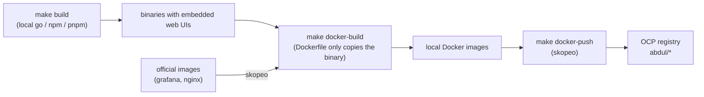

# Stock observability workspace

This directory holds every component of the stock observability stack. The top-level [Makefile](Makefile) builds all binaries locally, packages them into container images and pushes them to the OpenShift (OCP) internal registry.

| Directory | Component | Image | Source |
|---|---|---|---|
| [stock_exporter](stock_exporter) | Zerodha Kite market data exporter | `stock-exporter:<stock_exporter/VERSION>` | built locally |
| [stock_home](stock_home) | Product home page (Go API + Next.js UI) | `stock-home:<stock_home/VERSION>` | built locally |
| [prometheus](prometheus) | Prometheus + promtool (with web UI) | `prometheus:v<prometheus/VERSION>` | built locally |
| [alertmanager](alertmanager) | Alertmanager + amtool (with web UI) | `alertmanager:v<alertmanager/VERSION>` | built locally |
| [grafana](grafana) | Grafana | `grafana:13.2.3` | official release image (copied) |
| — | Portal reverse proxy (nginx) | `nginx-unprivileged:1.28-alpine-slim` | official release image (copied) |
| [stock-observability](stock-observability) | Helm chart, Prometheus rules, Alertmanager config, Docker Compose | — | — |

Grafana is not built from [grafana](grafana): that checkout is an unreleased 13.3.0-pre, and its frontend build needs far more memory than this workstation has.

How images are produced:



Nothing is compiled inside Docker. The Dockerfiles only copy prebuilt binaries onto a small base image, so `docker build` downloads nothing through the proxy.

## Install on a workstation (Linux, Windows)

The installer downloads the **latest published GitHub release** (`latest`) and installs the whole stack for the current user, without root/admin rights or Docker: stock_exporter, stock_home, Prometheus, Alertmanager, Grafana, OpenBB and an Nginx portal at http://localhost:8080. The release bundles a static Linux Nginx binary and the official Windows Nginx binary. Run the command for your OS:

Linux (x86_64 with systemd):

```bash
curl -fsSL https://raw.githubusercontent.com/SAbdulRahuman/stock-observability/main/install.sh | bash -s -- --version latest
```

Windows 10/11 (x64, PowerShell 5.1 or later):

```powershell
& ([scriptblock]::Create((irm https://raw.githubusercontent.com/SAbdulRahuman/stock-observability/main/install.ps1))) -Version latest
```

The installer verifies the downloaded release archive against its published SHA-256 checksum. To upgrade later, run the same command again; it checks GitHub for the latest published release each time, installs it, and keeps your configuration and data. Upgrades are manual; the installer does not run automatically in the background. To install a specific release instead, replace `latest` with its tag, such as `vX.Y.Z`.

After installation, open http://localhost:8080. For live market data, configure your [Kite Connect](https://developers.kite.trade) app in **Settings → Data Sources → Zerodha Kite Connect**. The page shows the redirect URL (`http://127.0.0.1:8080/exporter/kite/callback`); save the credentials, then select **Test with Kite** to sign in and verify them. Credentials can be changed later on the same computer. For unattended installs, set `KITE_API_KEY` and `KITE_API_SECRET` before running the installer. Kite login must be refreshed once per trading day.

Options: Linux supports `--kite-api-key` (or `KITE_API_KEY` with `KITE_API_SECRET`), `--port`, `--listen`, `--no-start`, `--no-browser`, `--archive`, `--uninstall` and `--purge` (with `--uninstall`), passed after `bash -s --`. Windows supports the corresponding `-KiteApiKey`, `-Port`, `-Listen`, `-NoStart`, `-NoBrowser`, `-Archive`, `-Uninstall` and `-Purge` parameters. For example, append `--no-start` to the Linux command above, or `-NoStart` after the Windows scriptblock invocation.

Linux: programs and data are in `~/.local/share/stock-observability`, config in `~/.config/stock-observability`, and services are managed with `systemctl --user` (`stockobs.target`). Windows: files are in `%LOCALAPPDATA%\StockObservability`; services are Scheduled Tasks named `StockObservability-*` and start at user logon. On either OS, edits to `prometheus.yml`, `alertmanager.yml`, `watchlist.yml` and `nginx.conf` are kept during upgrades; changed defaults are written alongside as `.new` files. Existing Caddy installations keep their old `Caddyfile`, but Nginx no longer reads it; move any custom portal routes to `nginx.conf`.

Releases are built by [.github/workflows/release.yml](.github/workflows/release.yml) on `v*` tags (`make dist-native` locally). Local release builds also need `gcc`, `make`, `libpcre2-dev`, `strip`, `curl` and `unzip`. Third-party binaries are pinned by SHA-256 and the Nginx source by commit in [deploy/native/manifest.env](deploy/native/manifest.env).

## Repository layout

This repository lives at [SAbdulRahuman/stock-observability](https://github.com/SAbdulRahuman/stock-observability). `stock_exporter`, `stock_home` and `deploy` are tracked here directly. Most upstream projects are git submodules that point to forks in the [stock-observability](https://github.com/stock-observability) org, each pinned to a commit. Lightweight Charts is pinned directly to its upstream repository:

| Submodule | Source | Branch |
|---|---|---|
| alertmanager | prometheus/alertmanager | main |
| blackbox_exporter | prometheus/blackbox_exporter | master |
| client_golang | prometheus/client_golang | main |
| grafana | grafana/grafana (shallow) | main |
| lightweight-charts | tradingview/lightweight-charts (upstream) | master |
| node_exporter | prometheus/node_exporter | master |
| prometheus | prometheus/prometheus | main |
| proposals | prometheus/proposals | main |
| test-infra | prometheus/test-infra | master |

```bash
git clone --recurse-submodules git@github.com:SAbdulRahuman/stock-observability.git
git submodule update --init --recursive      # after a plain clone or a pull that moved a pin
```

Org-fork submodules have two remotes: `origin` (the org fork) and `upstream` (the original project). `lightweight-charts` uses `origin` for the upstream TradingView repository.

Move a component to a newer upstream commit:

```bash
gh repo sync stock-observability/prometheus  # or "Sync fork" on GitHub
git submodule update --remote prometheus     # check out the fork's latest commit
git add prometheus && git commit -m "Bump prometheus"
```

Changes to an upstream project go to a branch in its fork (`git -C prometheus push origin <branch>`). After that, commit the new submodule pointer here.

`prometheus` and `alertmanager` are built in place and set `ignore = dirty` in [.gitmodules](.gitmodules), so build outputs do not show up in `git status`.

## Prerequisites

| Tool | Used for |
|---|---|
| `go` (1.26+) | stock_exporter, stock_home, prometheus, alertmanager binaries |
| `node` (22+) and `npm` | stock_home, prometheus and alertmanager web UIs (`pnpm` is run through `npx`) |
| `docker` | `docker-build` |
| `skopeo` | base images, Grafana/nginx images, `docker-push` |
| `oc` (logged in) | registry token for `docker-push` |
| `helm` | `make deploy` |
| `openssl` | reading the proxy CA for the Elm compiler (Alertmanager UI) |

```bash
oc login https://api.ocp4poc.c4lab.local:6443
oc project abdul
```

## Quick start

```bash
cd ~/git/prometheus

make build          # 1. build all binaries, one service after another
make docker-build   # 2. build/copy all images into the local Docker daemon
make docker-push    # 3. push all images to the OCP registry (abdul namespace)
make deploy         # 4. optional: helm upgrade --install into abdul

make all            # 1 + 2 + 3
make help           # targets and the exact image tags
```

Check the result:

```bash
docker images | grep -E 'stock-|prometheus|alertmanager|grafana|nginx'
oc get is -n abdul
```

## What each step does

### `make build`

| Target | What happens | Output |
|---|---|---|
| `build-stock-exporter` | `make -C stock_exporter build` | `stock_exporter/stock_exporter` |
| `build-stock-home` | Next.js static export → embedded into the Go binary | `stock_home/stock_home` |
| `build-prometheus` | Mantine web UI with pnpm, `scripts/compress_assets.sh`, then `go build -tags netgo,builtinassets` | `prometheus/.build/linux-amd64/{prometheus,promtool}` |
| `build-alertmanager` | Elm and Mantine web UIs (`make ui-elm ui-mantine`), then `go build -tags netgo` | `alertmanager/.build/linux-amd64/{alertmanager,amtool}` |

Prometheus and Alertmanager are compiled with plain `go build` using the same build tags and version stamping as their release tool (promu), so promu does not have to be downloaded. `prometheus --version` and `alertmanager --version` report the version from their `VERSION` file.

### `make docker-build`

| Target | Dockerfile | Base image |
|---|---|---|
| `docker-build-stock-exporter` | [stock_exporter/Dockerfile.prebuilt](stock_exporter/Dockerfile.prebuilt) | `gcr.io/distroless/static-debian12:nonroot` |
| `docker-build-stock-home` | [stock_home/Dockerfile.prebuilt](stock_home/Dockerfile.prebuilt) | `gcr.io/distroless/static-debian12:nonroot` |
| `docker-build-prometheus` | upstream [prometheus/Dockerfile](prometheus/Dockerfile) (copies `.build/linux-amd64/*`) | `quay.io/prometheus/busybox-linux-amd64` |
| `docker-build-alertmanager` | upstream [alertmanager/Dockerfile](alertmanager/Dockerfile) | `quay.io/prometheus/busybox-linux-amd64` |
| `docker-build-grafana` | — (official image copied with skopeo) | — |
| `docker-build-nginx` | — (official image copied with skopeo) | — |

Base images are loaded into Docker with skopeo once (`make base-images`). Each `docker-build-*` stops with a clear message if its binary has not been built yet.

### `make docker-push`

Logs in to the registry with your `oc` token (piped, never printed), then pushes every image to `$(OCP_REGISTRY)/$(NAMESPACE)/<name>:<tag>`. Each image is written to `.build/push` first and uploaded from there, because streamed uploads of large layers are rejected with HTTP 400 by the registry route.

## Single service

Every step has a per-service target (`stock-exporter`, `stock-home`, `prometheus`, `alertmanager`, `grafana`, `nginx`):

```bash
make build-stock-home docker-build-stock-home docker-push-stock-home
make docker-build-grafana docker-push-grafana
```

After pushing a new image, roll it out with `make deploy` (the Helm chart re-pulls images that are rebuilt under the same tag).

## Variables

| Variable | Default | Meaning |
|---|---|---|
| `OCP_REGISTRY` | `default-route-openshift-image-registry.apps.ocp4poc.c4lab.local` | External route of the OCP image registry |
| `NAMESPACE` | `abdul` | Registry namespace (OpenShift project) |
| `TLS_VERIFY` | `false` | `false`: skip TLS verification for skopeo and npm, and trust the proxy CA for Elm |
| `GRAFANA_IMAGE` | `docker.io/grafana/grafana:13.2.3` | Grafana image to copy |
| `NGINX_IMAGE` | `docker.io/nginxinc/nginx-unprivileged:1.28-alpine-slim` | Portal image to copy |
| `PNPM` | `npx --yes pnpm@10` | pnpm command for the Prometheus UI |
| `PROXY_CA_PROBE` | `package.elm-lang.org:443` | Host used to read the proxy CA for the Elm compiler |

Versions are not set here: bump the `VERSION` file of a component and rebuild. The tags must match the Helm values in [stock-observability/charts/stock-observability](stock-observability/charts/stock-observability); `make deploy` passes them automatically.

Example for another cluster/namespace with trusted certificates:

```bash
make docker-push OCP_REGISTRY=registry.example.com NAMESPACE=stock TLS_VERIFY=true
```

## Corporate proxy notes

The workstation reaches the internet through a TLS-intercepting proxy (Zscaler), and the lab registry uses a self-signed certificate. With the default `TLS_VERIFY=false`:

- skopeo uses `--src-tls-verify=false` / `--dest-tls-verify=false`.
- npm and pnpm run with `strict-ssl=false`, fewer parallel sockets and long timeouts.
- The Elm compiler (Alertmanager UI) cannot disable verification. The Makefile reads the proxy's CA certificate from a TLS connection to `PROXY_CA_PROBE` and gives Elm a CA bundle (system CAs + proxy CA) in `.build/ca` via `SYSTEM_CERTIFICATE_PATH`.

Only use these defaults on the lab network.

## Troubleshooting

| Symptom | Fix |
|---|---|
| `npm ERR! code ERR_SOCKET_TIMEOUT` | Slow proxy; re-run the same `make build-*` target (downloads are cached) |
| Elm: `certificate has unknown CA` | `rm -rf .build/ca` and re-run `make build-alertmanager` |
| `... is missing: run 'make build-...' first` | Run the named build target before `docker-build-*` |
| `skopeo copy`: `uploading layer chunked: StatusCode: 400` | Use `make docker-push-*` (stages images on disk first) |
| `unauthorized` on push | `oc login` again; the token in `make registry-login` has expired |
| Pod still runs the old image after a rebuild | `make deploy`, or `oc -n abdul rollout restart deploy/<name>` |

## Cleaning up

```bash
make clean   # removes .build, prometheus/.build, alertmanager/.build and the stock binaries
```

`node_modules` directories are kept to speed up the next build.

## Deployment

Deployment, configuration, access, credentials and day-2 operations are described in [stock-observability/README.md](stock-observability/README.md).

## OCP 

OCP cluster details
 
10.189.185.210    api.ocp4poc.c4lab.local

10.189.185.210    console-openshift-console.apps.ocp4poc.c4lab.local

10.189.185.210    oauth-openshift.apps.ocp4poc.c4lab.local
 
kubeadmin/ABKHs-TnW6m-I2pmb-vYZZg
 
---

# Stock Home UX design

## Stock_Home UI 


## Market Overview UI


## Watchlist 


## Alerts UI 


## Top Movers UI 


# Sector View 


## Stock Exporter UI 


## Settings UI 


--- 
Stock Home UX wireframe 

import pypandoc

md = r"""# stock_home — Settings UI Wireframe

**Document:** `STOCK_HOME_SETTINGS_WIREFRAME.md`  
**Product:** stock_home — Stock Observability Platform  
**Page:** Settings  
**Theme:** Dark / desktop-first  
**Primary market:** NSE  
**Data source:** Zerodha Kite API  
**Version:** v0.1.0

---

## 1. Page Objective

The Settings page provides a centralized configuration surface for:

- General application preferences
- Market-data sources
- Alert behavior and notification delivery
- Watchlist behavior
- Chart and display preferences
- External integrations
- User preferences
- Application information

The page should feel like an **operations/control plane** rather than a generic application settings screen.

---

# 2. Global Application Shell

```text
┌─────────────────────────────────────────────────────────────────────────────────────────────────────────────┐
│ stock_home                         🔍 Search stocks, indices, sectors...       Tue, Oct 8, 2026  09:42 AM     │
│ Stock Observability Platform                                                  ● Live Market    ⚙   🔔 12  AS │
├──────────────────────┬──────────────────────────────────────────────────────────────────────────────────────┤
│                      │                                                                                      │
│  🏠 Home             │  Settings                                                                         │
│  📈 Market Overview  │  Configure your preferences, data sources, alerts, and system settings             │
│  ♡  Watchlist        │                                                                                      │
│  🔔 Alerts       12   │  [General] [Data Sources] [Alerts] [Watchlist] [Display] [Notifications]          │
│  ↗  Top Movers       │  [Integrations] [Users] [About]                                                     │
│  ◈  Sector View      │                                                                                      │
│  🔎 Stock Explorer   │  ┌──────────────────────┐ ┌──────────────────────┐ ┌──────────────────────────────┐ │
│  ▦  Dashboards       │  │ General Settings     │ │ Data Sources         │ │ Alert Settings              │ │
│  ◈  OpenBB Analysis  │  │                      │ │                      │ │                              │ │
│  🔵 Prometheus   ↗   │  │ Theme                │ │ Provider tabs        │ │ Default Severity             │ │
│  🟠 Grafana      ↗   │  │ Default Exchange     │ │ API credentials      │ │ Alert Grouping               │ │
│  🔴 AlertManager ↗   │  │ Landing Page        │ │ Connection status    │ │ Notification channels        │ │
│  ⚙  Settings         │  │ Refresh Interval     │ │ WebSocket mode       │ │ Alert sound                  │ │
│                      │  │ Auto Refresh         │ │ Subscribe depth      │ │ Toast notifications          │ │
│ ┌──────────────────┐ │  │ Market Status Banner │ │ Reconnect            │ │ Auto acknowledge             │ │
│ │ Market Status    │ │  │ Alert Sound          │ │                      │ │ Daily digest                 │ │
│ │ ● OPEN           │ │  └──────────────────────┘ └──────────────────────┘ └──────────────────────────────┘ │
│ │ NSE              │ │                                                                                      │
│ │ 09:15–03:30 PM   │ │  ┌──────────────────────┐ ┌──────────────────────┐ ┌──────────────────────────────┐ │
│ │ Live via Kite    │ │  │ Watchlist Settings   │ │ Display & Chart      │ │ Integrations & Tools        │ │
│ └──────────────────┘ │  │                      │ │ Settings             │ │                              │ │
│                      │  │ Default view         │ │ Default timeframe    │ │ Prometheus     ● Connected   │ │
│                      │  │ Default sort         │ │ Chart type           │ │ Grafana        ● Connected   │ │
│                      │  │ Items/page           │ │ Indicators           │ │ AlertManager   ● Connected   │ │
│                      │  │ Mini charts          │ │ Color scheme         │ │ OpenBB         ● Connected   │ │
│                      │  │ Sector tag           │ │ Volume / grid        │ │                              │ │
│                      │  │ Alert count          │ │ Crosshair             │ │ User Preferences             │ │
│                      │  └──────────────────────┘ └──────────────────────┘ └──────────────────────────────┘ │
├──────────────────────┴──────────────────────────────────────────────────────────────────────────────────────┤
│ stock_home | v0.1.0                         Data via Zerodha Kite API | NSE | ● Live                         │
└─────────────────────────────────────────────────────────────────────────────────────────────────────────────┘
```

---

# 3. Header

## 3.1 Header Layout

```text
┌─────────────────────────────────────────────────────────────────────────────────────────────────────────────┐
│ stock_home   [☰]   [ 🔍 Search stocks, indices, sectors (e.g. RELIANCE, TCS, NIFTY, Bank...) ]             │
│                                                                                         Tue, Oct 8, 2026     │
│                                                                                         09:42 AM             │
│                                                                                         ● Live Market        │
│                                                                                         ⚙  🔔12  [AS]       │
└─────────────────────────────────────────────────────────────────────────────────────────────────────────────┘
```

### Components

| Component | Behavior |
|---|---|
| Hamburger | Collapse/expand sidebar |
| Global search | Search stocks, indices, sectors, metrics |
| Date/time | Current platform time |
| Live Market | Market connection/open-state indicator |
| Settings icon | Current page / settings shortcut |
| Notification icon | Opens notification center |
| User avatar | User/profile menu |

---

# 4. Sidebar Navigation

```text
┌──────────────────────────┐
│ 📊 stock_home             │
│ Stock Observability       │
├──────────────────────────┤
│ 🏠 Home                   │
│ 📈 Market Overview        │
│ ♡  Watchlist              │
│ 🔔 Alerts             12  │
│ ↗  Top Movers             │
│ ◈  Sector View            │
│ 🔎 Stock Explorer         │
│ ▦  Dashboards             │
│ ◈  OpenBB Analysis        │
│ 🔵 Prometheus         ↗   │
│ 🟠 Grafana            ↗   │
│ 🔴 AlertManager       ↗   │
│ ⚙  Settings       ACTIVE  │
├──────────────────────────┤
│ Market Status             │
│ ● OPEN                    │
│ NSE                       │
│ 09:15 AM – 03:30 PM       │
│                           │
│ ◉ Live data via           │
│   Zerodha Kite API        │
└──────────────────────────┘
```

### Sidebar Rules

- Settings is visually highlighted.
- External tools display an external-link icon.
- Alerts badge displays current unresolved alert count.
- Market Status remains visible at the bottom.
- Sidebar is collapsible.
- Mobile behavior: convert to drawer.

---

# 5. Settings Navigation

```text
Settings

[⚙ General]
[▣ Data Sources]
[🔔 Alerts]
[♡ Watchlist]
[▣ Display]
[✉ Notifications]
[🔗 Integrations]
[♙ Users]
[ⓘ About]
```

## Navigation Behavior

- Active tab uses primary blue highlight.
- Tab changes content without leaving Settings.
- Deep-linking should be supported:

```text
/settings/general
/settings/data-sources
/settings/alerts
/settings/watchlist
/settings/display
/settings/notifications
/settings/integrations
/settings/users
/settings/about
```

---

# 6. General Settings

```text
┌─────────────────────────────────────────────┐
│ ⚙ General Settings                          │
│ Basic application preferences               │
├─────────────────────────────────────────────┤
│                                             │
│ Theme                                       │
│ [ ☀ Dark (Default)                     ▼ ] │
│                                             │
│ Default Exchange                            │
│ [ 🇮🇳 NSE                               ▼ ] │
│                                             │
│ Default Landing Page                        │
│ [ 📈 Market Overview                    ▼ ] │
│                                             │
│ Refresh Interval                            │
│ [ ◷ 30 seconds                          ▼ ] │
│                                             │
│ Auto Refresh                         [ ON ] │
│ Automatically refresh data at set interval  │
│                                             │
│ Show Market Status Banner             [ ON ] │
│ Display market open/close status            │
│                                             │
│ Play Sound for Alerts                 [OFF ] │
│ Play notification sound for new alerts      │
│                                             │
└─────────────────────────────────────────────┘
```

### Controls

| Setting | Type | Default |
|---|---|---|
| Theme | Select | Dark |
| Default Exchange | Select | NSE |
| Landing Page | Select | Market Overview |
| Refresh Interval | Select | 30 seconds |
| Auto Refresh | Toggle | ON |
| Market Status Banner | Toggle | ON |
| Alert Sound | Toggle | OFF |

---

# 7. Data Sources

```text
┌─────────────────────────────────────────────┐
│ 🗄 Data Sources                    ● Connected│
│ Configure market data providers              │
├─────────────────────────────────────────────┤
│ [Zerodha Kite] [OpenBB] [Other Sources]     │
│                                             │
│ API Key                                     │
│ [ ••••••••••••••••••••••••• ]        ◉    │
│                                             │
│ API Secret                                  │
│ [ ••••••••••••••••••••••••• ]        ◉    │
│                                             │
│ Access Token                                │
│ [ ••••••••••••••••••••••••• ]        ◉    │
│                                             │
│ ┌─────────────────────────────────────────┐ │
│ │ ✓ Successfully connected to Zerodha    │ │
│ │   Kite API                              │ │
│ │   Last validated: Oct 8, 2026 09:40 AM │ │
│ │                       [Test Connection] │ │
│ └─────────────────────────────────────────┘ │
│                                             │
│ WebSocket Mode                       [ ON ] │
│ Use WebSocket for live market data          │
│                                             │
│ Subscribe Depth                             │
│ [ Full Market (All Segments)            ▼ ] │
│                                             │
│ [ ↻ Reconnect ]                             │
└─────────────────────────────────────────────┘
```

### Data Source Requirements

- Never expose secrets in plain text.
- Support masked credentials.
- Test connection before saving.
- Display last validation timestamp.
- Display connection health.
- Support WebSocket and REST modes.
- Support subscription depth.

---

# 8. Alert Settings

```text
┌─────────────────────────────────────────────┐
│ 🔔 Alert Settings                            │
│ Configure alert behavior and delivery       │
├─────────────────────────────────────────────┤
│                                             │
│ Default Severity                            │
│ [ 🔴 Critical                           ▼ ] │
│                                             │
│ Alert Grouping                              │
│ [ 5 minutes                             ▼ ] │
│                                             │
│ Notification Channels                       │
│ ☑ In-App Notifications                      │
│ ☑ Email Notifications                       │
│ ☐ Browser Push Notifications                │
│ ☐ Webhook (Custom)                          │
│                                             │
│ Alert Sound                                 │
│ [ Default                                ▼ ] │
│                                             │
│ Show Toast Notifications              [ ON ]│
│                                             │
│ Auto Acknowledge (Test Alerts)       [ OFF ]│
│                                             │
│ Enable Alert Digest (Daily)          [ ON ] │
│                                             │
└─────────────────────────────────────────────┘
```

### Alert Configuration Model

```text
Severity:
  Critical
  Warning
  Info

Grouping:
  None
  1 minute
  5 minutes
  15 minutes
  30 minutes
  1 hour

Channels:
  In-App
  Email
  Browser Push
  Webhook
```

---

# 9. Watchlist Settings

```text
┌─────────────────────────────────────────────┐
│ ♡ Watchlist Settings                         │
│ Manage watchlist behaviour                  │
├─────────────────────────────────────────────┤
│                                             │
│ Default Watchlist View                      │
│ [ ▦ Table View                           ▼ ]│
│                                             │
│ Default Sort                                │
│ [ ↕ % Change (High to Low)              ▼ ]│
│                                             │
│ Items per Page                              │
│ [ 25                                    ▼ ]│
│                                             │
│ Show Mini Charts                      [ ON ]│
│                                             │
│ Show Sector Tag                       [ ON ]│
│                                             │
│ Show Alerts Count                     [ ON ]│
│                                             │
└─────────────────────────────────────────────┘
```

### Supported Views

- Table View
- Card View
- Compact View

### Sort Options

- Symbol
- LTP
- % Change
- Volume
- Alert Count
- Last Updated

---

# 10. Display & Chart Settings

```text
┌─────────────────────────────────────────────┐
│ 🖥 Display & Chart Settings                  │
│ Customize charts and visual appearance      │
├─────────────────────────────────────────────┤
│                                             │
│ Default Chart Timeframe                     │
│ [ 1 Day                                  ▼ ]│
│                                             │
│ Chart Type                                  │
│ [ Candlestick                            ▼ ]│
│                                             │
│ Technical Indicators                        │
│ [ SMA20 ] [ EMA50 ] [ RSI ] [ MACD ]       │
│                                             │
│ Color Scheme                                │
│ [ Green/Red (Default)                   ▼ ]│
│                                             │
│ Show Volume                           [ ON ]│
│ Show Grid                             [ ON ]│
│ Show Crosshair                         [ ON ]│
│                                             │
└─────────────────────────────────────────────┘
```

### Chart Timeframes

```text
1D | 1W | 1M | 3M | 1Y | 5Y
```

### Indicator Examples

```text
SMA20
EMA50
EMA200
RSI
MACD
Bollinger Bands
VWAP
Volume
ATR
```

---

# 11. Integrations & Tools

```text
┌─────────────────────────────────────────────┐
│ 🔗 Integrations & Tools                     │
│ External tools and platform integrations    │
├─────────────────────────────────────────────┤
│                                             │
│ 🔥 Prometheus                               │
│    Metrics & Monitoring        ● Connected ↗│
│                                             │
│ 🟠 Grafana                                  │
│    Dashboards & Visualization ● Connected ↗│
│                                             │
│ 🔴 AlertManager                             │
│    Alerting & Notifications    ● Connected ↗│
│                                             │
│ ◈ OpenBB                                    │
│    Market Data & Analysis      ● Connected ↗│
│                                             │
└─────────────────────────────────────────────┘
```

### Integration Status

Each integration should expose:

```text
Name
Purpose
Connection status
Endpoint / URL
Last health check
Open / Launch action
Configure action
```

---

# 12. User Preferences

```text
┌─────────────────────────────────────────────┐
│ ♙ User Preferences                           │
│ Display name and application settings       │
├─────────────────────────────────────────────┤
│                                             │
│ Display Name                                │
│ [ Abdul S                                ] │
│                                             │
│ Email                                       │
│ [ abdul.s@example.com                    ] │
│                                             │
│ Timezone                                    │
│ [ (GMT +05:30) Asia/Kolkata              ▼ ]│
│                                             │
│ Language                                    │
│ [ English                                ▼ ]│
│                                             │
└─────────────────────────────────────────────┘
```

---

# 13. Notifications Tab

Recommended content:

```text
┌────────────────────────────────────────────────────────────┐
│ Notifications                                               │
├────────────────────────────────────────────────────────────┤
│ In-App Notifications                         [ ON ]         │
│ Email Notifications                          [ ON ]         │
│ Browser Push                                 [ OFF]         │
│ Alert Sounds                                 [ OFF]         │
│ Daily Market Digest                          [ ON ]         │
│ Pre-Market Summary                            [ ON ]         │
│ Post-Market Summary                           [ ON ]         │
│ Critical Alert Escalation                     [ ON ]         │
│                                                            │
│ Quiet Hours                                                   │
│ [ 10:00 PM ] → [ 07:00 AM ]                                │
└────────────────────────────────────────────────────────────┘
```

---

# 14. Users Tab

For MVP / single-user deployment:

```text
┌─────────────────────────────────────────────┐
│ Users                                       │
├─────────────────────────────────────────────┤
│                                             │
│ Current User                                │
│ Abdul S                                     │
│ Administrator                               │
│ ● Active                                    │
│                                             │
│ [ Edit Profile ]                            │
│ [ Change Password ]                         │
│                                             │
└─────────────────────────────────────────────┘
```

Future multi-user capability:

```text
Admin
Trader
Analyst
Viewer
Read-only
```

---

# 15. About Tab

```text
┌─────────────────────────────────────────────┐
│ About stock_home                            │
├─────────────────────────────────────────────┤
│                                             │
│ stock_home                                  │
│ Stock Observability Platform               │
│                                             │
│ Version: v0.1.0                             │
│                                             │
│ Data Provider                               │
│ Zerodha Kite API                            │
│                                             │
│ Monitoring                                  │
│ Prometheus                                  │
│                                             │
│ Visualization                               │
│ Grafana                                     │
│                                             │
│ Alerting                                    │
│ AlertManager                                │
│                                             │
│ Market Analysis                             │
│ OpenBB                                       │
│                                             │
│ [ Documentation ] [ GitHub ] [ License ]   │
└─────────────────────────────────────────────┘
```

---

# 16. Save / Reset Behavior

Settings should use predictable configuration behavior.

### Preferred Pattern

```text
┌──────────────────────────────────────────────────────────┐
│ Unsaved changes                                           │
│ You have modified settings.                              │
│                                                          │
│ [ Reset ]                                  [ Save ]       │
└──────────────────────────────────────────────────────────┘
```

### Save Behavior

1. Validate field values.
2. Persist configuration.
3. Apply runtime-safe changes immediately.
4. Restart/reconnect only when required.
5. Display success toast.

Example:

```text
✓ Settings saved successfully
```

### Reset Behavior

Reset only the current settings section unless the user explicitly chooses:

```text
Reset all settings
```

---

# 17. Validation & Error States

## Data Source Error

```text
┌─────────────────────────────────────────────┐
│ 🔴 Connection failed                       │
│                                             │
│ Unable to connect to Zerodha Kite API.     │
│                                             │
│ Reason: Authentication failed              │
│                                             │
│ [ Retry ]        [ Configure Credentials ] │
└─────────────────────────────────────────────┘
```

## Invalid Setting

```text
Refresh Interval

[ -5 seconds ]

🔴 Value must be greater than 0 seconds.
```

## Integration Unavailable

```text
Prometheus
● Disconnected

Last successful connection:
08:41 AM

[ Retry ] [ Configure ]
```

---

# 18. Responsive Wireframe

## Desktop

```text
Sidebar + Main Content

┌──────────────┬──────────────────────────────────────────────┐
│ Sidebar      │ Main Settings Content                       │
│ 240px        │ 3-column configuration grid                 │
└──────────────┴──────────────────────────────────────────────┘
```

## Tablet

```text
┌───────┬──────────────────────────────────────────┐
│ 72px  │ Main content                             │
│ icons │ 2-column cards                           │
└───────┴──────────────────────────────────────────┘
```

## Mobile

```text
┌─────────────────────────────┐
│ ☰ stock_home        🔔      │
├─────────────────────────────┤
│ Settings                    │
│                             │
│ [ General              ▼ ]  │
│                             │
│ ┌─────────────────────────┐ │
│ │ General Settings        │ │
│ │                         │ │
│ │ Theme                   │ │
│ │ [ Dark              ▼ ] │ │
│ │                         │ │
│ │ Auto Refresh       ON   │ │
│ └─────────────────────────┘ │
└─────────────────────────────┘
```

---

# 19. UX Principles

### 19.1 Configuration Hierarchy

Organize settings in this order:

```text
Application
   ↓
Data
   ↓
Alerts
   ↓
Watchlist
   ↓
Visualization
   ↓
Notifications
   ↓
Integrations
   ↓
Users
   ↓
About
```

### 19.2 Safety

Sensitive credentials must:

- Always be masked.
- Never appear in logs.
- Never be displayed in browser console.
- Never be included in screenshots.
- Support token rotation.
- Support connection testing.

### 19.3 Observability

Every external dependency should expose:

```text
Connection State
Health
Last Successful Check
Latency
Endpoint
Version
```

### 19.4 Runtime Awareness

Settings that affect live trading/market data should clearly indicate:

```text
Applied immediately
Requires reconnect
Requires exporter restart
Requires browser refresh
```

---

# 20. Recommended Component Model

```text
SettingsPage
├── AppShell
│   ├── Header
│   ├── Sidebar
│   └── MarketStatus
│
├── SettingsHeader
│   ├── Title
│   └── SettingsTabs
│
├── GeneralSettings
│   ├── ThemeSelector
│   ├── ExchangeSelector
│   ├── LandingPageSelector
│   ├── RefreshIntervalSelector
│   └── ToggleSettings
│
├── DataSourceSettings
│   ├── ProviderTabs
│   ├── CredentialForm
│   ├── ConnectionStatus
│   ├── WebSocketSettings
│   └── SubscriptionDepth
│
├── AlertSettings
│   ├── SeveritySelector
│   ├── GroupingSelector
│   ├── NotificationChannels
│   └── AlertBehavior
│
├── WatchlistSettings
│   ├── ViewSelector
│   ├── SortSelector
│   └── DisplayToggles
│
├── DisplaySettings
│   ├── ChartTimeframe
│   ├── ChartType
│   ├── Indicators
│   └── DisplayToggles
│
├── NotificationSettings
├── IntegrationSettings
├── UserSettings
└── AboutSettings
```

---

# 21. Suggested Frontend Routes

```text
/app/settings
/app/settings/general
/app/settings/data-sources
/app/settings/alerts
/app/settings/watchlist
/app/settings/display
/app/settings/notifications
/app/settings/integrations
/app/settings/users
/app/settings/about
```

For a Next.js implementation, tabs can alternatively use query parameters:

```text
/settings?tab=general
/settings?tab=data-sources
/settings?tab=alerts
/settings?tab=watchlist
/settings?tab=display
/settings?tab=notifications
/settings?tab=integrations
/settings?tab=users
/settings?tab=about
```

---

# 22. Design Tokens

## Colors

```text
Background:
  #07111F
  #0B1626
  #101D2D

Primary:
  Blue / Electric Blue

Positive:
  Green

Negative:
  Red

Warning:
  Orange

Info:
  Cyan / Blue

Border:
  Low-opacity blue/gray

Text:
  Primary white
  Secondary blue-gray
  Muted gray
```

## Visual Language

```text
Dark observability console
+
Financial trading dashboard
+
Cloud-native operations UI
```

Use:

- Rounded cards
- Thin borders
- Subtle shadows
- Compact spacing
- High information density
- Clear status indicators
- Green/red financial semantics
- Consistent iconography
- Small but readable secondary text

---

# 23. MVP Implementation Priority

## P0 — Required

```text
✓ General
✓ Data Sources
✓ Alerts
✓ Watchlist
✓ Display
✓ Integrations
✓ Save / Reset
✓ Validation
✓ Connection status
```

## P1

```text
✓ Notifications
✓ Users
✓ About
✓ Deep-linkable tabs
✓ Responsive mobile UI
✓ Import / Export settings
```

## P2

```text
○ Multi-user RBAC
○ Configuration profiles
○ Environment profiles
○ Backup / Restore
○ Audit history
○ Configuration versioning
○ API-based remote configuration
```

---

# 24. Final Target

The Settings page should become the **configuration control plane for the entire stock_home platform**:

```text
                         stock_home
                             │
              ┌──────────────┼──────────────┐
              │              │              │
           Market          Alerts         Data
           Config          Config         Config
              │              │              │
              └──────────────┼──────────────┘
                             │
                         Settings
                             │
       ┌─────────────┬───────┼────────┬─────────────┐
       │             │       │        │             │
   Watchlist      Charts  Notifications Integrations Users
       │             │       │        │             │
       └─────────────┴───────┴────────┴─────────────┘
                             │
                    Runtime Configuration
                             │
        ┌────────────────────┼────────────────────┐
        │                    │                    │
  stock_exporter        Prometheus          AlertManager
        │                    │                    │
        └────────────────────┼────────────────────┘
                             │
                           Grafana
                             │
                           OpenBB
```

**End of wireframe**
"""
