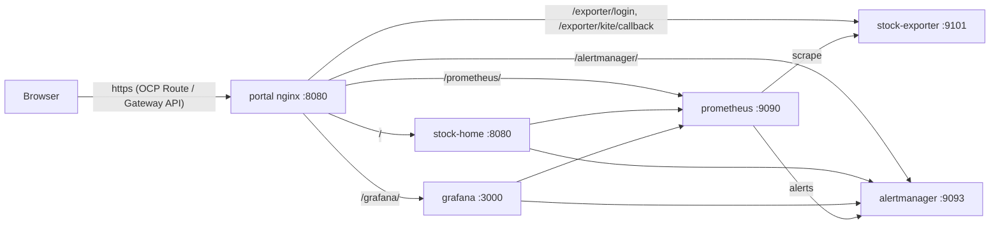

# stock-observability

Stock market observability stack: **stock_exporter** (Zerodha Kite Connect feed) → **Prometheus** (rules) → **Alertmanager** → **Grafana**, plus the **stock-home** product home page, all served behind a single **portal** (nginx) URL.

- Development/testing: OpenShift (OCP) lab cluster, namespace `abdul`, deployed with the Helm chart in [charts/stock-observability](charts/stock-observability).
- Production: any Kubernetes cluster in the cloud, same chart with [values-cloud-prod.yaml](charts/stock-observability/values-cloud-prod.yaml).
- Local: Docker Compose ([docker-compose.yml](docker-compose.yml)).



## Contents

1. [Repository layout](#1-repository-layout)
2. [Prerequisites](#2-prerequisites)
3. [Configuration](#3-configuration)
4. [Build and upload images to the OCP registry](#4-build-and-upload-images-to-the-ocp-registry)
5. [Create the Kite secret](#5-create-the-kite-secret)
6. [Deploy to OpenShift](#6-deploy-to-openshift)
7. [Verify the deployment](#7-verify-the-deployment)
8. [Access, credentials and daily Kite login](#8-access-credentials-and-daily-kite-login)
9. [Day-2 operations](#9-day-2-operations)
10. [Production deployment (cloud Kubernetes)](#10-production-deployment-cloud-kubernetes)
11. [Troubleshooting](#11-troubleshooting)
12. [Local development with Docker Compose](#12-local-development-with-docker-compose)
13. [Home page (stock-home)](#13-home-page-stock-home)

## 1. Repository layout

```
stock-observability/
├── Makefile                         # build, push, lint, deploy targets
├── docker-compose.yml               # local stack
├── prometheus/
│   ├── prometheus.yml               # compose-only Prometheus config
│   ├── rules/*.rules.yml            # alert + recording rules (shared with Helm)
│   └── tests/                       # promtool rule unit tests
├── alertmanager/
│   ├── alertmanager.yml             # routes, inhibitions, time intervals (shared with Helm)
│   └── templates/stock.tmpl
└── charts/stock-observability/      # Helm chart
    ├── values.yaml                  # portable defaults
    ├── values-ocp-dev.yaml          # OCP lab (namespace abdul)
    ├── values-cloud-prod.yaml       # cloud Kubernetes example
    ├── files/prometheus-rules -> ../../../prometheus/rules   (symlink)
    ├── files/alertmanager     -> ../../../alertmanager       (symlink)
    ├── files/holidays.yml     -> ../../../../stock_exporter/examples/holidays-nse-2026.yml (symlink)
    └── templates/
```

The chart reads the rules, Alertmanager config and exchange holidays through symlinks, so Docker Compose, the exporter and Helm always use the same files. `helm` prints a `found symbolic link in path` warning; this is expected.

The exporter source lives in [../stock_exporter](../stock_exporter) and the home page in [../stock_home](../stock_home).

## 2. Prerequisites

### Tools on the workstation

| Tool | Version | Used for |
|---|---|---|
| `oc` | matches cluster (4.20) | cluster access, registry token |
| `helm` | ≥ 3.14 | deploy/upgrade |
| `docker` | any recent | build the stock_exporter image |
| `skopeo` | any recent | pull base images, push/mirror images |
| `make` | any | run the targets below |

Check:

```bash
oc version --client && helm version --short && docker --version && skopeo --version
```

### Cluster access

```bash
oc login https://api.ocp4poc.c4lab.local:6443
oc project abdul            # everything is deployed into this namespace only
```

### Lab environment facts

| Item | Value |
|---|---|
| Namespace | `abdul` |
| Apps domain | `apps.ocp4poc.c4lab.local` |
| Portal URL | `https://stock-abdul.apps.ocp4poc.c4lab.local` |
| Ingress IP | `10.189.185.210` |
| Registry (external route) | `default-route-openshift-image-registry.apps.ocp4poc.c4lab.local` |
| Registry (in-cluster) | `image-registry.openshift-image-registry.svc:5000` |
| StorageClass | `local` (static 20Gi local PVs, not default) |

If `stock-abdul.apps.ocp4poc.c4lab.local` does not resolve on your machine, add it to your hosts file (`/etc/hosts`, and `C:\Windows\System32\drivers\etc\hosts` for a Windows browser):

```
10.189.185.210  stock-abdul.apps.ocp4poc.c4lab.local
```

> **TLS verification is disabled** (`TLS_VERIFY=false`) for image operations because the corporate proxy intercepts TLS for `quay.io`, `gcr.io` and Docker's CDN, and the lab registry uses a self-signed certificate. Only use this on the lab network.

## 3. Configuration

| File | Purpose |
|---|---|
| [values.yaml](charts/stock-observability/values.yaml) | Defaults for any Kubernetes: image tags, resources, retention, auth **on** |
| [values-ocp-dev.yaml](charts/stock-observability/values-ocp-dev.yaml) | OCP lab: Route, `storageClassName: local`, images from the internal registry, auth **off** (POC) |
| [values-cloud-prod.yaml](charts/stock-observability/values-cloud-prod.yaml) | Cloud example: Gateway API HTTPRoute, explicit UIDs, 90d retention |

Most-used values:

| Value | Meaning |
|---|---|
| `openshift` | `true` lets OpenShift SCC assign UID/fsGroup; `false` uses `podSecurityContext` |
| `externalURL` | Public base URL; used for links and Grafana `root_url` |
| `namePrefix` | Optional prefix for all object names (default empty) |
| `storageClassName` | StorageClass for all PVCs |
| `route.*` / `httpRoute.*` | OpenShift Route or Gateway API exposure of the portal |
| `prometheus.retention.time` / `.size` | TSDB retention (keep `size` below the PVC size) |
| `stockExporter.feed.source` | `kite` (live) or `sim` (synthetic data) |
| `stockExporter.kite.existingSecret` | Secret with keys `api-key` and `api-secret` |
| `portal.auth.enabled` | Basic auth on `/prometheus`, `/alertmanager`, `/exporter/*` |
| `grafana.anonymous.enabled` / `.role` | Grafana access without login |

Makefile variables (override on the command line, e.g. `make deploy-ocp NAMESPACE=abdul`):

| Variable | Default |
|---|---|
| `RELEASE` | `stock` |
| `NAMESPACE` | `abdul` |
| `HELM_VALUES` | `charts/stock-observability/values-ocp-dev.yaml` |
| `EXPORTER_VERSION`, `HOME_VERSION`, `PROM_VERSION`, `AM_VERSION` | contents of the component's `VERSION` file (image tags passed by `deploy-ocp`) |

Image build and push settings (`OCP_REGISTRY`, `TLS_VERIFY`, Grafana/nginx images) live in the [top-level Makefile](../Makefile).

## 4. Build and upload images to the OCP registry

The cluster pulls **every** image from the internal registry (`abdul/*` image streams), so nothing is pulled from the internet at runtime.

Images are built and pushed by the [top-level Makefile](../Makefile); see the [top-level README](../README.md) for details. All binaries are built locally and the Dockerfiles only copy them, so `docker build` needs no downloads through the proxy.

```bash
cd ~/git/prometheus
make build          # stock_exporter, stock_home, prometheus, alertmanager (incl. web UIs)
make docker-build   # local images; grafana and nginx are copied from the official images
make docker-push    # push everything to the abdul registry
oc get is -n abdul  # verify
```

(`make ocp-images` in this directory runs the same three steps.)

Expected image streams:

```
alertmanager         v0.34.1
grafana              13.2.3
nginx-unprivileged   1.28-alpine
prometheus           v3.14.0
stock-exporter       0.1.0
stock-home           0.1.0
```

A single service, e.g. after a change to the home page:

```bash
cd ~/git/prometheus
make build-stock-home docker-build-stock-home docker-push-stock-home
```

## 5. Create the Kite secret

The live feed (`stockExporter.feed.source: kite`) needs the Kite Connect API key and secret. They are never stored in Helm values or Git.

```bash
oc -n abdul create secret generic kite \
  --from-literal=api-key=kv8i33fc2z8qn1vr --from-literal=api-secret=fv4dqadu6piypi3ntbpewxbop1phew4h
```

To replace it later:

```bash
oc -n abdul delete secret kite
oc -n abdul create secret generic kite --from-literal=api-key=... --from-file=api-secret=...
oc -n abdul rollout restart deploy/stock-exporter
```

In the [Kite developer console](https://developers.kite.trade/), set the app's **Redirect URL** to:

```
https://stock-abdul.apps.ocp4poc.c4lab.local/exporter/kite/callback
```

A Kite app allows only one redirect URL; use a separate Kite app for local Docker Compose (`http://127.0.0.1:9101/kite/callback`).

> No Kite credentials yet? Deploy with the simulator instead: add `--set stockExporter.feed.source=sim --set stockExporter.feed.forceOpen=true` to the deploy command.

## 6. Deploy to OpenShift

### 6.1 Validate

```bash
make helm-lint                   # helm lint with values-ocp-dev.yaml
make helm-template | less        # review rendered manifests
```

### 6.2 Install or upgrade

```bash
make deploy-ocp
```

which runs:

```bash
helm upgrade --install stock charts/stock-observability -n abdul \
  -f charts/stock-observability/values-ocp-dev.yaml \
  --set stockExporter.image.tag=$(cat ../stock_exporter/VERSION) \
  --set home.image.tag=$(cat ../stock_home/VERSION) \
  --wait --timeout 10m
```

`--wait` blocks until every pod is ready; the exporter only becomes ready once the `kite` secret exists (step 5).

### 6.3 What gets created (namespace `abdul`)

| Kind | Names |
|---|---|
| Deployment / Service / NetworkPolicy | `prometheus`, `alertmanager`, `grafana`, `portal`, `stock-exporter`, `stock-home` |
| Route | `portal` → `https://stock-abdul.apps.ocp4poc.c4lab.local` (edge TLS, HTTP → HTTPS redirect) |
| ConfigMap | `prometheus`, `prometheus-rules`, `alertmanager`, `alertmanager-templates`, `grafana-datasources`, `portal`, `stock-home` |
| PVC (20Gi local PV each) | `prometheus-data`, `alertmanager-data`, `grafana-data`, `stock-exporter-data` |
| Secret (generated) | `grafana-admin`; `portal-auth` when `portal.auth.enabled=true` |
| Secret (yours) | `kite` |

PVCs and generated secrets carry `helm.sh/resource-policy: keep`: they survive upgrades and `helm uninstall`, and generated passwords are reused on every upgrade.

## 7. Verify the deployment

```bash
oc -n abdul get pods,pvc,route
helm -n abdul status stock
```

All six pods should be `1/1 Running` and all PVCs `Bound`.

Endpoint checks:

```bash
H=https://stock-abdul.apps.ocp4poc.c4lab.local
for p in /healthz / /api/v1/status /grafana/api/health /prometheus/-/ready /alertmanager/-/ready; do
  printf '%-24s %s\n' $p "$(curl -sk -o /dev/null -w '%{http_code}' $H$p)"
done
```

Expected: `200`, `200` (home page), `200`, `200`, `200`, `200`. With `portal.auth.enabled=true`, Prometheus/Alertmanager return `401` without credentials.

Scrape targets (all should be `1`):

```bash
oc -n abdul exec deploy/prometheus -- \
  wget -qO- 'http://localhost:9090/prometheus/api/v1/query?query=up' | grep -oE '"job":"[a-z_]+"|"[01]"\]'
```

Jobs: `prometheus`, `alertmanager`, `stock_core`, `stock_broad`.

## 8. Access, credentials and daily Kite login

| UI | URL |
|---|---|
| Home page (start here) | https://stock-abdul.apps.ocp4poc.c4lab.local/ |
| Grafana | https://stock-abdul.apps.ocp4poc.c4lab.local/grafana/ |
| Prometheus | https://stock-abdul.apps.ocp4poc.c4lab.local/prometheus/ |
| Alertmanager | https://stock-abdul.apps.ocp4poc.c4lab.local/alertmanager/ |
| Kite login | https://stock-abdul.apps.ocp4poc.c4lab.local/exporter/login |

Always use `https` without a port. Port `8080` on the ingress IP is an unrelated Apache server.

Grafana is preconfigured with the **Prometheus** and **Alertmanager** data sources: use *Explore* for queries and *Alerting* for Prometheus rules, active alerts and silences.

### Authentication

POC setting in `values-ocp-dev.yaml`: no login for the portal paths, Grafana anonymous **Admin**. To re-enable login, set `portal.auth.enabled: true` and `grafana.anonymous.enabled: false`, then `make deploy-ocp`.

Credentials (username `admin` for both):

```bash
# Grafana admin
oc -n abdul get secret grafana-admin -o jsonpath='{.data.admin-password}' | base64 -d; echo
# Prometheus / Alertmanager / Kite login (only when portal.auth.enabled=true)
oc -n abdul get secret portal-auth -o jsonpath='{.data.password}' | base64 -d; echo
```

The Grafana password is applied only when Grafana first initialises its database; change it later in Grafana (*Profile → Change password*).

### Daily Kite login

Kite access tokens expire every trading day. Once per day open `/exporter/login`, sign in to Kite; the browser returns to `/exporter/kite/callback` and the exporter stores the token on its PVC. Check:

```bash
oc -n abdul exec deploy/prometheus -- \
  wget -qO- 'http://localhost:9090/prometheus/api/v1/query?query=stock_kite_session_valid' | grep -oE '"[01]"\]'
```

`1` means the session is valid.

## 9. Day-2 operations

### Change alert rules or Alertmanager config

Edit `prometheus/rules/*.rules.yml` or `alertmanager/alertmanager.yml` (shared with Docker Compose), test, then deploy:

```bash
make check test      # promtool / amtool validation and unit tests
make deploy-ocp      # config checksum change rolls the affected pod
```

### Release a new stock_exporter version

```bash
echo 0.2.0 > ../stock_exporter/VERSION
make -C .. build-stock-exporter docker-build-stock-exporter docker-push-stock-exporter
make deploy-ocp      # sets stockExporter.image.tag from VERSION
```

### Release a new stock-home version

```bash
echo 0.2.0 > ../stock_home/VERSION
(cd ../stock_home && make test NPM_STRICT_SSL=false)
make -C .. build-stock-home docker-build-stock-home docker-push-stock-home
make deploy-ocp      # sets home.image.tag from VERSION
```

### Rebuild Prometheus / Alertmanager from source

After updating the `prometheus` or `alertmanager` checkout (its `VERSION` file sets the image tag):

```bash
make -C .. build-prometheus docker-build-prometheus docker-push-prometheus
make deploy-ocp      # sets prometheus.image.tag / alertmanager.image.tag from VERSION
```

### Upgrade Grafana / nginx

1. Change the tag in [values.yaml](charts/stock-observability/values.yaml) **and** `GRAFANA_IMAGE` / `NGINX_IMAGE` in the [top-level Makefile](../Makefile).
2. `make -C .. docker-build-grafana docker-push-grafana` (or `-nginx`)
3. `make deploy-ocp`

### Helm history and rollback

```bash
helm -n abdul history stock
helm -n abdul rollback stock <REVISION>
```

### Restart a component

```bash
oc -n abdul rollout restart deploy/<prometheus|alertmanager|grafana|portal|stock-exporter|stock-home>
```

### Logs

```bash
oc -n abdul logs deploy/stock-exporter -f
```

### Uninstall

```bash
helm -n abdul uninstall stock
# PVCs and generated secrets are kept on purpose; delete them only to wipe all data:
oc -n abdul delete pvc prometheus-data alertmanager-data grafana-data stock-exporter-data
oc -n abdul delete secret grafana-admin portal-auth --ignore-not-found
```

Local PVs use `Retain`: after a PVC is deleted its PV becomes `Released` and needs a cluster admin to clean and make it `Available` again.

## 10. Production deployment (cloud Kubernetes)

Same chart, with [values-cloud-prod.yaml](charts/stock-observability/values-cloud-prod.yaml):

- `openshift: false` → pods run with `runAsUser`/`fsGroup` 65532 (Pod Security `restricted` compatible).
- Exposure through a Gateway API `HTTPRoute` (TLS terminated at your Gateway). Set `httpRoute.parentRefs` and `hostnames` to your Gateway and DNS name.
- Auth **on** (defaults): basic auth on portal paths, Grafana login required.
- Images from public registries (or your mirror); the exporter image from your registry.

Steps:

```bash
# 1. Build and push the exporter and home page to your registry
VERSION=$(cat ../stock_exporter/VERSION)
(cd ../stock_exporter && docker build --build-arg VERSION=$VERSION -t ghcr.io/<org>/stock-exporter:$VERSION .)
docker push ghcr.io/<org>/stock-exporter:$VERSION
HOME_VERSION=$(cat ../stock_home/VERSION)
(cd ../stock_home && docker build --build-arg VERSION=$HOME_VERSION -t ghcr.io/<org>/stock-home:$HOME_VERSION .)   # multi-stage, for CI with direct internet
docker push ghcr.io/<org>/stock-home:$HOME_VERSION

# 2. Namespace and Kite secret
kubectl create namespace stock-observability
kubectl label namespace stock-observability pod-security.kubernetes.io/enforce=restricted
kubectl -n stock-observability create secret generic kite \
  --from-literal=api-key=<key> --from-file=api-secret=<file>

# 3. Deploy
helm upgrade --install stock charts/stock-observability -n stock-observability \
  -f charts/stock-observability/values-cloud-prod.yaml \
  --set stockExporter.image.tag=$VERSION --set home.image.repository=ghcr.io/<org>/stock-home \
  --set home.image.tag=$HOME_VERSION --wait --timeout 10m
```

Before deploying, set `externalURL`, `httpRoute.hostnames`, `httpRoute.parentRefs`, `stockExporter.image.repository` and, if needed, `storageClassName` and `imagePullSecrets`. Register `https://<host>/exporter/kite/callback` in a dedicated production Kite app. For production secrets prefer External Secrets or Sealed Secrets over `kubectl create secret`.

## 11. Troubleshooting

| Symptom | Cause | Fix |
|---|---|---|
| `docker build`: `x509: certificate signed by unknown authority` | Corporate proxy intercepts TLS; Docker daemon does not trust it | Use the top-level `make docker-build` (base images via skopeo, `--pull=false`, binaries built locally) |
| `npm ci`: `SELF_SIGNED_CERT_IN_CHAIN` or `ERR_SOCKET_TIMEOUT` | TLS interception / slow proxy | Build with `NPM_STRICT_SSL=false` (the OCP targets do this); timeouts are raised in `stock_home/web/.npmrc` |
| Home page tile shows "Unavailable" | stock-home cannot reach Prometheus/Alertmanager | `oc -n abdul logs deploy/stock-home`; check those pods and NetworkPolicies |
| Portfolio tile says "not available" | Portfolio collector off or no Kite session | Keep `--collector.portfolio` in `stockExporter.extraArgs`; log in to Kite |
| No `stock_depth_*` / `stock_orderbook_*` series | Kite ticker not in `full` mode (exporter logs a warning), or collectors disabled | Keep the default `--kite.ticker-mode=full`; remove `--no-collector.depth` / `--no-collector.orderbook` from `stockExporter.extraArgs`. Broad tier is excluded on purpose (`collect[]` of the `stock_broad` job) |
| `StockScrapeUnhealthy` on `stock_core` sample limit | Order book metrics add ~10,000 samples per core scrape (~13,000 total, limit 20,000) | Shrink the watchlist, raise `sample_limit`, or pass `--no-collector.depth` (raw 5-level book) and keep the `orderbook` KPIs |
| `skopeo copy`: `uploading layer chunked: StatusCode: 400` | Registry route rejects streamed registry-to-registry uploads | Use the top-level `make docker-push` (stages images on disk first) |
| `curl: Could not resolve host stock-abdul...` | No DNS record on the workstation | Add the hosts entry from [section 2](#lab-environment-facts) |
| `404 Not Found ... Apache ... Port 8080` | Browser/curl used `http://...:8080` | Use `https://stock-abdul.apps.ocp4poc.c4lab.local/` (no port); clear cached redirects |
| Exporter `ContainerCreating`, event `secret "kite" not found` | Kite secret missing | [Create the Kite secret](#5-create-the-kite-secret) |
| `stock_kite_session_valid` is `0` | No Kite login today | Open `/exporter/login` |
| Login page: `session exchange with Kite failed`; log `api.kite.trade/session/token ... Client.Timeout exceeded` | Pod has no direct internet egress | Set `stockExporter.env` `HTTPS_PROXY`/`NO_PROXY` (see `oc get proxy cluster -o yaml`); `values-ocp-dev.yaml` already does |
| PVC `Pending` | No `Available` local PV, or wrong StorageClass | `oc get pv`; ask a cluster admin to free/add PVs |
| Pod `ImagePullBackOff` | Image/tag not in the `abdul` registry | `oc get is -n abdul`; run the top-level `make docker-build docker-push` |
| `helm upgrade`: `spec.selector: field is immutable` | A component's labels changed | `oc -n abdul delete deploy/<name>` then `make deploy-ocp` |
| Grafana redirect loop / wrong links | `externalURL` does not match the Route host | Fix `externalURL` and `route.host` in the values file |

## 12. Local development with Docker Compose

```bash
make up-sim      # simulated feed, no Kite credentials
make up          # live Kite feed (needs secrets/kite_api_secret and KITE_API_KEY)
make down
make check test  # validate config and run rule/route tests
```

Local URLs: Prometheus http://127.0.0.1:9090, Alertmanager http://127.0.0.1:9093, exporter http://127.0.0.1:9101 (Kite login at `/login`).

## 13. Home page (stock-home)

`stock-home` ([../stock_home](../stock_home)) is the product home page served at `/`. It is a read-only "front door": a Go backend-for-frontend (BFF) that queries Prometheus and Alertmanager over cluster-internal service names and serves an embedded Next.js static UI. Detailed analysis stays in Grafana, Prometheus and Alertmanager; every tile links there.

| # | Section | Shows |
|---|---|---|
| 1 | Feed health | Kite session and expiry, WebSocket connections, subscribed instruments, last tick age, ticks/s sparkline, reconnects/errors (1h), Kite API failures (10m), stale core instruments |
| 2 | Active alerts | Counts by severity and category, silenced/inhibited, list with links to the source rule |
| 3 | Market overview | Index tiles (`home.indices`), today's sparkline of the first index, advance/decline breadth, sector strip |
| 4 | Portfolio | Holdings value, day change, holdings and positions P&L, margin used, top holdings (amounts hidden until the eye toggle is used) |
| 5 | Quick links | Kite login, Grafana, Grafana Alerting, Prometheus targets and rules, Alertmanager |
| 6 | Market status | Phase, IST clock, countdown to open/close, next exchange holiday |
| 7 | Top movers | Top 5 gainers and losers among core equities |
| 8 | Circuit watch | Circuit hits and instruments within 2% of a limit |
| 9 | System health | Prometheus/Alertmanager/Grafana health and latency, scrape time vs timeout, sample-limit usage, exporter collectors |
| 10 | Alert timeline | Firing periods of all alerts over the last 24h |
| 11 | Action banner | Kite session expired (with login button), exporter down, stale data, critical alerts, upstream unreachable |

Technology: Go 1.25+ standard library + `client_golang` API client; Next.js 16 (App Router, static export), React 19, TypeScript, Tailwind CSS v4, shadcn/ui-style components on Radix, TanStack Query (polling), Recharts sparklines, lucide icons, next-themes (dark default), zod (response validation), Geist font; Vitest + Testing Library.

API (`GET`, JSON envelope `{data, updatedAt, stale}`; cached server-side so many browsers do not multiply Prometheus load):

| Endpoint | Refresh |
|---|---|
| `/api/v1/status`, `/api/v1/feed`, `/api/v1/alerts` | 5s |
| `/api/v1/market`, `/api/v1/movers`, `/api/v1/circuits` | 10s |
| `/api/v1/system` | 15s |
| `/api/v1/portfolio` | 30s |
| `/api/v1/timeline` | 60s |
| `/api/v1/links` | static |

If an upstream is down, only the affected tiles show "Unavailable" (or the last value marked *stale*), and the banner reports it. PromQL never leaves the server.

Local development (against the cluster through port-forwards):

```bash
cd ../stock_home
make test NPM_STRICT_SSL=false     # go vet/test + tsc + vitest
make build NPM_STRICT_SSL=false    # next build -> ui/dist -> Go binary with embedded UI
make docker                        # package ./stock_home into stock-home:<VERSION> (Dockerfile.prebuilt)
oc -n abdul port-forward svc/prometheus 19090:9090 &
oc -n abdul port-forward svc/alertmanager 19093:9093 &
./stock_home --web.listen-address=127.0.0.1:18080 \
  --prometheus.url=http://127.0.0.1:19090/prometheus \
  --alertmanager.url=http://127.0.0.1:19093/alertmanager \
  --market.holidays-file=../stock_exporter/examples/holidays-nse-2026.yml
# open http://127.0.0.1:18080/
```

Set `home.enabled=false` to remove it; `/` then redirects to Grafana again.
