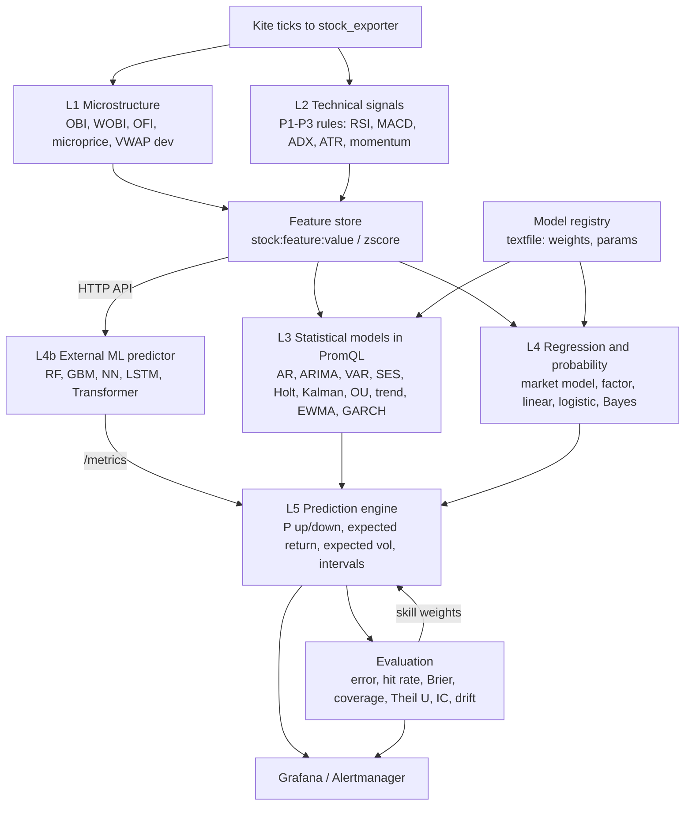

# NSE Market Observability — Formula Rules Architecture (v1.0 draft)

| | |
|---|---|
| Status | v1.0 draft. v0.9 approved by the product/architecture review with changes; Part A records the decisions and supersedes Part B where they differ |
| Scope | `deploy/prometheus/rules/nse_*.rules.yml` (+ chart symlinks, promtool tests, Grafana), KPI catalogue, Alertmanager routing; Quant Lab boundary |
| Release 1 | 30 KPIs (7 already exposed by the exporter or base rules + 23 new rules), 4 EOD snapshot rules, 1 signal rule, 1 data-quality rule, 11 alerts (§A5) |
| Full inventory | 100 formulas + 22 F&O formulas mapped in §7 (~153 rules); prediction design in §8, now split between Prometheus (~33 rules) and the Quant Lab (§A9) |
| Depends on | `stock_exporter` metrics (quote, circuit, depth, orderbook, market, feed) and the base rules in `stock_recording.rules.yml` |

The document has two parts. **Part A** (product and architecture) defines what ships, in
which release, who owns which computation and how KPIs, signals and alerts relate.
**Part B** (sections 1–12) is the technical design and formula inventory that Part A
selects from.

# Part A — Product and architecture

## A0. Review disposition

| Review item | Decision | Where |
|---|---|---|
| Separate KPI / signal / alert / regime concepts | Accepted: seven-layer model with naming per layer | §A3 |
| Reduce P1 | Accepted: Release 1 = 30 KPIs, 11 alerts (was 50 rules, 19 alerts) | §A5 |
| KPI contracts | Accepted: `kpi-catalog.yaml`, CI-checked against rule files | §A4 |
| Cardinality and query budgets | Accepted: per-KPI budget, release-level caps | §A10 |
| Data-quality / approximation metadata | Accepted: static (`stock_kpi_info`) and runtime (`kpi:coverage:ratio`) | §A4 |
| Prometheus is not the quant engine | Accepted with one boundary: light, closed-form or one-line recursive KPIs (EMA, Wilder, OBV) stay in PromQL because alerts need them; model fitting, AR/ARIMA/VAR/GARCH/Kalman/OU, Bayes/regression scoring, ensemble, ML, option pricing and backtesting move to a Quant Lab service | §A9 |
| Separate prediction into a Quant/Prediction boundary | Accepted: Release 5 "Predictive Intelligence"; Prometheus keeps features, naive baseline, intake and evaluation | §A9 |
| Backtesting / effectiveness | Accepted: rolling effectiveness ledger in Prometheus + offline backtests in the Quant Lab; alert annotations quote the historical hit rate | §A8 |
| Market regimes | Accepted for Release 2: six scores, ten regimes, precedence-ordered | §A7 |
| Client-facing tiers | Accepted: six product levels, releases R1–R6 | §A1, §A5 |
| AI Analyst | Accepted as Release 6 vision; depends on the KPI catalogue as its evidence layer | §A11 |
| P1 acceptance criteria | Accepted, made measurable | §A12 |
| Keep list (tiers, 1m bars, EOD snapshots, session gating, per-family files, recording before alerts, promtool tests, exporter boundary, F&O later, naive benchmark, explicit limitations) | Kept unchanged | Part B |

One inconsistency in the review was resolved: its Release 1 list includes MACD while its P1
capability list does not. MACD is in Release 1, flagged `approximation` (SMA-based until
the EMA rules of Release 2).

## A1. Positioning and product levels

Positioning: **"Observability for financial markets"** — a cloud-native market observability
and intelligence platform for NSE, not a trading or stock-prediction system. Alerts describe
market state; they are not buy/sell recommendations.

| Level | Question it answers | Content | Release |
|---|---|---|---|
| 1. Market Health | Is the market healthy right now? | breadth, volatility, liquidity, stress, regime | R1 (regime R2) |
| 2. Sector Intelligence | Where is money rotating? | sector strength, rotation, dispersion, sector volume | R1 / R2 |
| 3. Stock Intelligence | What is this stock doing and why? | momentum, trend, volatility, liquidity, order flow, breakouts | R1 / R2 |
| 4. Risk Intelligence | How risky is it? | VaR/ES, drawdown, beta, correlation, portfolio risk, 52W | R3 |
| 5. Derivatives Intelligence | How is the market positioned? | OI, PCR, IV, Greeks, futures basis, max pain | R4 |
| 6. Predictive Intelligence | What could happen next, and how sure are we? | forecasts, probabilities, model skill | R5 |

KPI families map onto these levels: **Technical** (RSI, MACD, ATR, Bollinger, Stochastic,
SMA/EMA, ADX), **Microstructure** (spread, depth, microprice, OBI, OFI, walls, tick
imbalance, volume delta), **Market** (breadth, TRIN, dispersion, sector rotation, relative
strength, circuit clusters, regime), **Risk** (volatility, VaR, CVaR, beta, correlation,
drawdown, Sharpe, Sortino), **Predictive** (forecast, probability, expected return/volatility,
intervals, skill). Microstructure and market KPIs are the product differentiators; technical
indicators are table stakes.

## A2. Platform architecture and ownership

```
                          STOCK OBSERVABILITY PLATFORM
+--------------------------------------------------------------------------+
| EXPERIENCE      stock_home (UX, KPI catalogue, AI analyst R6)            |
|                 Grafana (levels 1-6)   Alertmanager (layer routing)      |
+--------------------------------------------------------------------------+
| INTELLIGENCE    regimes, scores, composite conditions, effectiveness     |  Prometheus rules
+--------------------------------------------------------------------------+
| KPI ENGINE      price, returns, MA, RSI, MACD, ATR, BB, RVOL, OFI, VWAP,   |  Prometheus rules
|                 spread, depth, TRIN, beta, VaR, correlation, OI           |
+--------------------------------------------------------------------------+
| QUANT LAB       statistical models, ML, ensemble, option pricing,        |  Python service (R4/R5)
|                 training, backtesting  -> publishes metrics               |
+--------------------------------------------------------------------------+
| TELEMETRY       Prometheus TSDB (90 d)        historical store (TBD)      |
+--------------------------------------------------------------------------+
| INGESTION       stock_exporter: Kite WebSocket/REST, depth, quote,       |
|                 circuit, OI, session calendar, reference data            |
+--------------------------------------------------------------------------+
                                Zerodha Kite
```

| Component | Owns | Does not own |
|---|---|---|
| `stock_exporter` | Kite ingestion and normalization, session calendar, reference data from Kite historical candles (52W, daily SMA50/200) | derived analytics, models, option pricing |
| Prometheus | KPIs (rolling windows, closed-form statistics, light stateful recursions), signals, conditions, regimes, alerts, effectiveness ledger, forecast evaluation, 90-day store | model fitting, ML, long history, IV/Greeks |
| Alertmanager | routing by `layer` and `category`, grouping, digests, inhibition | |
| Grafana | analytical dashboards per product level | |
| `stock_home` | product experience, KPI catalogue browser, OpenBB proxy, AI analyst (R6) | computation |
| OpenBB | research data (fundamentals, news, history) | real-time KPIs |
| Quant Lab (new Python service) | AR/ARIMA/VAR/Holt/Kalman/GARCH/OU, regression/Bayes scoring, ensemble, ML inference, IV/Greeks/max pain, training, backtesting; publishes results as metrics | real-time KPIs, alerting |
| Historical store | multi-year candles and downsampled KPIs (remote-write TSDB or Parquet; open question) | real-time |

## A3. Layer model

```
Telemetry -> KPI -> Signal -> Event -> Condition -> Regime -> Incident
                                                     \-> Effectiveness -> Prediction -> AI Analyst
```

| Layer | Definition | Naming | Notifies? |
|---|---|---|---|
| Telemetry | raw exporter metrics | `stock_*` | no |
| KPI | derived measurement with a contract | `stock:<kpi>:<unit>`, `sector:`, `market:` | no |
| Signal | a KPI threshold state (e.g. RSI > 70) | `stock:signal_active:bool{signal, direction}` | no (dashboard) |
| Event | a signal transition (e.g. RSI crossed 70) | Grafana annotations from `changes()`; `stock:event:bool{event}` from R2 | no (dashboard) |
| Condition | ≥ 2 signals from different families (e.g. momentum exhaustion) | alert, `layer="condition"` | yes, `info`, digest |
| Regime | market/sector/stock state classification | `market:regime:info{regime}`, `market:*_score:index` | on change, `info` |
| Incident | stress regime, data-quality or infra failure | alert, `layer="incident"` | yes, `warning`/`critical` |

Rules for alerts: raw indicator thresholds never notify; every notifying alert carries
`layer`, `category`, `formula`/`condition` labels; conditions are grouped into a 15-minute
digest per category; incidents page only during market hours.

Part B alerts re-classified:

| Part B alert | New layer | Release |
|---|---|---|
| `StockMultiSessionBreakout`, `StockOpeningRangeBreakout` | condition (price + RVOL) | R1 |
| `StockRangeExpansion` | condition (range/ATR + RVOL) | R1 |
| `StockLiquidityDrain` | condition (depth drop + spread widening) | R1 |
| `StockProjectedCircuitHit` | condition | R1 |
| `StockAggressorPressure` | condition `StockOrderFlowPressure` | R1 |
| `StockMomentumExtreme` + MACD + volume delta | condition `StockMomentumExhaustion` | R1 |
| `MarketTRINExtreme` + % above VWAP | incident `MarketBreadthStress` | R1 |
| `MarketCircuitCluster` | incident | R1 |
| `SectorRotation` | condition | R1 |
| `StockPivotLevelBreak`, `StockMACDCrossover`, `StockBollingerBreakout` | event (dashboard) | R2 |
| `StockBollingerSqueeze`, `StockRelativeVolumeHigh`, `StockRelativeStrengthDivergence` | signal (dashboard) | R1 |
| `StockRSIDivergence`, `StockOrderBookWall` | condition | R2 |
| `StockOIBuildup` | condition | R4 |

## A4. KPI contract and quality metadata

Every recording rule that is a KPI has a contract in `deploy/prometheus/kpi-catalog.yaml`.
A CI check (`make check-kpis`) fails if a KPI rule has no contract or a contract names a
series no rule produces. The same file generates Grafana descriptions, the `stock_home`
catalogue page and a textfile with `stock_kpi_info`.

```yaml
- name: stock:rsi_14m:index
  family: technical            # technical | microstructure | market | risk | derivatives | predictive
  level: stock_intelligence
  release: R1
  formula: "RSI(14) = 100 - 100 / (1 + avg_gain / avg_loss), 1m bars"
  inputs: [stock_last_price]
  rule_file: nse_momentum.rules.yml
  frequency: 15s
  scope: core                  # core | broad | all_eq | market | sector
  unit: index
  range: {min: 0, max: 100}
  warmup: 15m
  data_quality: {minimum_samples: 14, freshness: 1s, coverage_target: 0.95}
  quality: approximation       # exact | approximation | proxy | heuristic | model
  method: "Cutler (SMA) RSI; Wilder RSI from R2"
  alertable: true
  dashboard_default: true

- name: stock:volume_delta_1h:ratio
  family: microstructure
  release: R1
  method: tick-rule
  quality: approximation
  limitation: "Kite provides no aggressor side"
  scope: core
  freshness: 1s
```

Runtime metadata:

| Series | Meaning |
|---|---|
| `stock_kpi_info{kpi, family, level, release, quality, method, scope}` = 1 | static contract, textfile (~150 series); Grafana joins it to show "approximation" badges |
| `kpi:coverage:ratio{kpi}` | instruments with a value / instruments in scope, per R1 KPI (`count by (__name__)` + `label_replace` into `kpi`), 1m |
| `market:stale_core_instruments:ratio` | existing freshness KPI |

Alert `KPIDataQualityDegraded` (incident): any R1 KPI below 90 % coverage after its warm-up
(from 09:45) for 5 minutes.

## A5. Release plan and Release 1 scope

| Release | Goal | Content | From Part B |
|---|---|---|---|
| **R1 Market Observability MVP** | "What is happening in the NSE market right now?" | 30 KPIs, 11 alerts, R1 dashboard, KPI catalogue v1 | subset of P1 |
| R2 Market Intelligence | "Why is the market moving?" | rest of P1, P2 (EMA, Wilder RSI, OBV, VPT, A/D, CMF), ADX/TRIX/UO, advanced order flow (WOBI, Cont OFI, walls, Amihud), z-score/R², regimes, events, effectiveness ledger | P1 rest, P2, part of P3, §8.7, §8.9–8.10 KPIs |
| R3 Risk Intelligence | "How risky is it?" | beta, correlation, VaR/CVaR, Sharpe, Sortino, drawdown, portfolio risk, 52W, SMA50/200, EWMA vol, VIX implied move, abnormal return | P3, §8.11–8.12 KPIs |
| R4 F&O Intelligence | "How are derivatives positioned?" | OI, PCR, basis, cost of carry; IV/Greeks/max pain from the Quant Lab | P4 |
| R5 Predictive Intelligence | "What could happen next — with measured confidence?" | Quant Lab models, ML, ensemble; Prometheus features, intake, evaluation | §8 |
| R6 AI Market Analyst | "Explain, compare, investigate" | `stock_home` analyst over the KPI catalogue and OpenBB | new |

**Release 1 KPIs** (Q = quality: E exact, A approximation, H heuristic; X = exporter-native):

| # | Capability | KPI | Series | Q | Rule |
|---|---|---|---|---|---|
| 1 | Price | Returns 1m/5m/15m | `stock:return_{1m,5m,15m}:percent` | E | base |
| 2 | Price | Gap | `stock:gap_open:percent` | E | base |
| 3 | Price | Intraday return | `stock:intraday_return:percent` | E | new |
| 4 | Price | VWAP deviation | `stock:vwap_deviation:percent` | E | base |
| 5 | Price | Floor pivots | `stock:pivot:price{level}` | E | new |
| 6 | Price | Opening range | `stock:opening_range:price{bound}` | E | new |
| 7 | Momentum | RSI(14) | `stock:rsi_14m:index` | A | new |
| 8 | Momentum | Stochastic %K | `stock:stochastic_k_14m:percent` | E | new |
| 9 | Momentum | MACD | `stock:macd_12_26m:price` | A | new |
| 10 | Momentum | Relative strength vs NIFTY | `stock:relative_strength_nifty:percent` | E | new |
| 11 | Volatility | Realized volatility | `stock:realized_vol_annualised:percent` | E | new |
| 12 | Volatility | Bollinger width | `stock:bollinger_width_20m:percent` | E | new |
| 13 | Volatility | Bollinger %B | `stock:bollinger_percent_b_20m:ratio` | E | new |
| 14 | Volatility | ATR(14) | `stock:atr_14d:points` | A | new |
| 15 | Volatility | Range expansion | `stock:range_expansion:ratio` (`(H − L)/ATR14`) | E | new |
| 16 | Liquidity | Spread | `stock_orderbook_spread_bps` | E | X |
| 17 | Liquidity | Depth notional | `stock:orderbook_depth:inr` | E | new |
| 18 | Liquidity | Depth vs 1h | `stock:depth_vs_1h:ratio` | E | new |
| 19 | Order flow | Order-book imbalance | `stock_orderbook_imbalance_ratio` | E | X |
| 20 | Order flow | Microprice deviation | `stock:microprice_deviation:bps` | E | new |
| 21 | Order flow | Volume delta | `stock:volume_delta_1h:ratio` | A | new |
| 22 | Volume | Relative volume | `stock:relative_volume:ratio` | H | new |
| 23 | Volume | Turnover | `stock:turnover:inr` | E | new |
| 24 | Breadth | Advance/decline | `market:advance_decline:ratio` | E | base |
| 25 | Breadth | % above VWAP | `market:above_vwap:ratio` | E | new |
| 26 | Breadth | TRIN | `market:trin:ratio` | E | new |
| 27 | Sector | Sector relative strength | `sector:relative_strength:percent` | E | new |
| 28 | Market | Dispersion | `market:dispersion:percent` | E | new |
| 29 | Market | Circuit concentration | `market:circuit_hits:count{band}` | E | new |
| 30 | Circuit | Circuit distance | `stock:{upper,lower}_circuit_distance:percent` | E | base |

Release 1 rules: 23 KPI rules + 4 EOD snapshot rules (§6.0) + `stock:signal_active:bool`
(R1 signals: RSI/%K extremes, Bollinger breakout/squeeze, RVOL high, above R1 / below S1,
relative strength strong/weak) + `kpi:coverage:ratio` = **29 recording rules**.

**Release 1 alerts** (11):

| Alert | Layer | Definition | Severity |
|---|---|---|---|
| `StockMultiSessionBreakout` | condition | C beyond 20-session high/low **and** RVOL > 1.5 | info |
| `StockOpeningRangeBreakout` | condition | ORB cross after 09:30 **and** RVOL > 1.5 | info |
| `StockRangeExpansion` | condition | range/ATR14 > 2 **and** RVOL > 2 | warning |
| `StockLiquidityDrain` | condition | depth vs 1h < 0.25 **and** spread > 2 × its 1h mean | warning |
| `StockProjectedCircuitHit` | condition | 15-minute linear projection reaches a band | warning |
| `StockMomentumExhaustion` | condition | RSI > 70, %K > 80, MACD histogram falling, volume delta < 0 (mirror for oversold) | info |
| `StockOrderFlowPressure` | condition | volume delta > 0.6, microprice deviation > 0, OBI > 0.3 (mirror) | info |
| `SectorRotation` | condition | abs(sector RS) > 2 for 10m | info |
| `MarketBreadthStress` | incident | TRIN > 2 **and** % above VWAP < 0.2 for 10m (mirror `info` for euphoria) | warning |
| `MarketCircuitCluster` | incident | lower-circuit count ≥ 20 or upper ≥ 40 | warning |
| `KPIDataQualityDegraded` | incident | R1 KPI coverage < 90 % after warm-up | warning |

```yaml
      - alert: StockMomentumExhaustion
        expr: |
          (
              label_replace(
                  stock:rsi_14m:index{instrument_type="EQ"} > 70
                and stock:stochastic_k_14m:percent > 80
                and (stock:macd_12_26m:price - avg_over_time(stock:macd_12_26m:price[9m])) < (stock:macd_12_26m:price offset 2m - avg_over_time(stock:macd_12_26m:price[9m] offset 2m))
                and stock:volume_delta_1h:ratio < 0,
                "direction", "bearish", "", "")
            or label_replace(
                  stock:rsi_14m:index{instrument_type="EQ"} < 30
                and stock:stochastic_k_14m:percent < 20
                and (stock:macd_12_26m:price - avg_over_time(stock:macd_12_26m:price[9m])) > (stock:macd_12_26m:price offset 2m - avg_over_time(stock:macd_12_26m:price[9m] offset 2m))
                and stock:volume_delta_1h:ratio > 0,
                "direction", "bullish", "", "")
          )
          and on() stock_market_open == 1
        for: 2m
        labels: {severity: info, category: price, layer: condition, condition: momentum_exhaustion}
```

The existing 28 alerts in `stock_alerts.rules.yml` stay as the base layer and get a `layer`
label (`incident` for infra and portfolio, `condition` or `signal` for the rest) in R1.

## A6. Alert routing and noise budget

| Layer | Route | Grouping | Notify |
|---|---|---|---|
| signal, event | none (Grafana annotations) | — | never |
| condition | `market-digest` receiver | `group_by: [category, condition]`, `group_interval: 15m` | market hours |
| regime change | `market-digest` | `group_by: [alertname]` | market hours |
| incident (market, data quality) | `market-incident` | `group_by: [alertname]`, `repeat_interval: 1h` | market hours |
| incident (infra) | existing infra route | unchanged | always |

Noise budget: in the soak test (§A12) no condition may exceed 20 notifications per session
and all conditions together ≤ 60 digest entries per session; thresholds are tuned until met.

## A7. Market regimes (Release 2)

Scores (0–100, `market:` level, 1m):

| Score | Formula (initial, calibrated after 20 sessions) |
|---|---|
| `market:breadth_score:index` | `100 × mean(adv/(adv+dec), above_vwap, clamp(1 − (TRIN − 0.5)/1.5, 0, 1))` |
| `market:momentum_score:index` | `50 + 50 × clamp(NIFTY 50 change% / 2, −1, 1)` |
| `market:volatility_score:index` | `100 × clamp((INDIA VIX − 10)/20, 0, 1)` |
| `market:liquidity_score:index` | `100 × clamp(median(stock:depth_vs_1h:ratio), 0, 1)` |
| `market:stress_score:index` | `0.3(100 − breadth) + 0.3·volatility + 0.2(100 − liquidity) + 0.2·100·clamp(lower circuits/50, 0, 1)` |
| `market:risk_score:index` | `0.5·volatility + 0.5·stress` |

Regimes in precedence order (first match wins):

| Code | Regime | Condition |
|---:|---|---|
| 1 | `LIQUIDITY_STRESS` | liquidity < 30 |
| 2 | `HIGH_VOLATILITY` | volatility > 70 |
| 3 | `BROAD_MARKET_SELL_OFF` | breadth < 25 and momentum < 30 |
| 4 | `BROAD_MARKET_RALLY` | breadth > 75 and momentum > 70 |
| 5 | `TRENDING_BEAR` | NIFTY trend R² > 0.7, slope < 0 |
| 6 | `TRENDING_BULL` | NIFTY trend R² > 0.7, slope > 0 |
| 7 | `BREAKOUT_REGIME` | ≥ 15 % of core EQ beyond their 20-session range |
| 8 | `SECTOR_ROTATION` | stddev of sector RS > 1.5 and breadth 40–60 |
| 9 | `LOW_VOLATILITY` | volatility < 20 and dispersion below its 20-session median |
| 10 | `NORMAL` | otherwise |

`or on()` gives precedence (the right side is used only if the left side is empty):

```yaml
      - record: market:regime:info
        expr: |
          (
                label_replace(vector(1) and on() (market:liquidity_score:index < 30), "regime", "LIQUIDITY_STRESS", "", "")
            or on() label_replace(vector(1) and on() (market:volatility_score:index > 70), "regime", "HIGH_VOLATILITY", "", "")
            or on() label_replace(vector(1), "regime", "NORMAL", "", "")
          )
          and on() stock_market_open == 1
```

Also `market:regime:code` (same chain, numeric, for Grafana state timelines), sector regimes
(`sector:regime:info`) and stock regimes (`stock:{volatility,liquidity,momentum,orderflow}_regime:info`).
Alerts: `MarketRegimeChange` (condition layer, regime label absent 15 minutes ago) and
`MarketStressIncident` (`stress_score > 70` for 5m, warning). All scores are `quality: heuristic`
in the catalogue.

## A8. Signal effectiveness and backtesting

**In Prometheus (R2, rolling 5 sessions)** — generalises the Bayes pattern of §8.13 to every
signal and every condition alert (via the built-in `ALERTS` series):

| Series | Meaning |
|---|---|
| `signal:occurrences_5d:count{signal}` | activations in the window |
| `signal:forward_return_5d:percent{signal, horizon}` | mean return 5m / 15m / 1h after activation |
| `signal:hit_rate_5d:ratio{signal, horizon}` | share of activations followed by a move in the signal's `direction` |
| `alert:forward_return_5d:percent{alertname, horizon}`, `alert:hit_rate_5d:ratio{alertname, horizon}` | same for condition alerts, from `ALERTS{layer="condition"} offset <h>` |

```yaml
      - record: signal:forward_return_5d:percent
        labels: {horizon: "15m"}
        expr: |
          avg by (signal, direction) (
            avg_over_time((
              (
                stock:return_15m:percent{tier="core", instrument_type="EQ"}
                + on(exchange, symbol) group_right() (0 * stock:signal_active:bool offset 15m)
              )
              and on() stock_market_open == 1
              and on() stock_market_seconds_to_close < 21600
            )[5d:15m])
          )
```

Alert annotations quote the ledger:

```yaml
          effectiveness: >-
            {{ with printf "alert:hit_rate_5d:ratio{alertname=%q,horizon=\"15m\"}" .Labels.alertname | query }}
            Historical 15m hit rate (5 sessions): {{ . | first | value | humanizePercentage }}
            {{ else }}No history yet{{ end }}
```

**In the Quant Lab (R2+ offline)** — full backtests over Kite historical candles and exported
Prometheus data: occurrences, mean return and hit rate at 1m/5m/15m/1h/next session,
confidence intervals, regime breakdowns. Results are published back as
`signal_backtest_{occurrences,mean_return_percent,hit_rate_ratio}{signal, horizon, period}`.

## A9. Computation boundary and prediction ownership

Rule of thumb: **PromQL owns a computation if it is a KPI that alerts or dashboards need in
real time and fits in one readable expression (or a one-line recursion); everything that
fits parameters, searches, simulates or trains belongs to the Quant Lab.**

| §8 component | Owner after review | Release |
|---|---|---|
| Feature store (§8.6.1) | Prometheus | R5 |
| WOBI, Cont OFI, OFI impact (§8.7) | Prometheus, as R2 microstructure KPIs; OFI/microprice forecasts move to Quant Lab | R2 / R5 |
| Naive forecast | Prometheus (benchmark) | R5 |
| AR/ARIMA/VAR/SES/Holt/Kalman (§8.8) | Quant Lab | R5 |
| Z-score (§8.9) | Prometheus KPI | R2 |
| OU parameters and forecast (§8.9) | Quant Lab | R5 |
| Trend R² / t-stat (§8.10) | Prometheus KPI (feeds regimes) | R2 |
| Linear forecast (§8.10) | Quant Lab | R5 |
| EWMA variance, VIX implied move (§8.11) | Prometheus KPIs | R3 |
| GARCH, forward VaR/ES (§8.11) | Quant Lab | R5 |
| Market model, abnormal return (§8.12) | Prometheus KPI + condition | R3 |
| Factor, linear, logistic scoring (§8.12) | Quant Lab | R5 |
| Bayes conditional frequencies (§8.13) | Prometheus effectiveness ledger (§A8) | R2 |
| Naive Bayes, Bayes expectation (§8.13) | Quant Lab | R5 |
| ML intake + staleness alerts (§8.14) | Prometheus, generalised to all Quant Lab outputs | R5 |
| Ensemble (§8.15) | Quant Lab (reads skill from Prometheus) | R5 |
| Evaluation (§8.17) | Prometheus | R5 |
| IV, Greeks, max pain (§7.9) | Quant Lab (was exporter) | R4 |

Result: Prometheus-side prediction shrinks from 98 to ~33 rules (features 5, naive 1,
intake 4, staleness 2, evaluation 21). The Quant Lab publishes into the unchanged §8.3
schema, so evaluation stays generic. The PromQL sketches for moved models remain in §8 as
reference implementations for Quant Lab parity tests.

## A10. Cardinality and query budget

Release caps: R1 ≤ 12 000 new series, ≤ 700 samples/s, every rule group
`prometheus_rule_group_last_duration_seconds` ≤ 25 % of its interval, every R1 dashboard
panel ≤ 1 M samples per refresh. Each later release states its own cap before implementation.

Release 1 per-KPI budget (core ≈ 219 instruments, ~200 EQ; all EQ ≈ 2 100):

| KPI rule | Instruments | Series | Interval | Samples/s | Samples read / eval |
|---|---:|---:|---|---:|---:|
| intraday return, microprice dev, RS, realized vol, BB width, %B, range expansion | 219 | 7 × 219 = 1 533 | 15s–30s | ~80 | 2k–40k each (`[20m:1m]`, `[15m]`) |
| RSI, Stochastic, MACD | 219 | 657 | 15s | 44 | ~6k–12k (`[14m:1m]`, `[26m:1m]`) |
| pivots (5 levels), opening range (2) | 219 | 1 533 | 15s | 100 | < 2k (sparse snapshots) |
| ATR, RVOL | 200 | 400 | 30s / 15s | 20 | < 5k (`[20d]`, `[14d]` sparse) |
| depth notional, depth vs 1h | 200 | 400 | 15s | 27 | ~50k (`[1h]` of 15s series) |
| volume delta | 200 | 200 | 5s | 40 | ~24k (`[1h:1m]` × 2) |
| turnover | 2 100 | 2 100 | 15s | 140 | 4k |
| breadth, TRIN, dispersion, circuits, sector RS | market/sector | ~40 | 15s | 3 | ~8k |
| EOD snapshots | 219 | 876 | 30m | ≈ 0 | < 1k |
| signals | 219 × ≤ 10 | ≤ 2 200 (sparse) | 1m | ≤ 37 | < 5k |
| `kpi:coverage:ratio` | 30 KPIs | 30 | 1m | < 1 | ~10k |
| **Release 1 total** | | **~10 000** | | **~490** | |

Prediction budget rule: `instruments × models × horizons × evaluation metrics` must be
stated before a model is added; R5 starts with ≤ 6 models × 2 horizons × 8 metrics over
NIFTY 50 (≈ 4 800 evaluation series) and widens only if the budget holds.

## A11. AI Market Analyst (Release 6, vision)

`stock_home` answers "Why did RELIANCE move +2.4 %?", "Compare TCS vs INFY", "Why did NIFTY
fall?" by querying an evidence layer: the KPI catalogue (§A4) tells it which series exist,
their units and quality; Prometheus supplies values; the effectiveness ledger supplies
historical context; OpenBB supplies news and fundamentals. Answers must cite KPI values and
quality flags and must not give buy/sell advice.

## A12. Release 1 acceptance criteria

| Criterion | Measure |
|---|---|
| Scope | 30 KPIs and 11 alerts of §A5 implemented, each with a catalogue contract |
| Validation | `promtool check rules` clean; `make check-kpis` clean |
| Unit tests | every KPI rule tested; every alert has positive, negative and market-closed cases |
| Reference parity | exact KPIs within 1e-9 relative of a Python reference (pandas/TA-Lib); approximations within their documented tolerance |
| Warm-up | no KPI or alert emits before its contract warm-up; tested |
| Stale feed | KPIs stop and `KPIDataQualityDegraded` fires when ticks stop for 60 s |
| Calendar | holiday, weekend, pre-open and post-close cases tested |
| Budget | §A10 caps met on live data |
| Latency | rule-group duration ≤ 25 % of interval; `prometheus_rule_evaluation_failures_total` = 0 |
| Dashboard | R1 Grafana dashboard (Market Health, Sector, Stock rows) provisioned by the chart |
| Routing | Alertmanager `layer` routes and digest receiver deployed; amtool route tests |
| Documentation | KPI pages generated from the catalogue |
| Noise | §A6 noise budget met |
| Soak | one full NSE session (09:00–16:00) on the live Kite feed with all of the above |

---

# Part B — Technical design and formula inventory

## 1. Summary

`stock_exporter` turns the Zerodha Kite Connect WebSocket feed (full mode: LTP, OHLC, VWAP,
volume, pending buy/sell quantity, top-5 depth, OI) and Kite REST quotes (circuit limits)
into Prometheus metrics. The existing rules cover first-order KPIs (returns, VWAP deviation,
SMA crossover, spread, breadth counts) and infra health.

This proposal adds the formulas NSE traders actually use — floor pivots, opening-range
breakout, RSI, Stochastic, MACD, Bollinger Bands, ATR, realized vs implied volatility,
relative volume, Amihud illiquidity, microprice, order-flow imbalance, tick-rule volume delta,
order-book walls, TRIN, sector relative strength, OI build-up — as recording rules (KPIs for
Grafana) plus alerts on the conditions that matter. Each formula family lives in its own file.

§7 maps a reference list of 100 stock-market formulas (price/return, moving averages,
volatility, momentum, MACD/trend strength, volume, order flow, risk/portfolio) plus F&O
formulas to a rule, an existing metric, a Grafana-only expression or an exporter change, and
schedules them in phases P1 (this proposal's 50 rules) to P4 (F&O).

§8 adds a separate **prediction** rule set: a feature store, statistical forecasts (AR/ARIMA,
VAR, Holt, Kalman, Ornstein-Uhlenbeck, linear trend), volatility forecasts (EWMA, GARCH),
regression and Bayesian probabilities, an interface for external ML models, an ensemble that
produces P(up), expected return, expected volatility and forecast intervals, and an
evaluation layer that scores every forecast out-of-sample against a naive benchmark.

## 2. Goals and non-goals

Goals
- In-depth, per-instrument market microstructure and technical KPIs for the **core tier**
  (NIFTY 200 + 19 indices, 1 s scrape, depth enabled).
- Market-wide breadth/sentiment KPIs over **all tracked NSE EQ** (core + broad).
- One rule file per formula family; recording rules first, alerts built on top of them.
- Every alert gated to the NSE session; every division guarded; every multi-session
  formula guarded against insufficient history.
- Fit inside the existing ingestion budget (target < 10 % extra samples/s).

Non-goals
- Trading signals or order execution. Alerts are observability signals, not advice.
- Formulas that need data Kite ticks do not carry (trade counts, aggressor side, multi-year
  history, option Greeks) are approximated or delegated to the exporter (§7, §11).
- New exporter metrics in Phase 1 (exporter enablers for P3/P4 are listed in §7.0).

## 3. Metrics exposed by stock_exporter

Reference for rule authors: every series `stock_exporter` exposes (source:
`stock_exporter/collector/*.go`), which scrape job carries it, and when it is absent. All
instrument values are the **last known state** held in the exporter's store, so they keep
their last value outside market hours — gate rules with `stock_market_open`, and use
`stock_tick_age_seconds` to detect stale feeds.

### 3.1 Scrape jobs and collectors

One exporter (`:9101`) is scraped twice; the `tier` URL parameter partitions instruments, so
no instrument appears in both jobs and sums across `tier` never double-count.

| Job | Interval | URL params | Collectors served | Instruments |
|---|---|---|---|---|
| `stock_core` | 1 s (timeout 900 ms, `sample_limit` 20 000) | `tier=core` | all enabled: quote, circuit, depth, orderbook, market, feed, textfile (+ portfolio if enabled) | 19 indices + NIFTY 200 constituents |
| `stock_broad` | 5 s (`sample_limit` 80 000) | `tier=broad`, `collect[]=quote,circuit` | quote, circuit | ~1 900 other NSE EQ |

| Collector | Default | Tier-scoped | Metrics |
|---|---|---|---|
| `quote` | on | yes | §3.3 |
| `circuit` | on | yes | §3.4 |
| `depth` | on | yes | §3.5 |
| `orderbook` | on | yes | §3.6 |
| `market` | on | no (core job only) | §3.7 |
| `feed` | on | no (core job only) | §3.8 |
| `portfolio` | **off** (`--collector.portfolio`; account data) | no (core job only) | §3.9 |
| `textfile` | on | no (core job only) | §3.10 |

Non-instrument metrics (market, feed, portfolio, textfile, exporter self-metrics) exist once,
with `job="stock_core"` — join them with `on()` / `on() group_left`, never by labels.

### 3.2 Common labels

| Label | Values | Notes |
|---|---|---|
| `exchange` | `NSE`, `BSE`, `NFO` | `SENSEX` is the only BSE instrument in the default watchlist |
| `symbol` | trading symbol, e.g. `RELIANCE`, `NIFTY 50`, `INDIA VIX` | index names contain spaces — quote them in selectors |
| `sector` | e.g. `Financial Services`, `Information Technology`, `Index`, `unknown` | from the watchlist; exclude `Index\|unknown` in sector rules |
| `instrument_type` | `EQ`, `INDEX`, `FUT`, `CE`, `PE` | default watchlist has only `EQ` and `INDEX` |
| `tier` | `core`, `broad` | |
| `side` | `bid`, `ask` | depth and orderbook side metrics |
| `level` | `1`–`5` | depth only; `1` = best price |
| `job`, `instance` | `stock_core` / `stock_broad`, `stock_exporter:9101` | added by Prometheus |

Instrument label set used below: `L = {exchange, symbol, sector, instrument_type, tier}`.

### 3.3 `quote` — latest tick per instrument (Kite WebSocket, full mode)

| Metric | Type | Labels | Unit | Kite field | Emitted for |
|---|---|---|---|---|---|
| `stock_last_price` | gauge | L | ₹ / index points | `last_price` | all types |
| `stock_open_price` | gauge | L | ₹ | `ohlc.open` | all |
| `stock_high_price` | gauge | L | ₹ | `ohlc.high` (day high so far) | all |
| `stock_low_price` | gauge | L | ₹ | `ohlc.low` (day low so far) | all |
| `stock_previous_close_price` | gauge | L | ₹ | `ohlc.close` (previous session's official close) | all |
| `stock_change_percent` | gauge | L | % (already × 100) | derived `(LTP − PC)/PC × 100` | all, only if `PC > 0` |
| `stock_exchange_timestamp_seconds` | gauge | L | Unix s | `exchange_timestamp` | all, if set |
| `stock_tick_age_seconds` | gauge | L | s | now − last tick received (since exporter start if none) | **every** watchlist instrument, even with no tick yet |
| `stock_day_volume_shares` | gauge | L | shares | `volume_traded`; **resets each session** | EQ, FUT, CE, PE |
| `stock_average_traded_price` | gauge | L | ₹ | `average_traded_price` (exchange VWAP) | EQ, FUT, CE, PE |
| `stock_total_buy_quantity` | gauge | L | shares | `total_buy_quantity` (whole book) | EQ, FUT, CE, PE |
| `stock_total_sell_quantity` | gauge | L | shares | `total_sell_quantity` (whole book) | EQ, FUT, CE, PE |
| `stock_last_traded_quantity` | gauge | L | shares | `last_traded_quantity` | EQ, FUT, CE, PE |
| `stock_last_trade_timestamp_seconds` | gauge | L | Unix s | `last_trade_time` | EQ, FUT, CE, PE, if set |
| `stock_open_interest` | gauge | L | contracts | `oi` | FUT, CE, PE |
| `stock_open_interest_day_high` | gauge | L | contracts | `oi_day_high` | FUT, CE, PE |
| `stock_open_interest_day_low` | gauge | L | contracts | `oi_day_low` | FUT, CE, PE |

Series per instrument: EQ 14, INDEX 8, FUT/CE/PE 17. Before the first tick only
`stock_tick_age_seconds` exists.

### 3.4 `circuit` — daily price bands (Kite REST `/quote`, every 5 min)

| Metric | Type | Labels | Unit | Kite field |
|---|---|---|---|---|
| `stock_circuit_upper_limit_price` | gauge | L | ₹ | `upper_circuit_limit` |
| `stock_circuit_lower_limit_price` | gauge | L | ₹ | `lower_circuit_limit` |

Emitted once limits have been fetched (both tiers). Indices have no bands.

### 3.5 `depth` — top-5 order book levels (core job)

| Metric | Type | Labels | Unit | Kite field |
|---|---|---|---|---|
| `stock_depth_price` | gauge | L, `side`, `level` | ₹ | `depth.buy/sell[i].price` |
| `stock_depth_quantity` | gauge | L, `side`, `level` | shares | `depth.buy/sell[i].quantity` |
| `stock_depth_orders` | gauge | L, `side`, `level` | count | `depth.buy/sell[i].orders` |

Up to 30 series per instrument; empty levels are omitted (a thin book has fewer `level`s).
Emitted only when the tick carries depth (full mode, non-index).

### 3.6 `orderbook` — KPIs derived from the top-5 depth (core job)

Book-level (labels L):

| Metric | Unit | Formula | Emitted when |
|---|---|---|---|
| `stock_orderbook_spread_price` | ₹ | `ask₁ − bid₁` (≤ 0 = locked/crossed) | both level 1 present |
| `stock_orderbook_spread_bps` | bps | `(ask₁ − bid₁) / mid × 10⁴` | both level 1 present, mid > 0 |
| `stock_orderbook_mid_price` | ₹ | `(bid₁ + ask₁) / 2` | both level 1 present |
| `stock_orderbook_microprice` | ₹ | `(bid₁·askQty₁ + ask₁·bidQty₁) / (bidQty₁ + askQty₁)` | level 1 qty > 0 |
| `stock_orderbook_top_imbalance_ratio` | −1…1 | `(bidQty₁ − askQty₁) / (bidQty₁ + askQty₁)` | level 1 qty > 0 |
| `stock_orderbook_imbalance_ratio` | −1…1 | `(ΣbidQty − ΣaskQty) / (ΣbidQty + ΣaskQty)` over 5 levels | total qty > 0 |

Per side (labels L, `side`):

| Metric | Unit | Formula | Emitted when |
|---|---|---|---|
| `stock_orderbook_quantity` | shares | Σ qty over 5 levels | always (with depth) |
| `stock_orderbook_orders` | count | Σ orders over 5 levels | always |
| `stock_orderbook_notional` | ₹ | Σ price × qty | always |
| `stock_orderbook_levels` | 0–5 | non-empty levels | always |
| `stock_orderbook_weighted_average_price` | ₹ | notional / quantity | quantity > 0 |
| `stock_orderbook_average_order_quantity` | shares | quantity / orders | orders > 0 |

Up to 18 series per instrument. All gauges.

### 3.7 `market` — NSE session calendar (core job, no instrument labels)

| Metric | Type | Labels | Meaning |
|---|---|---|---|
| `stock_market_open` | gauge | — | 1 during 09:15–15:30 IST on trading days |
| `stock_market_phase` | gauge | `phase` = `closed\|pre_open\|open\|post_close` | 1 for the active phase (pre-open 09:00–09:15, post-close 15:30–16:00) |
| `stock_market_trading_day` | gauge | — | 1 on weekdays that are not holidays (`--market.holidays-file`) |
| `stock_market_seconds_to_close` | gauge | — | seconds until 15:30; 0 when closed (22 500 at the open) |
| `stock_market_seconds_to_open` | gauge | — | seconds until the next open; 0 when open |

Sim mode (`--feed.source=sim`) forces phase `open` permanently.

### 3.8 `feed` — feed and Kite session health (core job)

| Metric | Type | Labels | Meaning |
|---|---|---|---|
| `stock_feed_info` | gauge (= 1) | `source` = `kite\|sim`, `mode` = `full\|quote\|ltp` | feed configuration |
| `stock_feed_connections` | gauge | — | connected WebSocket connections |
| `stock_feed_subscribed_instruments` | gauge | — | instruments subscribed |
| `stock_feed_instruments` | gauge | `tier` | resolved instruments per tier |
| `stock_feed_last_tick_timestamp_seconds` | gauge | — | Unix time of the latest tick (absent before the first) |
| `stock_feed_ticks_total` | **counter** | — | ticks received — use `rate()` |
| `stock_feed_reconnects_total` | **counter** | — | reconnect attempts |
| `stock_feed_errors_total` | **counter** | — | WebSocket errors |
| `stock_kite_session_valid` | gauge | — | 1 if a non-expired access token is held |
| `stock_kite_session_expiry_timestamp_seconds` | gauge | — | token expiry (Unix s), if known |
| `stock_kite_api_requests_total` | **counter** | `endpoint` = `quote\|holdings\|positions\|margins\|instruments`, `outcome` = `success\|error\|token_error\|rate_limited` | Kite REST calls |

### 3.9 `portfolio` — account data (disabled by default; refresh every 30 s)

| Metric | Type | Labels | Unit |
|---|---|---|---|
| `stock_portfolio_holding_quantity` | gauge | `exchange, symbol` | shares (incl. T1) |
| `stock_portfolio_holding_average_price` | gauge | `exchange, symbol` | ₹ |
| `stock_portfolio_holding_last_price` | gauge | `exchange, symbol` | ₹ |
| `stock_portfolio_holding_pnl` | gauge | `exchange, symbol` | ₹ unrealised |
| `stock_portfolio_holding_day_change` | gauge | `exchange, symbol` | ₹ change in value today |
| `stock_portfolio_position_quantity` | gauge | `exchange, symbol, product` | net qty (negative = short) |
| `stock_portfolio_position_average_price` | gauge | `exchange, symbol, product` | ₹ |
| `stock_portfolio_position_pnl` | gauge | `exchange, symbol, product` | ₹ |
| `stock_portfolio_position_m2m` | gauge | `exchange, symbol, product` | ₹ mark-to-market |
| `stock_portfolio_margin_net` | gauge | `segment` | ₹ free margin |
| `stock_portfolio_margin_total` | gauge | `segment` | ₹ free + utilised |
| `stock_portfolio_margin_utilised` | gauge | `segment` | ₹ debits |
| `stock_portfolio_last_update_timestamp_seconds` | gauge | — | Unix s |

Portfolio series lack `sector`/`instrument_type`/`tier`; join to instrument metrics with
`on(exchange, symbol) group_left`.

### 3.10 `textfile` and exporter self-metrics (core job)

| Metric | Type | Labels | Meaning |
|---|---|---|---|
| *any* `*.prom` metric | as written | as written | files in `--collector.textfile.directory` (planned use: `stock_risk_free_rate_ratio`, §7.0) |
| `stock_textfile_mtime_seconds` | gauge | `file` | mtime of each file read |
| `stock_textfile_scrape_error` | gauge | — | 1 if a file failed to read/parse |
| `stock_scrape_collector_duration_seconds` | gauge | `collector` | collector run time per scrape |
| `stock_scrape_collector_success` | gauge | `collector` | 1 if the collector succeeded (portfolio reports 0 until data arrives) |
| `stock_exporter_build_info` | gauge (= 1) | `version, revision, branch, goversion, goos, goarch, tags` | build metadata |
| `promhttp_metric_handler_requests_total`, `promhttp_metric_handler_requests_in_flight`, `go_*`, `process_*` | — | — | standard client_golang metrics, unless exporter metrics are disabled |

Prometheus adds per job: `up`, `scrape_duration_seconds`, `scrape_samples_scraped`,
`scrape_samples_post_metric_relabeling`, `scrape_series_added` and (with
`extra_scrape_metrics`) `scrape_timeout_seconds`, `scrape_sample_limit`, `scrape_body_size_bytes`.

### 3.11 Example exposition (one EQ instrument, core job)

```text
stock_last_price{exchange="NSE",symbol="RELIANCE",sector="Oil Gas & Consumable Fuels",instrument_type="EQ",tier="core"} 1412.6
stock_previous_close_price{...} 1398.2
stock_change_percent{...} 1.0299
stock_day_volume_shares{...} 4.8213e+06
stock_average_traded_price{...} 1407.35
stock_circuit_upper_limit_price{...} 1538
stock_depth_price{...,side="bid",level="1"} 1412.55
stock_depth_quantity{...,side="bid",level="1"} 820
stock_orderbook_spread_bps{...} 0.71
stock_orderbook_imbalance_ratio{...} 0.18
stock_orderbook_quantity{...,side="ask"} 6150
stock_tick_age_seconds{...} 0.4
stock_market_open 1
stock_market_phase{phase="open"} 1
stock_market_seconds_to_close 9120
```

### 3.12 Rule-writing notes

- **Types**: everything is a gauge except the four `*_total` counters (§3.8) — use `rate()`/
  `increase()` only on those, plus `increase(stock_day_volume_shares[...])`, which handles the
  daily reset like a counter reset.
- **Absent series**: many metrics are conditional (§3.3–3.6). Guard aggregates with
  `or on() vector(0)` and expect per-instrument rules to skip instruments without data.
- **Indices**: no volume, VWAP, buy/sell quantity or depth — filter volume/flow rules with
  `instrument_type="EQ"`.
- **Units**: `stock_change_percent` is already in percent; `*_ratio` imbalances are −1…1, while
  the base rule `stock:order_imbalance:ratio` is buy/sell (0…∞); timestamps are Unix seconds
  (`time() - stock_last_trade_timestamp_seconds`).
- **Cross-metric arithmetic** on instrument metrics matches on all labels, so it only works
  within the same job; tier partitioning guarantees that.
- **Budget**: core ≈ 13 000 samples per scrape vs `sample_limit` 20 000; `label_limit` 16.
  New exporter metrics must keep core under the limit (`TestCoreTierSampleBudget`).

### 3.13 Session constants and base rules

Session constants (NSE cash): open 09:15, close 15:30 IST → **375 min = 22 500 s**;
pre-open 09:00–09:15; post-close 15:30–16:00; ~252 sessions/year.

Base recorded series already available (`stock_recording.rules.yml`):

| Series | Group / interval |
|---|---|
| `stock:return_{1m,5m,15m}:percent`, `stock:intraday_drawdown:percent`, `stock:gap_open:percent`, `stock:vwap_deviation:percent`, `stock:order_imbalance:ratio`, `stock:{upper,lower}_circuit_distance:percent`, `stock:volume_1m:shares` | `stock_fast` / 5 s, all tiers |
| `market:advancers:count`, `market:decliners:count`, `market:advance_decline:ratio`, `sector:change_percent:avg`, `market:stale_core_instruments:ratio` | `stock_fast` / 5 s |
| `stock:volatility_15m:percent`, `stock:volume_1m_avg_1h:shares`, `stock:sma_{5m,30m}:price`, `stock:orderbook_spread_5m_avg:bps`, `stock:orderbook_imbalance_1m_avg:ratio` | `stock_slow` / 15 s, core |
| `portfolio:holding_value:sum`, `portfolio:day_change:sum`, `portfolio:holding_pnl:sum`, `portfolio:position_pnl:sum`, `portfolio:margin_utilisation:ratio` | `portfolio` / 15 s |

Planned exporter additions (not exposed yet) are listed in §7.0.

## 4. Design principles

1. **Naming** — `level:metric:unit` as in the existing files (`stock:`, `sector:`, `market:`).
2. **One file per formula family**, file name `nse_<family>.rules.yml` (matches the
   `*.rules.yml` glob in `prometheus.yml` and the Helm chart; chart gets symlinks under
   `files/prometheus-rules/`).
3. **1-minute bars via subqueries.** Oscillators are defined on bars, not on 1 s samples.
   `f(x[14m:1m])` samples LTP at minute boundaries = 1-minute closes, so RSI/Bollinger/MACD
   match the textbook definition on a 1m chart.
4. **End-of-day (EOD) snapshots for multi-session formulas.** Prometheus has no "previous
   session" concept. A 30 m group records `stock_high_price` etc. only during the 30-minute
   `post_close` phase → exactly one sample per trading day. Later rules read them with
   `last_over_time(...[7d])` (previous session, survives weekends/holidays) or
   `max/avg_over_time(...[28d])` (~20 sessions). Snapshot series are sparse by design and
   must only be read through `*_over_time` functions.
5. **Session gating** — every alert has `and on() stock_market_open == 1`; open-window
   formulas additionally use `stock_market_seconds_to_close` (e.g. `> 21600` = first 15 min).
6. **Guards** — denominators use `(x > 0)`; multi-session alerts require
   `count_over_time(snapshot[28d]) >= 15`; crossings use `unless (... offset 1m)` so an alert
   fires on the cross, with `keep_firing_for` to hold it.
7. **Tier scoping** — per-instrument formulas use `tier="core"` (1 s data, depth). Breadth,
   turnover and circuit projection use all EQ.
8. **Alert labels** — reuse existing `category` values (`price|circuit|flow|market`) so
   Alertmanager routes/inhibitions work unchanged; add a `formula` label
   (`pivot`, `rsi`, `macd`, `bollinger`, `atr`, `rvol`, `orderflow`, `trin`, `oi`, ...) for
   grouping and Grafana annotations. Direction-type alerts carry `direction=bullish|bearish`.
9. **Severity** — most per-stock formula alerts are `info` (200 symbols × signals = noise);
   `warning` only for risk conditions (range expansion, liquidity drain, circuit projection,
   market-wide stress).
10. **1-minute bar series (P2+)** — `nse_bars.rules.yml` records bar high/low/close/volume
    once per minute, so `avg_over_time(stock:bar_1m_close:price[20m])` is exactly SMA(20)
    without subqueries. Phase 1 subqueries migrate to bar series in P2.
11. **Stateful recording rules (P2+)** — a rule may read its own previous value with
    `last_over_time(<self>[3m])`. This gives true EMAs, Wilder smoothing (RSI, ATR, ADX) and
    cumulative lines (OBV, VPT, A/D) in pure PromQL (§7.0).
12. **Long-lookback reference data comes from the exporter** — 52-week levels, daily
    SMA50/200 and the risk-free rate exceed the 90-day retention or are not in the tick feed.

## 5. File layout and rule budget (Phase 1)

This is the full P1 rule design. Release 1 ships the subset in §A5; the rest moves to
Release 2 with the alert re-classification of §A3.

Later phases add `nse_bars`, `nse_returns`, `nse_moving_averages` and `nse_risk` and extend
the Phase 1 files (§7.11).

| # | File | Formula family | Rec | Alert | Total | Interval |
|---|---|---|---:|---:|---:|---|
| 0 | `nse_eod_snapshot.rules.yml` | Session OHLC/TR/volume snapshots | 4 | 0 | 4 | 30m |
| 1 | `nse_price_levels.rules.yml` | Floor pivots, opening range, N-session breakout | 2 | 3 | 5 | 15s |
| 2 | `nse_momentum.rules.yml` | RSI, Stochastic %K, relative strength vs NIFTY | 3 | 3 | 6 | 15s |
| 3 | `nse_trend.rules.yml` | MACD, regression slope, linear projection | 2 | 2 | 4 | 15s |
| 4 | `nse_volatility.rules.yml` | Bollinger, ATR, realized vol, VIX premium | 5 | 3 | 8 | 30s |
| 5 | `nse_volume_liquidity.rules.yml` | Turnover, RVOL, Amihud, depth notional | 4 | 2 | 6 | 15s |
| 6 | `nse_order_flow.rules.yml` | Microprice, OFI, tick-rule delta, walls | 4 | 2 | 6 | 5s |
| 7 | `nse_market_breadth.rules.yml` | % above VWAP, TRIN, circuits, dispersion, sector RS | 5 | 3 | 8 | 15s |
| 8 | `nse_derivatives.rules.yml` | OI change, price-OI build-up | 2 | 1 | 3 | 30m / 15s |
| | **Total** | | **31** | **19** | **50** | |

## 6. Formula families

Notation in formulas: `C` = LTP, `O/H/L` = day open/high/low, `PC` = previous close,
`PH/PL` = previous session high/low, `V` = day volume, `VWAP` = exchange average price.
PromQL below is a draft sketch; final expressions are validated by promtool tests.

### 6.0 `nse_eod_snapshot.rules.yml` — session snapshots (foundation)

| Rule | Formula |
|---|---|
| `stock:session_high:price` | `H` at post-close |
| `stock:session_low:price` | `L` at post-close |
| `stock:session_true_range:points` | `TR = max(H, PC) − min(L, PC)` |
| `stock:session_volume:shares` | `V` at post-close (EQ) |

```yaml
groups:
  - name: nse_eod_snapshot
    interval: 30m   # one evaluation always falls inside the 30-minute post_close window
    rules:
      - record: stock:session_high:price
        expr: stock_high_price{tier="core"} and on() stock_market_phase{phase="post_close"} == 1
      - record: stock:session_low:price
        expr: stock_low_price{tier="core"} and on() stock_market_phase{phase="post_close"} == 1
      - record: stock:session_true_range:points
        expr: |
          (
              ((stock_high_price{tier="core"} > stock_previous_close_price{tier="core"}) or stock_previous_close_price{tier="core"})
            - ((stock_low_price{tier="core"} < stock_previous_close_price{tier="core"}) or stock_previous_close_price{tier="core"})
          )
          and on() stock_market_phase{phase="post_close"} == 1
      - record: stock:session_volume:shares
        expr: stock_day_volume_shares{tier="core", instrument_type="EQ"} and on() stock_market_phase{phase="post_close"} == 1
```

### 6.1 `nse_price_levels.rules.yml` — pivots, opening range, breakouts

Formulas (classic floor pivots, NSE-standard):

```
P  = (PH + PL + PC) / 3
R1 = 2P − PL        S1 = 2P − PH
R2 = P + (PH − PL)  S2 = P − (PH − PL)
Opening range (ORB-15) = [min L, max H] over 09:15–09:30
20-session high/low   = max(session_high) / min(session_low) over 28 calendar days
```

| Rule | Type | Definition | Threshold / for |
|---|---|---|---|
| `stock:pivot:price{level=P\|R1\|R2\|S1\|S2}` | rec | formulas above, `PH/PL = last_over_time(stock:session_*:price[7d])`, `PC = stock_previous_close_price`; gated to `pre_open\|open` | — |
| `stock:opening_range:price{bound=high\|low}` | rec | `H`/`L` recorded only while `seconds_to_close > 21600` | — |
| `StockPivotLevelBreak` | alert | `C` crosses above R1/R2 or below S1/S2 in the last minute; `level` label | info, keep 10m |
| `StockOpeningRangeBreakout` | alert | after 09:30, `C` crosses `last_over_time(opening_range[6h15m])` **and** `stock:relative_volume:ratio > 1.5` | info, keep 15m |
| `StockMultiSessionBreakout` | alert | `C > max_over_time(session_high[28d])` or `C < min_over_time(session_low[28d])`, needs ≥ 15 snapshots | warning, for 1m |

```yaml
      - record: stock:opening_range:price
        expr: |
          (
              label_replace(stock_high_price{tier="core"}, "bound", "high", "", "")
            or label_replace(stock_low_price{tier="core"}, "bound", "low", "", "")
          )
          and on() stock_market_open == 1
          and on() stock_market_seconds_to_close > 21600

      - alert: StockMultiSessionBreakout
        expr: |
          (
              label_replace(stock_last_price{tier="core", instrument_type="EQ"} > max_over_time(stock:session_high:price[28d]), "direction", "bullish", "", "")
            or label_replace(stock_last_price{tier="core", instrument_type="EQ"} < min_over_time(stock:session_low:price[28d]), "direction", "bearish", "", "")
          )
          and count_over_time(stock:session_high:price[28d]) >= 15
          and on() stock_market_open == 1
        for: 1m
        keep_firing_for: 30m
        labels: {severity: warning, category: price, formula: breakout}
```

Grafana: candlestick-style LTP with pivot bands (`stock:pivot:price` by `level`), ORB box,
20-session high/low lines; table of symbols trading above R1 / below S1.

### 6.2 `nse_momentum.rules.yml` — RSI, Stochastic, relative strength

```
RSI(14)  = 100 − 100 / (1 + avg_gain_14 / avg_loss_14)      on 1m bars (Cutler/SMA RSI)
%K(14)   = (C − LL14) / (HH14 − LL14) × 100                  HH/LL over 14 minutes
RS_NIFTY = change%(stock) − change%(NIFTY 50)                percentage points
```

| Rule | Type | Definition | Threshold / for |
|---|---|---|---|
| `stock:rsi_14m:index` | rec | see below | — |
| `stock:stochastic_k_14m:percent` | rec | `(C − min_over_time(C[14m])) / (max − min > 0) × 100` | — |
| `stock:relative_strength_nifty:percent` | rec | `stock_change_percent{EQ} − on() group_left stock_change_percent{symbol="NIFTY 50"}` | — |
| `StockMomentumExtreme` | alert | RSI > 70 **and** %K > 80 (`condition=overbought`); RSI < 30 **and** %K < 20 (`oversold`) | info, for 3m |
| `StockRSIDivergence` | alert | `C ≥ max_over_time(C[30m])` but RSI < its 30m max − 10 and RSI > 60 (bearish); mirror for bullish | info, for 1m |
| `StockRelativeStrengthDivergence` | alert | `abs(RS_NIFTY) > 3` | info, for 10m |

```yaml
      - record: stock:rsi_14m:index
        expr: |
          100 - 100 / (1 +
              avg_over_time(clamp_min(stock_last_price{tier="core"} - stock_last_price{tier="core"} offset 1m, 0)[14m:1m])
            / avg_over_time(clamp_min(stock_last_price{tier="core"} offset 1m - stock_last_price{tier="core"}, 0)[14m:1m])
          )
```
(`avg_loss = 0` → `+Inf` → RSI 100; flat price → NaN, which never fires.)

Grafana: RSI and %K panels with 30/70 and 20/80 thresholds; heatmap of RSI across NIFTY 200
by sector; bar gauge of top/bottom 10 relative strength.

### 6.3 `nse_trend.rules.yml` — MACD, slope, projection

```
MACD(12,26,9)  ≈ SMA12(C) − SMA26(C) on 1m bars; signal = 9-minute mean of MACD; hist = MACD − signal
slope%/h       = d/dt(C) over 30m (least squares) × 3600 / C × 100
projection     = C extrapolated 15 min ahead from the last 10 min (least squares)
```

| Rule | Type | Definition | Threshold / for |
|---|---|---|---|
| `stock:macd_12_26m:price` | rec | `avg_over_time(C[12m:1m]) − avg_over_time(C[26m:1m])` | — |
| `stock:trend_slope_30m:percent_per_hour` | rec | `deriv(C[30m]) * 3600 / C * 100` | — |
| `StockMACDCrossover` | alert | sign of `macd − avg_over_time(macd[9m])` flips vs 1m ago; `direction` | info, keep 5m |
| `StockProjectedCircuitHit` | alert | `predict_linear(C[10m], 900) ≥ upper` or `≤ lower`, all EQ tiers, not already at circuit; `band` | warning, category circuit, for 1m |

```yaml
      - alert: StockProjectedCircuitHit
        expr: |
          (
              label_replace(predict_linear(stock_last_price{instrument_type="EQ"}[10m], 900) >= stock_circuit_upper_limit_price, "band", "upper", "", "")
            or label_replace(predict_linear(stock_last_price{instrument_type="EQ"}[10m], 900) <= stock_circuit_lower_limit_price, "band", "lower", "", "")
          )
          unless stock_last_price >= stock_circuit_upper_limit_price
          unless stock_last_price <= stock_circuit_lower_limit_price
          and on() stock_market_open == 1
        for: 1m
        labels: {severity: warning, category: circuit, formula: projection}
```

Grafana: MACD line/signal/histogram; slope ranking table (strongest up/down trends);
"minutes to circuit at current pace" table.

### 6.4 `nse_volatility.rules.yml` — Bollinger, ATR, realized vs implied

```
Bollinger(20, 2) on 1m bars: mid = SMA20, σ = stddev20
  bandwidth% = 4σ / mid × 100        %B = (C − (mid − 2σ)) / 4σ
ATR(14)     ≈ mean(session TR) over 20 calendar days (~14 sessions)
RV_ann%     = σ(1m returns, 15m) × √(375 × 252) = σ × 307.4
VRP         = INDIA VIX − RV_ann%(NIFTY 50)          (implied − realized)
```

| Rule | Type | Definition | Threshold / for |
|---|---|---|---|
| `stock:bollinger_width_20m:percent` | rec | `4 * stddev_over_time(C[20m:1m]) / avg_over_time(C[20m:1m]) * 100` | — |
| `stock:bollinger_percent_b_20m:ratio` | rec | `(C − avg + 2σ) / (4σ > 0)` | — |
| `stock:atr_14d:points` | rec | `avg_over_time(stock:session_true_range:points[20d])`, needs ≥ 10 snapshots | — |
| `stock:realized_vol_annualised:percent` | rec | `stock:volatility_15m:percent * 307.4` | — |
| `market:nifty_vol_risk_premium:points` | rec | `stock_last_price{symbol="INDIA VIX"} − on() RV_ann{symbol="NIFTY 50"}` | — |
| `StockBollingerBreakout` | alert | `%B > 1` (bullish) or `< 0` (bearish), EQ | info, for 2m |
| `StockBollingerSqueeze` | alert | width ≤ 1.05 × `min_over_time(width[2h])` and width < 0.6 %, after 11:15 | info, for 5m |
| `StockRangeExpansion` | alert | `(H − L) / ATR14 > 2` (wide-range day) | warning, for 1m |

Grafana: price with Bollinger bands; bandwidth sparkline (squeeze finder); ATR% table;
NIFTY realized vol vs INDIA VIX overlay with VRP shaded (negative VRP = realized exceeds
implied, a stress regime).

### 6.5 `nse_volume_liquidity.rules.yml` — turnover, RVOL, Amihud, depth

```
Turnover (₹)        = V × VWAP
RVOL (time-adjusted) = V / (avg session volume (10 sessions) × elapsed / 22500)
Amihud (15m)         = |return_15m| (bps) / turnover_15m (₹ crore)      → bps moved per ₹1 Cr traded
Depth notional (₹)   = Σ price × qty over top-5 bid + ask
```

| Rule | Type | Definition | Threshold / for |
|---|---|---|---|
| `stock:turnover:inr` | rec | `stock_day_volume_shares * stock_average_traded_price` (all EQ) | — |
| `stock:relative_volume:ratio` | rec | see below; only after 09:45 | — |
| `stock:price_impact_15m:bps_per_crore` | rec | `abs(stock:return_15m:percent) * 100 / (increase(V[15m]) * VWAP / 1e7 > 0)` | — |
| `stock:orderbook_depth:inr` | rec | `sum without(side) (stock_orderbook_notional)` | — |
| `StockRelativeVolumeHigh` | alert | RVOL > 3 | info, for 2m |
| `StockLiquidityDrain` | alert | depth < 0.25 × `avg_over_time(depth[1h])` (EQ) | warning, for 2m |

```yaml
      - record: stock:relative_volume:ratio
        expr: |
          stock_day_volume_shares{tier="core", instrument_type="EQ"}
          / (
              avg_over_time(stock:session_volume:shares[14d])
              * on() group_left() ((22500 - stock_market_seconds_to_close) / 22500)
              > 0
            )
          and on() stock_market_open == 1
          and on() stock_market_seconds_to_close < 20700
```

Grafana: market/sector turnover (₹ Cr) stacked; RVOL leaderboard; Amihud scatter vs
turnover (illiquid names stand out); depth notional per symbol over time.

### 6.6 `nse_order_flow.rules.yml` — microstructure

```
Microprice dev (bps) = (microprice − mid) / mid × 10⁴          > 0 ⇒ pressure toward ask
OFI proxy (1m)       = (Δ total_buy_qty − Δ total_sell_qty) / (buy + sell)
Volume delta (tick rule, 1h) = Σ V_1m × sgn(r_1m) / Σ V_1m     ∈ [−1, 1]
Wall ratio           = qty(level) / mean qty(other levels, same side)
```

| Rule | Type | Definition | Threshold / for |
|---|---|---|---|
| `stock:microprice_deviation:bps` | rec | `(stock_orderbook_microprice − stock_orderbook_mid_price) / (mid > 0) * 1e4` | — |
| `stock:pending_flow_imbalance_1m:ratio` | rec | `(delta(buy_qty[1m]) − delta(sell_qty[1m])) / (buy_qty + sell_qty > 0)` | — |
| `stock:volume_delta_1h:ratio` | rec | `sum_over_time((stock:volume_1m:shares * sgn(stock:return_1m:percent))[1h:1m]) / (sum_over_time(stock:volume_1m:shares[1h:1m]) > 0)` | — |
| `stock:depth_wall:ratio` | rec | `stock_depth_quantity / (mean of the other levels on that side > 0)` via `sum without(level)` and `ignoring(level) group_right` | — |
| `StockOrderBookWall` | alert | wall ratio > 5 **and** level notional ≥ ₹50 lakh; `side`, `level` | info, for 1m (filters flickering/spoof orders) |
| `StockAggressorPressure` | alert | volume delta > 0.6 **and** microprice dev > 0 **and** OFI > 0 (bullish); mirror < −0.6 (bearish) | info, for 2m |

Grafana: depth ladder (bid/ask quantity by level, heatmap over time); microprice vs mid;
cumulative volume delta; table of active walls with price/notional.

### 6.7 `nse_market_breadth.rules.yml` — breadth and sentiment

```
% above VWAP  = count(C > VWAP) / count(VWAP > 0)
TRIN (Arms)   = (advancers / decliners) / (adv volume / dec volume)   >1 bearish, <1 bullish
Dispersion    = stddev of change% across NIFTY 200 constituents
Sector RS     = sector avg change% − NIFTY 50 change%
```

| Rule | Type | Definition | Threshold / for |
|---|---|---|---|
| `market:above_vwap:ratio` | rec | formula above, all EQ | — |
| `market:trin:ratio` | rec | `(market:advancers:count / market:decliners:count) / (sum(V and chg > 0) / sum(V and chg < 0))` | — |
| `market:circuit_hits:count{band=upper\|lower}` | rec | `count(C >= upper)`, `count(C <= lower)`, all EQ | — |
| `market:dispersion:percent` | rec | `stddev(stock_change_percent{tier="core", instrument_type="EQ"})` | — |
| `sector:relative_strength:percent` | rec | `sector:change_percent:avg − on() group_left stock_change_percent{symbol="NIFTY 50"}` | — |
| `MarketTRINExtreme` | alert | TRIN > 2 (bearish) or < 0.5 (bullish) | warning, for 10m |
| `MarketCircuitCluster` | alert | lower ≥ 20 or upper ≥ 40 (initial; calibrate) | warning, for 1m |
| `SectorRotation` | alert | `abs(sector RS) > 2` excluding `unknown\|Index` | info, for 10m |

Grafana: breadth stat row (A/D, % above VWAP, TRIN, circuits, dispersion); sector RS bar
gauge (rotation map); TRIN timeline with 0.5/1/2 guides.

### 6.8 `nse_derivatives.rules.yml` — OI analysis (dormant until F&O is in the watchlist)

```
OI change %   = (OI − OI_prev_session) / OI_prev_session × 100
Build-up      price ↑ OI ↑ long build-up     price ↓ OI ↑ short build-up
              price ↑ OI ↓ short covering    price ↓ OI ↓ long unwinding
```

| Rule | Type | Definition | Threshold / for |
|---|---|---|---|
| `stock:session_open_interest:contracts` | rec | `stock_open_interest` at post-close (30m group) | — |
| `stock:oi_change:percent` | rec | vs `last_over_time(session_oi[7d])`, gated `pre_open\|open` | — |
| `StockOIBuildup` | alert | `abs(oi_change) > 10` and `abs(change%) > 1`, `class` label from the sign matrix | info, category flow, for 5m |

Not included (needs exporter labels `underlying`, `expiry`, `strike`): put-call ratio by OI,
futures basis/cost of carry, max pain, OI by strike. Scheduled in P4 (§7.9).

## 7. Formula catalogue (100 formulas + F&O)

Every formula is mapped to a rule, an existing metric/rule, a Grafana-only expression, or an
exporter change. Rule names follow §4; `C/O/H/L/V/PC` as in §6.

| Kind | Meaning |
|---|---|
| N | Native PromQL on live metrics |
| B | Uses the 1-minute bar series (`nse_bars`) or `[n:1m]` subqueries |
| S | Stateful (self-referencing) recording rule |
| D | Needs EOD snapshots; at most ~60 sessions with 90-day retention |
| A | Approximation of the textbook formula (reason in the row) |
| X | Needs an exporter change or external reference data |
| G | Grafana expression only; no rule |

| Status | Meaning |
|---|---|
| E | Already exists (exporter metric or base rule) |
| P1 | This proposal's 50 rules (§6) |
| P2 | Tier 1 gaps + technical intelligence (live data, bars, stateful rules) |
| P3 | Quant/risk intelligence (multi-session history, portfolio, exporter reference data) |
| P4 | F&O intelligence (needs NFO instruments and exporter labels/Greeks) |

### 7.0 Enablers for P2–P4

**`nse_bars.rules.yml`** (new, 1m interval, core, session-gated): `stock:bar_1m_high:price`
(`max_over_time(C[1m])`), `stock:bar_1m_low:price`, `stock:bar_1m_close:price`,
`stock:bar_1m_volume:shares` (`increase(V[1m])`), `stock:bar_1m_typical:price` (`(H+L+C)/3`),
`stock:bar_1m_money_flow_volume:shares` (`((C − L) − (H − C)) / (H − L) × V`). Bar high/low come
from 1 s LTP samples, not exchange candles (close enough at ~1 tick/s).

**Stateful rules.** State is read back from the TSDB; gating to the session makes the series go
stale overnight, so cumulative lines reset each session automatically. Stateful rules read raw
metrics (not other groups' outputs) to avoid inter-group lag.

```yaml
  - name: nse_moving_averages_stateful
    interval: 1m   # one evaluation per 1m bar
    rules:
      - record: stock:ema_12m:price
        # Seeds with the price when no previous value exists (start of session, after an outage).
        expr: |
          (
              0.1538 * stock_last_price{tier="core"} + 0.8462 * last_over_time(stock:ema_12m:price[3m])
            or stock_last_price{tier="core"}
          )
          and on() stock_market_open == 1
  - name: nse_volume_stateful
    interval: 1m
    rules:
      - record: stock:obv_session:shares
        expr: |
          (
              last_over_time(stock:obv_session:shares[3m])
                + sgn(stock_last_price{tier="core", instrument_type="EQ"} - stock_last_price{tier="core", instrument_type="EQ"} offset 1m)
                  * increase(stock_day_volume_shares{tier="core", instrument_type="EQ"}[1m])
            or 0 * stock_last_price{tier="core", instrument_type="EQ"}
          )
          and on() stock_market_open == 1
```

Wilder smoothing uses the same template with `α = 1/n`. EMAs converge after ~3/α bars; a
Prometheus outage longer than 3 minutes re-seeds them.

**EOD snapshot additions** (`nse_eod_snapshot`): P2 `stock:session_log_return:ratio`
(`ln(C/PC)`), `stock:session_turnover:inr`, `stock:session_log_range_sq:ratio` (`ln(H/L)²`);
P3 `stock:session_return_x_nifty:ratio`, `stock:peak_close:price` (stateful running max),
`stock:session_drawdown:percent`, `portfolio:session_return:ratio`,
`portfolio:session_downside_sq:ratio`.

**Exporter enablers (X)**
- `stock_52w_high_price`, `stock_52w_low_price`, `stock_sma_50d_price`, `stock_sma_200d_price`,
  refreshed before the open from Kite historical day candles (removes the 90-day limit).
- `stock_risk_free_rate_ratio` (textfile collector, e.g. 91-day T-bill yield).
- F&O: labels `underlying`, `expiry`, `strike`; `stock_instrument_expiry_timestamp_seconds`;
  IV and Greeks computed in Go (`stock_option_{implied_volatility_ratio,delta,gamma,theta,vega,rho}`),
  `stock_option_theoretical_price`, `underlying_max_pain_strike_price`, IV percentile.
- Aroon (bars since n-bar high/low).
- Portfolio rules (P3) need the `portfolio` collector enabled (`--collector.portfolio`).

### 7.1 Price & return — `nse_returns.rules.yml` (new)

| # | Formula | Prometheus implementation | Kind | Status |
|---|---|---|---|---|
| 1 | Simple return `(P_t − P_{t−1}) / P_{t−1}` | `stock:return_{1m,5m,15m}:percent / 100` | G | E |
| 2 | Percentage return `(P_t/P_{t−1} − 1) × 100` | `stock:return_{1m,5m,15m}:percent`; add `stock:return_60m:percent` | N | E / P2 |
| 3 | Log return `ln(P_t/P_{t−1})` | `stock:log_return_1m:ratio = ln(C / C offset 1m)` (1m group, non-overlapping bars); daily `stock:session_log_return:ratio` | N, D | P2 |
| 4 | Cumulative return `P_t/P_0 − 1` | intraday (`P_0` = open) is #7; holdings (`P_0` = average buy price) `portfolio:holding_return:percent` | N | P2 / P3 |
| 5 | CAGR `(P_t/P_0)^(1/n) − 1` | needs multi-year prices and holding dates (Kite holdings have none) — out of scope for rules | X | — |
| 6 | Gap % `(O − PC)/PC × 100` | `stock:gap_open:percent` | N | E |
| 7 | Intraday return `(C − O)/O` | `stock:intraday_return:percent` | N | P2 |
| 8 | High-low range % `(H − L)/L × 100` | `stock:day_range:percent` | N | P2 |
| 9 | Close position `(C − L)/(H − L)` | `stock:range_position:ratio` (live; value at post-close = daily close location) | N | P2 |
| 10 | Typical price `(H + L + C)/3` | per bar `stock:bar_1m_typical:price`; daily TP of the previous session is pivot `P` (§6.1) | B | P2 / P1 |

### 7.2 Moving averages & trend — `nse_moving_averages.rules.yml` (new)

| # | Formula | Prometheus implementation | Kind | Status |
|---|---|---|---|---|
| 11 | SMA(n) `ΣP_i/n` | `stock:sma_{20,50,200}m:price = avg_over_time(stock:bar_1m_close:price[nm])` (5m/30m exist) | B | E / P2 |
| 12 | EMA(n) `α·P_t + (1 − α)·EMA_{t−1}` | stateful `stock:ema_{9,12,20,26,50}m:price` | S | P2 |
| 13 | EMA α `2/(n + 1)` | constant per rule: α9 = 0.2, α12 = 0.1538, α20 = 0.0952, α26 = 0.0741, α50 = 0.0392 | — | P2 |
| 14 | WMA `Σ(w_i P_i)/Σw_i` (linear) | `stock:wma_20m:price = (predict_linear(close[20m], 0) + 2 × avg_over_time(close[20m])) / 3`, from the identity LSMA = 3·WMA − 2·SMA | B, A | P2 |
| 15 | Price vs SMA `(P − SMA)/SMA` | `stock:sma_distance_20m:percent` | B | P2 |
| 16 | Price vs EMA `(P − EMA)/EMA` | `stock:ema_distance_20m:percent` | S | P2 |
| 17 | SMA spread `SMA_fast − SMA_slow` | `stock:sma_5m:price − stock:sma_30m:price` | G | E |
| 18 | SMA spread % `(SMA_fast/SMA_slow − 1) × 100` | `stock:sma_spread_5_30m:percent` | N | P2 |
| 19 | EMA spread `EMA_fast − EMA_slow` | = MACD line (#53) | S | P2 |
| 20 | Golden cross `SMA50 > SMA200` | intraday 50m/200m bars: alert `StockMACrossoverLong` (P2); daily 50d/200d needs 200 sessions → exporter `stock_sma_{50,200}d_price` + alert `StockGoldenDeathCross` (P3) | B, X | P2 / P3 |
| 21 | Death cross `SMA50 < SMA200` | same alerts, `direction=bearish` | B, X | P2 / P3 |
| 22 | MA slope `(MA_t − MA_{t−n})/n` | `stock:sma_20m_slope:percent_per_hour = (sma − sma offset 10m) / sma × 600` | B | P2 |
| 23 | Price momentum `P_t/P_{t−n} − 1` | = ROC (#43) | N | E |
| 24 | 52W position `(P − L52)/(H52 − L52)` | `stock:range_52w_position:ratio` on exporter `stock_52w_{high,low}_price` | X | P3 |
| 25 | Distance from 52W high `(P − H52)/H52` | `stock:distance_52w_high:percent` + alert `Stock52WeekBreakout`; interim 20-session version from EOD snapshots | X, D | P3 |

### 7.3 Volatility — `nse_volatility.rules.yml`

| # | Formula | Prometheus implementation | Kind | Status |
|---|---|---|---|---|
| 26 | Variance `Σ(r_i − r̄)²/(n − 1)` | `stdvar_over_time(stock:log_return_1m:ratio[15m])` | G | — |
| 27 | Standard deviation `√Variance` | `stock:volatility_15m:percent` | N | E |
| 28 | Annualised vol `σ × √252` | intraday `stock:realized_vol_annualised:percent` (`σ_1m × √(375·252)`); daily is #37 | N | P1 |
| 29 | True range `max(H − L, abs(H − C_prev), abs(L − C_prev))` | daily `stock:session_true_range:points` (P1); live `stock:true_range:points` (P2); per bar inside #30 | N, D | P1 / P2 |
| 30 | ATR(n) `SMA(TR, n)` | daily `stock:atr_14d:points` (P1); intraday Wilder `stock:atr_14m:points` on bar TR (P2) | D, S | P1 / P2 |
| 31 | ATR % `ATR/C × 100` | `stock:atr_14d:percent` | D | P2 |
| 32 | Bollinger middle `SMA(n)` | `avg_over_time(stock:bar_1m_close:price[20m])` | G | — |
| 33 | Bollinger upper `SMA + kσ` | `stock:bollinger_20m:price{band="upper"}` | B | P2 |
| 34 | Bollinger lower `SMA − kσ` | `stock:bollinger_20m:price{band="lower"}` | B | P2 |
| 35 | Bollinger width `(U − L)/M` | `stock:bollinger_width_20m:percent` | B | P1 |
| 36 | Bollinger %B `(P − L)/(U − L)` | `stock:bollinger_percent_b_20m:ratio` | B | P1 |
| 37 | Historical vol `stddev(log r) × √252` | `stock:historical_vol_20d:percent = stddev_over_time(stock:session_log_return:ratio[28d]) × √252 × 100` | D | P2 |
| 38 | Volatility ratio `ATR_short/ATR_long` | `stock:atr_ratio_5_20d:ratio = avg_over_time(session_TR[7d]) / avg_over_time(session_TR[28d])` | D | P2 |
| 39 | Parkinson `√(Σ ln(H/L)² / (4n ln 2))` | `stock:parkinson_vol_20d:percent = sqrt(avg_over_time(stock:session_log_range_sq:ratio[28d]) / 2.7726) × √252 × 100` | D | P2 |
| 40 | Volatility change % `(σ_t/σ_prev − 1) × 100` | `stock:volatility_change_15m:percent` (vs `offset 15m`) | N | P2 |

### 7.4 Momentum & oscillators — `nse_momentum.rules.yml`

| # | Formula | Prometheus implementation | Kind | Status |
|---|---|---|---|---|
| 41 | RSI `100 − 100/(1 + RS)` | Cutler/SMA `stock:rsi_14m:index` (P1); Wilder `stock:rsi_wilder_14m:index` from stateful `stock:rsi_avg_{gain,loss}_14m:points` (P2) | B, S | P1 / P2 |
| 42 | RS `avg gain / avg loss` | ratio of the two Wilder helpers | G | P2 |
| 43 | ROC(n) `(P_t/P_{t−n} − 1) × 100` | `stock:return_{1m,5m,15m,60m}:percent` | N | E |
| 44 | Momentum(n) `P_t − P_{t−n}` | `stock:momentum_10m:points` | N | P2 |
| 45 | Stochastic %K | `stock:stochastic_k_14m:percent` | N | P1 |
| 46 | Stochastic %D `SMA(%K, 3)` | `stock:stochastic_d_3m:percent = avg_over_time(%K[3m])` | N | P2 |
| 47 | Williams %R `(H_n − C)/(H_n − L_n) × −100` | `%K − 100` | G | — |
| 48 | CCI `(TP − SMA(TP)) / (0.015 × MD)` | `stock:cci_20m:index`; MD via `avg_over_time(abs(TP − avg_over_time(TP[20m]))[20m:1m])` (rolling mean, not the fixed window mean) | B, A | P2 |
| 49 | MFI (money-flow RSI) | `stock:mfi_14m:index = 100 − 100/(1 + Σ⁺/Σ⁻)`, `Σ⁺ = sum_over_time(((TP × V) and (TP > TP offset 1m))[14m:1m])` | B | P2 |
| 50 | Ultimate oscillator | per bar `BP = C − min(L, C_prev)`, `TR = max(H, C_prev) − min(L, C_prev)` (2 helpers); `UO = 100 × (4·A7 + 2·A14 + A28)/7`, `A_n = ΣBP/ΣTR` | B | P3 |
| 51 | TRIX `ROC(EMA(EMA(EMA(P))))` | three chained stateful EMA(15) + 1-bar ROC → `stock:trix_15m:percent` | S | P3 |
| 52 | Awesome oscillator `SMA5(median) − SMA34(median)` | `stock:awesome_oscillator:price = (avg_over_time(high[5m]) + avg_over_time(low[5m]))/2 − (… [34m])/2` (SMA is linear, so no median series needed) | B | P2 |

### 7.5 MACD & trend strength — `nse_trend.rules.yml`

| # | Formula | Prometheus implementation | Kind | Status |
|---|---|---|---|---|
| 53 | MACD `EMA12 − EMA26` | P1: SMA approximation; P2: `stock:macd_12_26m:price = stock:ema_12m:price − stock:ema_26m:price` (same name, rule replaced) | S | P1 / P2 |
| 54 | MACD signal `EMA9(MACD)` | `stock:macd_signal_9m:price` (stateful) | S | P2 |
| 55 | MACD histogram `MACD − signal` | `stock:macd_histogram:price` (P1 alert computes it inline) | S | P2 |
| 56 | ADX `Wilder(DX, 14)` | stateful Wilder `+DM`, `−DM`, `TR` on 1m bars (3 helpers), then stateful `stock:adx_14m:index` | S, B | P3 |
| 57 | +DI `100 × +DM14/TR14` | `stock:di_plus_14m:percent` | S | P3 |
| 58 | −DI `100 × −DM14/TR14` | `stock:di_minus_14m:percent` | S | P3 |
| 59 | DX `100 × abs(+DI − −DI)/(+DI + −DI)` | inline in the ADX rule | S | P3 |
| 60 | Aroon up `100 × (n − bars since n-bar high)/n` | PromQL has no "time of max" over a window → exporter-side | X | P3 |
| 61 | Aroon down `100 × (n − bars since n-bar low)/n` | exporter-side | X | P3 |
| 62 | Aroon oscillator `Up − Down` | Grafana on exporter metrics | G | P3 |

### 7.6 Volume & liquidity — `nse_volume_liquidity.rules.yml`

| # | Formula | Prometheus implementation | Kind | Status |
|---|---|---|---|---|
| 63 | Volume SMA `ΣV/n` | intraday `stock:volume_1m_avg_1h:shares` (E); daily `avg_over_time(stock:session_volume:shares[28d])` (inside RVOL) | N, D | E / P1 |
| 64 | Relative volume `V/avg V` | `stock:relative_volume:ratio` (time-of-day adjusted) | D | P1 |
| 65 | Volume change % `(V_t/V_prev − 1) × 100` | `stock:volume_change_15m:percent = (increase(V[15m]) / increase(V[15m] offset 15m) − 1) × 100` | N | P2 |
| 66 | ₹ volume `P × V` | `stock:turnover:inr` | N | P1 |
| 67 | Average ₹ volume `SMA(P × V, n)` | `stock:avg_turnover_20d:inr = avg_over_time(stock:session_turnover:inr[28d])` | D | P2 |
| 68 | Volume ROC `V_t/V_{t−n} − 1` | = #65 / 100 (one rule serves both) | G | P2 |
| 69 | OBV (cumulative signed volume) | stateful `stock:obv_session:shares` (§7.0), resets each session | S | P2 |
| 70 | VWAP `Σ(P × V)/ΣV` | exchange `stock_average_traded_price` | N | E |
| 71 | VWAP deviation `(P − VWAP)/VWAP` | `stock:vwap_deviation:percent` | N | E |
| 72 | Volume price trend `Σ(return × V)` | stateful `stock:vpt_session:shares` | S | P2 |
| 73 | Accumulation/Distribution `Σ MFM × V` | stateful `stock:ad_line_session:shares` on `stock:bar_1m_money_flow_volume:shares` | S, B | P2 |
| 74 | Chaikin Money Flow `ΣMFV/ΣV` (20) | `stock:cmf_20m:ratio = sum_over_time(money_flow_volume[20m]) / sum_over_time(bar_volume[20m])` | B | P2 |
| 75 | Volume z-score `(V − μ_V)/σ_V` | `stock:volume_zscore_1h:sigma` on `stock:bar_1m_volume:shares[1h]` | B | P2 |

### 7.7 Order flow / microstructure — `nse_order_flow.rules.yml`

| # | Formula | Prometheus implementation | Kind | Status |
|---|---|---|---|---|
| 76 | Bid-ask spread `Ask − Bid` | `stock_orderbook_spread_price` | N | E |
| 77 | Spread % `(Ask − Bid)/Mid × 100` | `stock_orderbook_spread_bps / 100`; `stock:orderbook_spread_5m_avg:bps` | G | E |
| 78 | Mid price `(Bid + Ask)/2` | `stock_orderbook_mid_price` | N | E |
| 79 | Order book imbalance (L1) | `stock_orderbook_top_imbalance_ratio` | N | E |
| 80 | Bid/ask ratio `BidQty/AskQty` | full book `stock:order_imbalance:ratio` (E); top 5 `stock:depth_bid_ask:ratio` (P2) | N | E / P2 |
| 81 | Trade imbalance `(Buy − Sell)/(Buy + Sell)` | `stock:volume_delta_1h:ratio` — tick rule, Kite has no aggressor side | B, A | P1 |
| 82 | Buy volume % | `stock:buy_volume_1h:percent = (1 + volume_delta) / 2 × 100` | A | P2 |
| 83 | Sell volume % | `100 − buy %` | G | P2 |
| 84 | Tick imbalance `(Up − Down)/(Up + Down)` | `stock:tick_imbalance_1m:ratio = sum_over_time(sgn(C − C offset 1s)[1m:1s]) / sum_over_time(abs(sgn(C − C offset 1s))[1m:1s])` on 1 s scrapes | A | P2 |
| 85 | Order book depth `ΣBidQty + ΣAskQty` | `sum without(side)(stock_orderbook_quantity)`; ₹ version `stock:orderbook_depth:inr` | G, N | E / P1 |
| 86 | Depth imbalance (top 5) | `stock_orderbook_imbalance_ratio` | N | E |
| 87 | VWAP premium | = #71 | N | E |
| 88 | Average trade size `Qty/Trades` | Kite ticks have no trade count; proxy `stock:avg_trade_size_5m:shares = avg_over_time(stock_last_traded_quantity[5m])`; resting order size is `stock_orderbook_average_order_quantity` | A | P2 |

### 7.8 Risk & portfolio — `nse_risk.rules.yml` (new)

With 90-day retention, daily statistics see at most ~60 sessions (95 % VaR = 3rd worst day).

| # | Formula | Prometheus implementation | Kind | Status |
|---|---|---|---|---|
| 89 | Beta `Cov(R_s, R_m)/Var(R_m)` | intraday `stock:beta_nifty_60m:ratio` on 1m log returns, `Cov = E[XY] − E[X]E[Y]` via `avg_over_time((r_s * on() group_left r_nifty)[60m:1m])`; daily `stock:beta_nifty_20d:ratio` from `stock:session_return_x_nifty:ratio` | B, D | P3 |
| 90 | Alpha `R_p − R_f − β(R_m − R_f)` | `stock:alpha_20d:percent`, `R_f` from `stock_risk_free_rate_ratio` | D, X | P3 |
| 91 | Sharpe `(R_p − R_f)/σ_p` | `portfolio:sharpe_60d:ratio = (avg(r_p) − R_f/252) / stddev(r_p) × √252` over `portfolio:session_return:ratio` | D | P3 |
| 92 | Sortino `(R_p − R_f)/downside dev` | `portfolio:sortino_60d:ratio`, downside dev `sqrt(avg_over_time(portfolio:session_downside_sq:ratio[90d]))` | D | P3 |
| 93 | Max drawdown `min((P_t − P_peak)/P_peak)` | intraday `stock:intraday_drawdown:percent` (E); `stock:max_drawdown_60d:percent = min_over_time(stock:session_drawdown:percent[90d])` vs stateful `stock:peak_close:price` | S, D | E / P3 |
| 94 | Calmar `CAGR / abs(MaxDD)` | needs multi-year CAGR — out of scope | X | — |
| 95 | VaR (historical, 95 %, 1-day) | `stock:var_95_1d:percent = quantile_over_time(0.05, stock:session_log_return:ratio[90d])`, `portfolio:var_95_1d:percent`; alert `PortfolioVaRBreach` when today's loss exceeds it | D | P3 |
| 96 | CVaR `E[Loss given Loss > VaR]` | parametric (normal) `stock:cvar_95_1d:percent = μ − 2.063σ`; historical CVaR needs a moving-threshold filter PromQL lacks | A | P3 |
| 97 | Correlation `Cov/(σ_X σ_Y)` | `stock:correlation_nifty_60m:ratio` (vs NIFTY 50; sector index optional) | B | P3 |
| 98 | Covariance `E[(X − μ_X)(Y − μ_Y)]` | `stock:covariance_nifty_60m:ratio` (helper for #89, #97) | B | P3 |
| 99 | Portfolio return `Σ w_i R_i` | `portfolio:day_return:percent = day_change / (value − day_change)` (value-weighted by construction) | N | P3 |
| 100 | Portfolio volatility `√(wᵀΣw)` | equals the stddev of the portfolio return series → `portfolio:volatility_20d:percent = stddev_over_time(portfolio:session_return:ratio[28d]) × √252`; no covariance matrix needed | D | P3 |

### 7.9 F&O intelligence — `nse_derivatives.rules.yml`

| Formula | Prometheus implementation | Kind | Status |
|---|---|---|---|
| Black-Scholes price | needs the normal CDF (no `erf` in PromQL) → exporter `stock_option_theoretical_price` | X | P4 |
| Implied volatility | Newton–Raphson inversion of Black-Scholes → exporter | X | P4 |
| Delta, Gamma, Theta, Vega, Rho | exporter, from IV, spot, strike, expiry and `R_f` | X | P4 |
| PCR by OI | `underlying:pcr_oi:ratio = sum by(underlying, expiry)(OI{instrument_type="PE"}) / sum by(underlying, expiry)(OI{instrument_type="CE"})` + alert `PCRExtreme` (> 1.5 or < 0.5) | N + X labels | P4 |
| PCR by volume | `underlying:pcr_volume:ratio` (same with day volume) | N + X labels | P4 |
| OI change | `stock:oi_change:percent` | D | P1 |
| OI / price divergence | `StockOIBuildup` `class` label | D | P1 |
| Max pain | strike minimising total option-writer payout (cross-strike search) → exporter | X | P4 |
| IV rank `(IV − IV_min)/(IV_max − IV_min)` | `underlying:iv_rank_60d:ratio` from snapshot `stock:session_iv:ratio` (~60 sessions; 252-day rank needs exporter history) | D, A | P4 |
| IV percentile | share of days with IV below today — moving threshold, not expressible → exporter | X | P4 |
| Futures basis `F − S` | `underlying:futures_basis:points`, FUT joined to spot `on(underlying)` (spot `symbol` copied to `underlying` with `label_replace`) + alert `FuturesBasisAnomaly` | N + X labels | P4 |
| Cost of carry `(F/S − 1) × 365/days to expiry` | `underlying:cost_of_carry:percent`, needs `stock_instrument_expiry_timestamp_seconds` | N + X | P4 |
| Futures premium/discount `(F/S − 1) × 100` | `underlying:futures_premium:percent` | N + X labels | P4 |
| Long/short build-up, short covering, long unwinding | `StockOIBuildup` `class` label | D | P1 |

### 7.10 KPI semantic layer (suggested names → rule names)

Recorded series keep the `level:metric:unit` convention (colons mark derived series), so raw
exporter metrics and KPIs stay distinguishable.

| Suggested KPI | Series | Status |
|---|---|---|
| `stock_return_1m/5m/15m` | `stock:return_{1m,5m,15m}:percent` | E |
| `stock_rsi_14` | `stock:rsi_14m:index` → `stock:rsi_wilder_14m:index` | P1 / P2 |
| `stock_macd`, `stock_macd_signal`, `stock_macd_histogram` | `stock:macd_12_26m:price`, `stock:macd_signal_9m:price`, `stock:macd_histogram:price` | P1 / P2 |
| `stock_atr_14` | `stock:atr_14d:points` (daily), `stock:atr_14m:points` (intraday) | P1 / P2 |
| `stock_relative_volume` | `stock:relative_volume:ratio` | P1 |
| `stock_vwap`, `stock_vwap_deviation` | `stock_average_traded_price`, `stock:vwap_deviation:percent` | E |
| `stock_order_book_imbalance` | `stock_orderbook_imbalance_ratio`, `stock:orderbook_imbalance_1m_avg:ratio` | E |
| `stock_bid_ask_spread` | `stock_orderbook_spread_price`, `stock_orderbook_spread_bps` | E |
| `stock_buy_pressure`, `stock_sell_pressure` | `stock:buy_volume_1h:percent`, Grafana `100 − buy` | P2 |
| `stock_volume_zscore` | `stock:volume_zscore_1h:sigma` | P2 |
| `stock_52w_high_distance` | `stock:distance_52w_high:percent` | P3 |
| `stock_drawdown` | `stock:intraday_drawdown:percent`, `stock:max_drawdown_60d:percent` | E / P3 |
| `stock_volatility` | `stock:volatility_15m:percent`, `stock:realized_vol_annualised:percent` | E / P1 |

### 7.11 Phase summary

| Phase | Files (new / extended) | New rules (approx.) | Prerequisites |
|---|---|---:|---|
| P1 | 9 files in §5 | 50 | live metrics; EOD snapshots for history-based rules |
| P2 | new `nse_bars`, `nse_returns`, `nse_moving_averages`; extends eod, volatility, momentum, trend, volume, order flow | 57 | none beyond P1 |
| P3 | new `nse_risk`; extends eod, price levels, moving averages, momentum (UO, TRIX), trend (ADX) | 37 | ≥ 20 sessions of snapshots; portfolio collector; exporter 52W/SMA/R_f |
| P4 | `nse_derivatives` | 9 | NFO watchlist; exporter F&O labels, IV/Greeks, max pain |
| | **Total** | **~153** | |

Release mapping (§A5): P1 → R1 (subset) + R2; P2 → R2; P3 → R3 (ADX, TRIX, UO → R2);
P4 → R4 (IV/Greeks/max pain computed by the Quant Lab, §A9).

## 8. Prediction

### 8.0 Scope and caveat

The prediction rules produce **signals and forecasts, not guarantees**. Prices are noisy and
regimes change; most short-horizon models will be close to a random walk. Every forecast is
therefore recorded at its origin time and scored later against what actually happened
(§8.17), and prediction alerts fire only for models that beat the naive forecast
recently ("earned trust"). Outputs are for personal observability, not investment advice;
distributing buy/sell calls publicly would fall under SEBI research-analyst rules.

Prediction rules are a **separate rule set**: files `nse_predict_*.rules.yml`, alert
`category: prediction`, own phases PR1–PR3 (§8.19). They read the P1–P3 KPIs but nothing in
P1–P4 depends on them.

> **Revised by §A9.** Prediction is Release 5 ("Predictive Intelligence"). Prometheus keeps
> the feature store, naive benchmark, output intake and evaluation (~33 rules); the models
> below move to the Quant Lab, and some KPIs (WOBI, OFI, z-score, R², EWMA, implied move,
> abnormal return) move earlier into R2/R3. The schema (§8.3) and evaluation (§8.17) are
> unchanged; the remaining PromQL serves as reference implementations.

### 8.1 Architecture



Prometheus is the feature store, the scoring engine for closed-form models and the monitor for
all models. Training (regression weights, GARCH/ARIMA parameters, VAR matrices, ML models)
happens offline and is published back as metrics.

### 8.2 Design principles

1. **Unified schema** — every model writes the same series names with `model` and `horizon`
   labels (§8.3), so evaluation and the ensemble are generic: one rule scores all models.
2. **Train offline, score online** — closed-form estimators run live in PromQL (autocorrelation,
   Yule–Walker AR, OU, betas, R², EWMA, Bayes frequencies). Parameters that need numerical
   fitting come from the model registry (textfile, §8.4) with in-rule defaults.
3. **No look-ahead** — forecasts use data up to the origin only; evaluation reads them back with
   `offset <horizon>`. Training jobs must use point-in-time features from Prometheus.
4. **Benchmark and earned trust** — the naive forecast `F = C_t` is recorded as `model="naive"`;
   Theil's U (model RMSE / naive RMSE) and Brier skill gate alerts and weight the ensemble.
5. **Join key** — prediction series join instruments with `on(exchange, symbol)` and aggregate
   `by (exchange, symbol, ...)`, so external predictor series (different `job`) match.
6. **Horizons** — `1m` (microstructure), `15m` (intraday default), `1d` (next session, PR2).
   Evaluation and Bayes statistics exclude windows that straddle the open/close.
7. **Stateful recursion** — Holt, Kalman, EWMA, GARCH and ARIMA residuals reuse the
   self-referencing pattern of §7.0 (1m groups, session-gated, re-seed after > 3 min gaps).
8. **Scope** — core tier EQ + NIFTY 50 / NIFTY BANK / INDIA VIX; can be narrowed to NIFTY 50
   constituents to cut cardinality by ~75 % (§12 question 11).
9. **Optional experimental PromQL** — with `--enable-feature=promql-experimental-functions`
   (Prometheus 3.14), `double_exponential_smoothing` (Holt level), `mad_over_time` (robust
   z-score) and `ts_of_max_over_time` / `ts_of_min_over_time` (Aroon, §7 #60–62) become
   available. The proposal does not depend on them.

### 8.3 Unified prediction schema

| Series | Extra labels | Meaning |
|---|---|---|
| `stock:feature:value`, `stock:feature:zscore` | `feature` | model inputs; z-score over the last day |
| `stock:signal_active:bool` | `signal` | discrete condition active now (value 1, absent otherwise) |
| `stock:forecast:price` | `model, horizon` | point forecast of LTP at `t + h` |
| `stock:model_return:percent` | `model, horizon` | model-native return forecast (return-based models) |
| `stock:forecast_return:percent` | `model, horizon` | expected return over `(t, t+h]`, all models (engine) |
| `stock:forecast_interval:price` | `model, horizon, bound=lower\|upper` | 95 % forecast interval |
| `stock:prob_up:ratio` | `model, horizon` | `P(C_{t+h} > C_t)`; `P(down) = 1 − P(up)` in Grafana |
| `stock:vol_forecast:percent` | `model, horizon` | expected σ of the return over `(t, t+h]` |
| `stock:var_forecast:percent`, `stock:es_forecast:percent` | `model, horizon` | 95 % VaR / expected shortfall (loss, positive) |

`model` values: `naive`, `ar1`, `ar2`, `arima111`, `var1`, `ses`, `holt`, `kalman`, `ou`,
`linear`, `ofi`, `microprice`, `linreg`, `logit`, `naive_bayes`, `bayes`, `ewma`, `garch`,
`rf`, `gbm`, `nn`, `lstm`, `transformer`, `ensemble`.

### 8.4 Model registry and predictor contracts

**Model registry** — an offline training job (walk-forward; history from the Prometheus API and
Kite historical candles) writes `models.prom` atomically into the textfile directory:

```text
stock_model_info{model="logit",horizon="15m",version="2026-10-01",trained_until="2026-09-30"} 1
stock_model_param{model="logit",horizon="15m",param="intercept"} -0.012
stock_model_weight{model="logit",horizon="15m",feature="rsi_14m"} -0.083
stock_model_feature_stat{model="logit",horizon="15m",feature="rsi_14m",stat="mean"} 0.02
stock_model_param{model="garch",param="alpha"} 0.05
stock_model_param{model="arima111",param="theta"} -0.21
stock_model_weight{model="var1",target="NIFTY 50",feature="NIFTY BANK"} 0.12
stock_model_weight{model="factor",symbol="INFY",feature="NIFTY IT"} 0.91
stock_trading_cost_bps 5
```

**External predictor** (PR3) — a separate service reads the feature matrix with one query
(`/api/v1/query?query=stock:feature:zscore`), runs RF/GBM/NN/LSTM/Transformer models and
exposes, for a new `stock_predictor` scrape job (15 s):

| Metric | Labels |
|---|---|
| `stock_prediction_prob_up` | `exchange, symbol, model, horizon` |
| `stock_prediction_expected_return_percent` | `exchange, symbol, model, horizon` |
| `stock_prediction_volatility_percent` | `exchange, symbol, model, horizon` |
| `stock_prediction_info` | `model, version, trained_until, features_hash` |
| `stock_prediction_last_run_timestamp_seconds` | `model` |
| `stock_prediction_inference_duration_seconds` (histogram) | `model` |

### 8.5 Formula review

Verdicts: **NEW** = new prediction rule (§8.6–8.16), **REUSE** = already planned in §6/§7,
**EXT** = offline training or external service, **NOTE** = correction to the formula as given.

| Formula (as proposed) | Verdict | Implementation |
|---|---|---|
| **1. Price & return** | | |
| Simple return `R_t` | REUSE | §7 #1; feature `return_1m` |
| Log return `r_t` | REUSE | §7 #3 `stock:log_return_1m:ratio`; input to AR/GARCH |
| `P_{t+1} = P_t(1 + R̂_{t+1})` | NEW | canonical conversion: return models emit `stock:forecast:price = C × (1 + R̂/100)` |
| `P_{t+n} = P_t e^{Σ r̂}` | NEW | AR(1) 15-step closed form, `model="ar1"` (§8.8) |
| `E[P_{t+1} \| X_t]` | NEW | `stock:forecast:price` of conditional models (linreg, ML, ensemble) |
| `E[R_{t+1} \| X_t]` | NEW | `stock:forecast_return:percent`; empirical `stock:return_given_signal:percent` |
| `α + βR_m` | NEW | `stock:market_model_expected_return_15m:percent` (uses §7 #89 beta) |
| Single-index `R_i = α + βR_m + ε` | NEW | `stock:abnormal_return_15m:percent` = ε, alert `StockAbnormalReturn` |
| Factor model | NEW + EXT | offline loadings (NIFTY 50, sector index, INDIA VIX) scored in PromQL |
| `E[P_{t+h}] − P_t` | REUSE | `stock:forecast_return:percent × C / 100` (Grafana) |
| **2. Moving averages (11–18)** | REUSE | §7 #11–14, 17–19, 53–55; EMA doubles as the SES forecast, MACD histogram is a feature |
| **3. Momentum / trend (19–30)** | REUSE | §7 #44, 43, 42, 41, 29, 30, 57, 58, 59, 56, 48, 45 |
| ADX = `SMA_n(DX)` | NOTE | §7 #56 uses Wilder smoothing (`α = 1/n`), the standard definition |
| **4. Volatility** | | |
| σ, annualised σ, Var, ATR, HV (31–33, 35, 38) | REUSE | §7 #27, 28, 26, 30, 37 |
| EWMA `λ·EWMA_{t−1} + (1 − λ) r_t²` | NEW | stateful, λ = 0.94 (RiskMetrics), `model="ewma"` |
| GARCH(1,1), `σ_t = √σ_t²` | NEW | stateful with variance targeting, α/β from registry, `model="garch"` |
| IV | EXT / NEW | option IV in P4 (§7.9); now: INDIA VIX implied move for NIFTY |
| `VolRatio = Volume/AvgVolume` | NOTE | a volume ratio, not volatility: RVOL (§7 #64), feature `relative_volume` |
| **5. Statistical** | | |
| AR(p) on prices | NOTE + NEW | prices are non-stationary: AR(1)/AR(2) on 1m log returns via Yule–Walker (= ARIMA(p,1,0)) |
| ARIMA(p,d,q) | NEW + EXT | ARIMA(1,1,1) scored with registry params (stateful residual); order selection offline |
| VAR | NEW + EXT | VAR(1) on NIFTY 50, NIFTY BANK, INDIA VIX 15m returns; matrix from registry |
| Exponential smoothing | NEW | SES (= EMA) and Holt linear trend (stateful level + trend) |
| Kalman filter | NEW | local-level filter; `Q` from EWMA variance, `R` from half-spread² |
| **6. Regression** | | |
| Linear `R̂ = β₀ + Σβ_i X_i` | NEW + EXT | registry weights × `stock:feature:zscore` |
| Logistic `P(Y=1\|X)` | NEW + EXT | `stock:prob_up:ratio{model="logit"}`; next-day version trained on Kite daily candles (PR2) |
| Features: RSI, MACD, volume, volatility, index, sector, OBI, VIX | NEW | feature store (§8.6) |
| Features: news sentiment, futures data | EXT | external `stock_news_sentiment` via textfile/predictor; futures after P4 |
| **7. Bayesian / probabilistic** | | |
| Bayes `P(H\|D)` | NEW | empirical `P(up \| signal)` over 5 sessions |
| `P(Up \| Indicators)` | NEW | naive Bayes: prior log-odds + Σ signal log-odds ratios |
| `E[X]`, `E[R] = Σ P_i R_i` | NEW | two-scenario expectation `P(up)·E[R\|up] + P(down)·E[R\|down]` |
| `σ² = Σ P_i (R_i − E[R])²` | NEW | `stock:model_return_variance:percent2{model="bayes"}` |
| **8. Mean reversion** | | |
| Z-score | NEW | `stock:price_zscore_20m:sigma` |
| Bollinger Bands | REUSE | §7 #33–36 |
| Ornstein–Uhlenbeck | NEW | θ, μ, half-life from AR(1) on 1m price levels; forecast `model="ou"` |
| **9. Trend strength** | | |
| Linear trend slope `b` | REUSE + NEW | P1 `stock:trend_slope_30m` (`deriv` = OLS slope); forecast `model="linear"` |
| R² | NEW | `stock:trend_r2_30m:ratio` (+ t-statistic) |
| **10. Microstructure** | | |
| Spread, spread %, mid, OBI, VWAP, VWAP deviation | REUSE | exporter §3.6, base rules |
| Weighted imbalance (WOBI) | NEW | `stock:orderbook_weighted_imbalance:ratio`, level weights 1, 0.8, 0.6, 0.4, 0.2 |
| Volume imbalance | REUSE | P1 `stock:volume_delta_1h:ratio` (tick rule) |
| *(added)* Cont order-flow imbalance, OFI price impact, microprice forecast | NEW | §8.7 |
| **11. Risk** | | |
| Sharpe, Sortino, MDD | REUSE | §7 #91–93 |
| `VaR_α = −μ − z_ασ` | NOTE + NEW | `z_α` is the lower-tail quantile (−1.645), so VaR = 1.645σ̂ − μ̂; forward-looking from the GARCH forecast |
| `ES_α = E[L \| L > VaR]` | NEW | parametric 2.063σ̂ − μ̂ |
| **12. Options (Black-Scholes, IV, Greeks)** | EXT | P4 exporter (§7.9) |
| **13. ML (RF, GBM, NN, LSTM, Transformer)** | EXT + NEW | external predictor (§8.4); Prometheus supplies `X_t`, normalises outputs, evaluates |
| **14. Five-layer architecture** | NEW | §8.1 + evaluation loop; all prioritised signals (OBI, VWAP dev, volume anomaly, volatility, momentum, trend slope, RSI/MACD, GARCH, P(up)) are in PR1 |

### 8.6 Rule files

| # | File | Layer | Rec | Alert | Total | Interval | Phase |
|---|---|---|---:|---:|---:|---|---|
| 0 | `nse_predict_features.rules.yml` | feature store | 5 | 0 | 5 | 1m | PR1 |
| 1 | `nse_predict_microstructure.rules.yml` | L1 | 5 | 1 | 6 | 1m | PR1 |
| 2 | `nse_predict_timeseries.rules.yml` | L3 | 16 | 0 | 16 | 1m (VAR 15m) | PR1 (ARIMA, VAR: PR2) |
| 3 | `nse_predict_mean_reversion.rules.yml` | L3 | 5 | 1 | 6 | 1m | PR1 |
| 4 | `nse_predict_trend.rules.yml` | L3 | 3 | 1 | 4 | 1m | PR1 |
| 5 | `nse_predict_volatility.rules.yml` | L3 | 7 | 2 | 9 | 1m | PR1 |
| 6 | `nse_predict_regression.rules.yml` | L4 | 7 | 1 | 8 | 1m | PR2 |
| 7 | `nse_predict_probability.rules.yml` | L4 | 9 | 0 | 9 | 1m / 15m | PR1 |
| 8 | `nse_predict_ml.rules.yml` | L4b | 4 | 2 | 6 | 15s | PR3 |
| 9 | `nse_predict_engine.rules.yml` | L5 | 7 | 1 | 8 | 1m | PR1 |
| 10 | `nse_predict_evaluation.rules.yml` | evaluation | 16 | 5 | 21 | 1m / 15m | PR1 |
| | **Total** | | **84** | **14** | **98** | | |

All prediction alerts: `category: prediction`, label `formula=<model>`, severity `info` unless
noted; signal alerts additionally require `stock:forecast_theil_u_1d:ratio < 1` for their model.

### 8.6.1 `nse_predict_features.rules.yml` — feature vector `X_t`

| Rule | Features (`feature` label) |
|---|---|
| `stock:feature:value` (price/momentum) | `return_1m`, `return_15m`, `rsi_14m`, `stochastic_k_14m`, `macd_histogram`, `bollinger_percent_b_20m`, `price_zscore_20m`, `trend_slope_30m`, `trend_r2_30m` |
| `stock:feature:value` (volatility/volume) | `realized_vol`, `garch_vol_15m`, `relative_volume`, `volume_zscore_1h`, `range_position` |
| `stock:feature:value` (microstructure) | `orderbook_imbalance`, `weighted_imbalance`, `microprice_deviation`, `ofi_1m`, `volume_delta_1h`, `spread_bps`, `vwap_deviation` |
| `stock:feature:value` (market context) | `nifty_return_15m`, `sector_return_15m`, `relative_strength_nifty`, `vix_change_15m`, `abnormal_return_15m` |
| `stock:feature:zscore` | `(x − avg_over_time(x[1d])) / stddev_over_time(x[1d])` for every feature |

```yaml
groups:
  - name: nse_predict_features
    interval: 1m
    rules:
      - record: stock:feature:value
        expr: |
          (
              label_replace(stock:return_1m:percent{tier="core", instrument_type="EQ"}, "feature", "return_1m", "", "")
            or label_replace(stock:rsi_14m:index{instrument_type="EQ"}, "feature", "rsi_14m", "", "")
            or label_replace(stock:price_zscore_20m:sigma{instrument_type="EQ"}, "feature", "price_zscore_20m", "", "")
          )
          and on() stock_market_open == 1
      - record: stock:feature:value
        # x * 0 + on() group_left y broadcasts a market-wide value to every stock.
        expr: |
          (
              label_replace(
                stock:return_15m:percent{tier="core", instrument_type="EQ"} * 0
                  + on() group_left() stock:return_15m:percent{symbol="NIFTY 50"},
                "feature", "nifty_return_15m", "", "")
            or label_replace(
                stock:return_15m:percent{tier="core", instrument_type="EQ"} * 0
                  + on(sector) group_left() avg by (sector) (stock:return_15m:percent{tier="core", instrument_type="EQ"}),
                "feature", "sector_return_15m", "", "")
          )
          and on() stock_market_open == 1
      - record: stock:feature:zscore
        expr: |
          (stock:feature:value - avg_over_time(stock:feature:value[1d]))
          / (stddev_over_time(stock:feature:value[1d]) > 0)
```

Features whose source rule is not deployed yet (P2/P3) are simply absent; models treat a
missing z-score as 0 (the mean).

### 8.7 `nse_predict_microstructure.rules.yml` — L1 leading signals

```
WOBI        = Σ w_i (bidQty_i − askQty_i) / Σ w_i (bidQty_i + askQty_i),   w = 1, 0.8, 0.6, 0.4, 0.2
Cont OFI    e_s = qᵇ_s·1{pᵇ_s ≥ pᵇ_{s−1}} − qᵇ_{s−1}·1{pᵇ_s ≤ pᵇ_{s−1}} − qᵃ_s·1{pᵃ_s ≤ pᵃ_{s−1}} + qᵃ_{s−1}·1{pᵃ_s ≥ pᵃ_{s−1}}
            OFI_1m = Σ e_s over the last 60 one-second steps (level 1)
Impact      λ = Cov(Δmid_t, OFI_{t−1}) / Var(OFI_{t−1})   over 60 one-minute bars (lagged = predictive)
Forecast    mid_{t+1m} = mid_t × (1 + λ·OFI_t / 10⁴)
```

| Rule | Type | Definition | Threshold / for |
|---|---|---|---|
| `stock:orderbook_weighted_imbalance:ratio` | rec | WOBI from `stock_depth_quantity` (weights applied per `level` with `or`, `sum without(level, side)`) | — |
| `stock:ofi_cont_1m:shares` | rec | `sum_over_time(e[1m:1s])` on level-1 depth; indicators written as `(x and cond) or 0 * x` | — |
| `stock:ofi_price_impact_60m:bps_per_share` | rec | lagged covariance / variance via `avg_over_time(...[60m:1m])` | — |
| `stock:forecast:price{model="ofi",horizon="1m"}` | rec | formula above | — |
| `stock:forecast:price{model="microprice",horizon="1m"}` | rec | `stock_orderbook_microprice` (fair-value estimate) | — |
| `StockOrderFlowForecastMove` | alert | `abs(ofi forecast / mid − 1) × 10⁴ > stock_orderbook_spread_bps` and Theil U(`ofi`, 1m) < 0.98; `direction` | info, for 2m |

### 8.8 `nse_predict_timeseries.rules.yml` — AR, ARIMA, VAR, smoothing, Kalman

```
Autocorrelation  ρ_k = Cov(r_t, r_{t−k}) / Var(r)                      over 60 one-minute log returns
Yule–Walker AR(2) φ₁ = ρ₁(1 − ρ₂)/(1 − ρ₁²)    φ₂ = (ρ₂ − ρ₁²)/(1 − ρ₁²)
AR(2), 1m         r̂_{t+1} = μ + φ₁(r_t − μ) + φ₂(r_{t−1} − μ)        F = C·e^{r̂}
AR(1), 15 steps   Σr̂ = 15μ + (r_t − μ)·ρ₁(1 − ρ₁¹⁵)/(1 − ρ₁)          F = C·e^{Σr̂}
ARIMA(1,1,1)      r̂_{t+1} = c + φ r_t + θ ε_t,   ε_t = r_t − r̂_{t|t−1} (own forecast, offset 1m)
VAR(1)            r̂_{t+1} = c + A·r_t   over [NIFTY 50, NIFTY BANK, INDIA VIX] 15m returns
SES               F_{t+h} = EMA_t (§7 #12)
Holt              L_t = αC_t + (1−α)(L_{t−1} + T_{t−1});  T_t = β(L_t − L_{t−1}) + (1−β)T_{t−1};  F_{t+h} = L_t + h·T_t
Kalman (local level)  K = (P + Q)/(P + Q + R);  x_t = x_{t−1} + K(C_t − x_{t−1});  P_t = (1 − K)(P + Q)
                      Q = C²·σ²_EWMA (per-minute price variance), R = (spread/2)² (microstructure noise)
```

| Rule | Type | Notes |
|---|---|---|
| `stock:forecast:price{model="naive"}` | rec | `C_t` for horizons `1m` and `15m` (benchmark) |
| `stock:return_autocorr_60m:ratio{lag="1\|2"}` | rec | on `stock:log_return_1m:ratio` (§7 #3) |
| `stock:ar2_coefficient:ratio{coef="phi1\|phi2"}` | rec | Yule–Walker, joined `ignoring(lag)` |
| `stock:forecast:price{model="ar2",horizon="1m"}` | rec | |
| `stock:forecast:price{model="ar1",horizon="15m"}` | rec | multi-period formula (#4) |
| `stock:model_return:percent{model="arima111",horizon="1m"}` | rec (S) | `c, φ, θ` from registry; bootstraps with `c + φ r_t` |
| `stock:forecast:price{model="arima111",horizon="1m"}` | rec | `C × (1 + r̂/100)` |
| `market:model_return:percent{model="var1",horizon="15m",target}` | rec | registry matrix joined `on(feature)` to index returns relabelled `symbol → feature` |
| `stock:forecast:price{model="var1",horizon="15m"}` | rec | for the three indices (`target → symbol`) |
| `stock:forecast:price{model="ses",horizon="15m"}` | rec | `stock:ema_20m:price` |
| `stock:holt_level:price` | rec (S) | α = 0.3 default |
| `stock:holt_trend:price_per_minute` | rec (S) | β = 0.1 default |
| `stock:forecast:price{model="holt",horizon="15m"}` | rec | `L + 15·T` |
| `stock:kalman_level:price` | rec (S) | latent fair price |
| `stock:kalman_variance:price2` | rec (S) | `P_t` |
| `stock:forecast_interval:price{model="kalman",horizon="1m"}` | rec | `x ± 1.96√(P + Q + R)` (point forecast = level) |

```yaml
  - name: nse_predict_holt
    interval: 1m
    rules:
      - record: stock:holt_level:price
        expr: |
          (
              0.3 * stock_last_price{tier="core"}
            + 0.7 * (last_over_time(stock:holt_level:price[3m]) + last_over_time(stock:holt_trend:price_per_minute[3m]))
            or stock_last_price{tier="core"}
          )
          and on() stock_market_open == 1
      - record: stock:holt_trend:price_per_minute
        expr: |
          (
              0.1 * (stock:holt_level:price - stock:holt_level:price offset 1m)
            + 0.9 * last_over_time(stock:holt_trend:price_per_minute[3m])
            or 0 * stock:holt_level:price
          )
          and on() stock_market_open == 1
      - record: stock:forecast:price
        labels: {model: holt, horizon: "15m"}
        expr: stock:holt_level:price + 15 * stock:holt_trend:price_per_minute
```

Rules in a group run in order and later rules see earlier results, so the trend rule reads
the level just written and `offset 1m` gives `L_{t−1}`.

### 8.9 `nse_predict_mean_reversion.rules.yml` — z-score and Ornstein–Uhlenbeck

```
Z_t        = (C − SMA20) / σ20                                  (1m bars)
OU (discrete AR(1) on levels over 60 bars):  P_t = a + b·P_{t−1} + ε
  b = Cov(P_t, P_{t−1}) / Var(P_{t−1});  a = mean(P_t) − b·mean(P_{t−1})
  θ = −ln b (per minute);  μ = a/(1 − b);  half-life = ln 2 / θ;  valid when 0 < b < 1
  E[P_{t+h}] = μ + (P_t − μ)·b^h
```

| Rule | Type | Definition | Threshold / for |
|---|---|---|---|
| `stock:price_zscore_20m:sigma` | rec | `(C − avg_over_time(C[20m:1m])) / (stddev_over_time(C[20m:1m]) > 0)` | — |
| `stock:ou_ar_coefficient_60m:ratio` | rec | `b`, see below | — |
| `stock:ou_mean_60m:price` | rec | `μ`, only where `0 < b < 1` | — |
| `stock:ou_half_life_60m:minutes` | rec | `−0.6931 / ln(b > 0 < 1)` | — |
| `stock:forecast:price{model="ou",horizon="15m"}` | rec | `μ + (C − μ) × b ^ 15` | — |
| `StockMeanReversionSetup` | alert | `abs(Z) > 2.5`, half-life < 30, `stock:trend_r2_30m:ratio < 0.3`, Theil U(`ou`) < 1; `direction` opposite to Z | info, for 2m |

```yaml
      - record: stock:ou_ar_coefficient_60m:ratio
        expr: |
          (
              avg_over_time((stock_last_price{tier="core"} * stock_last_price{tier="core"} offset 1m)[60m:1m])
            - avg_over_time(stock_last_price{tier="core"}[60m:1m]) * avg_over_time(stock_last_price{tier="core"}[60m:1m] offset 1m)
          )
          / (stdvar_over_time(stock_last_price{tier="core"}[60m:1m] offset 1m) > 0)
```

### 8.10 `nse_predict_trend.rules.yml` — linear trend and R²

```
b  = Σ(t − t̄)(P − P̄) / Σ(t − t̄)²            = deriv(C[30m:1m])  (OLS slope, per second)
R² = 1 − SS_res/SS_tot = b²·Var(t)/Var(P),   Var(t) = 60²·(30² − 1)/12 = 269 700 s² for 30 one-minute points
t  = sign(b)·√(R²(n − 2)/(1 − R²))
```

| Rule | Type | Definition | Threshold / for |
|---|---|---|---|
| `stock:trend_r2_30m:ratio` | rec | `clamp_max(deriv(C[30m:1m]) ^ 2 * 269700 / (stdvar_over_time(C[30m:1m]) > 0), 1)` | — |
| `stock:trend_tstat_30m:ratio` | rec | formula above, `n = 30` | — |
| `stock:forecast:price{model="linear",horizon="15m"}` | rec | `predict_linear(C[30m:1m], 900)` | — |
| `StockTrendContinuation` | alert | R² > 0.8, `abs(stock:trend_slope_30m:percent_per_hour) > 1`, Holt trend same sign, Theil U(`linear`) < 1; `direction` | info, for 2m |

### 8.11 `nse_predict_volatility.rules.yml` — EWMA, GARCH, implied move, VaR/ES

```
EWMA      h_{t+1} = λ h_t + (1 − λ) r_t²,  λ = 0.94;            15m forecast σ = √(15·h_{t+1})
GARCH     h_{t+1} = ω + α r_t² + β h_t,  ω = (1 − α − β)·V_L,  V_L = Var(r) over 5 sessions (variance targeting)
          Σ_{k=1..15} E[h_{t+k}] = 15·V_L + (h_{t+1} − V_L)·(1 − p¹⁵)/(1 − p),  p = α + β
Implied   NIFTY 1-day 1σ move = NIFTY × VIX/100 / √365
VaR_95    = 1.645·σ̂ − μ̂          ES_95 = 2.063·σ̂ − μ̂          (normal; μ̂ from the ensemble return)
```

| Rule | Type | Definition | Threshold / for |
|---|---|---|---|
| `stock:ewma_variance_1m:ratio` | rec (S) | seeded with `stdvar_over_time(r[60m])` | — |
| `stock:garch_variance_1m:ratio` | rec (S) | α = 0.05, β = 0.90 defaults, registry override | — |
| `stock:vol_forecast:percent{model="ewma",horizon="15m"}` | rec | | — |
| `stock:vol_forecast:percent{model="garch",horizon="15m"}` | rec | multi-step formula | — |
| `market:implied_move:points{symbol="NIFTY 50",horizon="1d"}` | rec | from `INDIA VIX` | — |
| `stock:var_forecast:percent{model="garch",horizon="15m"}` | rec | | — |
| `stock:es_forecast:percent{model="garch",horizon="15m"}` | rec | | — |
| `StockVolatilityForecastSpike` | alert | GARCH 15m σ > 2 × √(15·V_L) | info, for 2m |
| `MarketImpliedMoveExceeded` | alert | `abs(NIFTY − PC) > 2 ×` implied 1-day move | warning, for 1m |

```yaml
      - record: stock:garch_variance_1m:ratio
        # Conditional variance of the next 1m log return.
        expr: |
          (
              (1 - 0.05 - 0.90) * stdvar_over_time(stock:log_return_1m:ratio[5d])
            + 0.05 * stock:log_return_1m:ratio ^ 2
            + 0.90 * last_over_time(stock:garch_variance_1m:ratio[3m])
            or stdvar_over_time(stock:log_return_1m:ratio[60m])
          )
          and on() stock_market_open == 1
```

### 8.12 `nse_predict_regression.rules.yml` — market, factor, linear and logistic models (PR2)

| Rule | Type | Definition | Threshold / for |
|---|---|---|---|
| `stock:market_model_expected_return_15m:percent` | rec | `15·(mean r_s − β·mean r_m) + β × NIFTY return_15m`, β = `stock:beta_nifty_60m:ratio` | — |
| `stock:abnormal_return_15m:percent` | rec | `stock:return_15m:percent − expected` (ε) | — |
| `stock:factor_expected_return_15m:percent` | rec | `sum by (exchange, symbol) (stock_model_weight{model="factor"} * on(feature) group_left() factor_returns)` | — |
| `stock:factor_residual_15m:percent` | rec | actual − factor expected | — |
| `stock:model_return:percent{model="linreg",horizon="15m"}` | rec | `Σ w·z + b` | — |
| `stock:prob_up:ratio{model="logit",horizon="15m"}` | rec | `1 / (1 + exp(−(Σ w·z + b)))` | — |
| `stock:forecast:price{model="linreg",horizon="15m"}` | rec | `C × (1 + R̂/100)` | — |
| `StockAbnormalReturn` | alert | `abs(ε) > 3 × stddev_over_time(ε[1d])` (idiosyncratic move, e.g. news); `direction` | info, for 1m |

```yaml
      - record: stock:prob_up:ratio
        labels: {model: logit, horizon: "15m"}
        expr: |
          1 / (1 + exp(-(
              sum by (exchange, symbol) (
                stock:feature:zscore * on(feature) group_left() stock_model_weight{model="logit", horizon="15m"}
              )
            + on() group_left() stock_model_param{model="logit", horizon="15m", param="intercept"}
          )))
```

### 8.13 `nse_predict_probability.rules.yml` — empirical Bayes

```
Base rate        P(up) = frequency of r_{t,t+15m} > 0 over the last 5 sessions (in-session windows only)
Conditional      P(up | s) = frequency of r_{t,t+15m} > 0 when signal s was active at t
Naive Bayes      logit P(up | s₁..sₖ) = logit P(up) + Σ_i [logit P(up | s_i) − logit P(up)]   (signals independent)
Expectation      E[R] = P(up)·E[R | up] + (1 − P(up))·E[R | down]
Variance         σ² = P(up)·(E[R | up] − E[R])² + (1 − P(up))·(E[R | down] − E[R])²
```

Signals: `rsi_oversold`, `rsi_overbought`, `bid_heavy` (imbalance > 0.5), `ask_heavy`,
`above_vwap` (> 0.5 %), `below_vwap`, `volume_surge` (RVOL > 2), `zscore_low` (< −2),
`zscore_high`, `ofi_positive` (z > 1.5), `ofi_negative`.

| Rule | Type | Interval |
|---|---|---|
| `stock:signal_active:bool{signal}` | rec (union of conditions, value 1) | 1m |
| `stock:prob_up_base:ratio{horizon="15m"}` | rec | 15m |
| `stock:prob_up_given_signal:ratio{signal,horizon="15m"}` | rec | 15m |
| `stock:signal_observations:count{signal}` | rec (`count_over_time`, required ≥ 30) | 15m |
| `stock:return_given_signal:percent{signal}` | rec (signal edge, `E[R \| s]`) | 15m |
| `stock:return_conditional_mean:percent{outcome="up\|down"}` | rec | 15m |
| `stock:prob_up:ratio{model="naive_bayes",horizon="15m"}` | rec | 1m |
| `stock:model_return:percent{model="bayes",horizon="15m"}` | rec | 1m |
| `stock:model_return_variance:percent2{model="bayes",horizon="15m"}` | rec | 1m |

```yaml
      - record: stock:prob_up_given_signal:ratio
        labels: {horizon: "15m"}
        # 0 * (signal offset 15m) keeps only windows where the signal was active at their start.
        expr: |
          avg_over_time((
            (
              (stock:return_15m:percent{tier="core", instrument_type="EQ"} > bool 0)
              + on(exchange, symbol) group_right()
                (0 * stock:signal_active:bool offset 15m)
            )
            and on() stock_market_open == 1
            and on() stock_market_seconds_to_close < 21600
          )[5d:15m])
```

### 8.14 `nse_predict_ml.rules.yml` — external models (PR3)

| Rule | Type | Definition | Threshold / for |
|---|---|---|---|
| `stock:prob_up:ratio{model=~"rf\|gbm\|nn\|lstm\|transformer"}` | rec | `max by (exchange, symbol, model, horizon) (stock_prediction_prob_up)` | — |
| `stock:model_return:percent{model=~...}` | rec | from `stock_prediction_expected_return_percent` | — |
| `stock:vol_forecast:percent{model=~...}` | rec | from `stock_prediction_volatility_percent` | — |
| `stock:forecast:price{model=~...}` | rec | `C × (1 + R̂/100)` joined `on(exchange, symbol)` | — |
| `StockPredictorStale` | alert | `up{job="stock_predictor"} == 0` or `time() − stock_prediction_last_run_timestamp_seconds > 300` while open | warning, for 2m |
| `StockPredictorSlow` | alert | p95 `stock_prediction_inference_duration_seconds` > 30 s | info, for 10m |

### 8.15 `nse_predict_engine.rules.yml` — L5 prediction engine

```
P(up)_ens    = Σ_m w_m·P_m(up) / Σ_m w_m,          w_m = max(Brier skill_m, 0)      (no skilled model ⇒ no output)
E[R]_ens     = Σ_m v_m·R̂_m / Σ_m v_m,              v_m = 1/RMSE_m² for models with Theil U < 1
σ̂_ens        = mean of available vol forecasts (garch, ewma, ML)
Interval     = F_ens ± 1.96·C·σ̂_ens/100
Edge (bps)   = abs(E[R]_ens)·100 − (spread_bps + stock_trading_cost_bps)
```

| Rule | Type | Notes |
|---|---|---|
| `stock:forecast_return:percent{model!="ensemble"}` | rec | `(F/C − 1)×100 or stock:model_return:percent` — one generic rule for all models |
| `stock:prob_up:ratio{model="ensemble"}` | rec | skill-weighted, see below |
| `stock:forecast_return:percent{model="ensemble"}` | rec | inverse-MSE weighted |
| `stock:vol_forecast:percent{model="ensemble"}` | rec | |
| `stock:forecast:price{model="ensemble"}` | rec | `C × (1 + R̂/100)` |
| `stock:forecast_interval:price{model="ensemble"}` | rec | `bound=lower\|upper` (Grafana forecast cone) |
| `stock:expected_edge:bps{horizon="15m"}` | rec | net of spread and trading cost |
| `StockPredictedMove` | alert | P(up) ≥ 0.65 (bullish) or ≤ 0.35 (bearish), edge > 0, ensemble Theil U < 1, best model skill > 0.05 | info, for 2m |

```yaml
      - record: stock:prob_up:ratio
        labels: {model: ensemble, horizon: "15m"}
        expr: |
          sum by (exchange, symbol) (
            stock:prob_up:ratio{horizon="15m", model!="ensemble"}
            * on(exchange, symbol, model) group_left()
              clamp_min(stock:prob_skill_1d:ratio{horizon="15m"}, 0)
          )
          / (
            sum by (exchange, symbol) (
              clamp_min(stock:prob_skill_1d:ratio{horizon="15m", model!="ensemble"}, 0)
              and on(exchange, symbol, model) stock:prob_up:ratio{horizon="15m"}
            ) > 0
          )
```

### 8.16 Grafana

Per-symbol "Prediction" row: price with the ensemble forecast cone and per-model forecasts;
P(up) gauge with the base rate; expected return vs edge; GARCH/EWMA/realised volatility and
NIFTY implied move; OU half-life and z-score; model leaderboard (Theil U, hit rate, Brier
skill, coverage) per horizon; feature IC heatmap and drift table.

### 8.17 `nse_predict_evaluation.rules.yml` — out-of-sample scoring

```
Error        e_t = (C_t − F_{t−h}) / C_t × 100                  (F read with offset h)
RMSE         √(mean e²) over 1 session;  Theil U = RMSE_model / RMSE_naive  (< 1 beats random walk)
Hit rate     mean 1{sign(C_t − C_{t−h}) = sign(F_{t−h} − C_{t−h})}
Coverage     mean 1{lower_{t−h} ≤ C_t ≤ upper_{t−h}}                (target 0.95)
Brier        mean (p_{t−h} − 1{C_t > C_{t−h}})²;  skill = 1 − Brier / (p̄(1 − p̄))
Calibration  mean p_{t−h} − observed up-frequency
Vol bias     mean realised |r| / forecast σ (≈ 0.8 for a normal; drift means mis-scaled forecasts)
VaR breach   share of windows where loss > VaR_{t−h}                    (target 0.05, Kupiec)
IC           corr(feature z_{t−h}, r_{t−h,t}) over 5 sessions          (signal predictive power)
Drift        (mean feature today − training mean) / training std
```

| Rule | Type | Notes |
|---|---|---|
| `stock:forecast_error:percent{horizon="1m"}` | rec | one rule per horizon (`offset` must be literal) |
| `stock:forecast_error:percent{horizon="15m"}` | rec | excludes windows starting before 09:15 |
| `stock:forecast_direction_hit:bool` | rec | 15m |
| `stock:forecast_interval_hit:bool` | rec | 15m, models with intervals |
| `stock:prob_brier:ratio` | rec | 15m |
| `stock:forecast_rmse_1d:percent` | rec | `sqrt(avg_over_time((e ^ 2)[1d:1m]))` |
| `stock:forecast_theil_u_1d:ratio` | rec | `/ on(exchange, symbol, horizon) group_left rmse{model="naive"}` |
| `stock:forecast_hit_rate_1d:ratio` | rec | |
| `stock:forecast_interval_coverage_1d:ratio` | rec | |
| `stock:prob_skill_1d:ratio` | rec | feeds the ensemble weights |
| `stock:prob_calibration_1d:ratio` | rec | |
| `stock:vol_forecast_bias_1d:ratio` | rec | |
| `stock:var_breach_5d:ratio` | rec | |
| `stock:signal_ic_5d:ratio{feature}` | rec | covariance identity over `[5d:15m]`, 15m group |
| `market:signal_ic_5d:ratio{feature}` | rec | `avg by (feature)` across stocks |
| `stock:feature_drift:sigma{feature}` | rec | vs `stock_model_feature_stat` |
| `PredictionModelUnderperformsNaive` | alert | median Theil U by `(model, horizon)` > 1 | warning, for 1h |
| `PredictionIntervalCoverageLow` | alert | median coverage < 0.85 | warning, for 1h |
| `PredictionVaRBreachRateHigh` | alert | median breach rate > 0.10 | warning, for 1h |
| `PredictionFeatureDrift` | alert | median `abs(drift)` > 3 by `feature` | info, for 30m |
| `PredictionModelParamsStale` | alert | registry file older than 7 days or `trained_until` older than 30 days | warning, for 1h |

```yaml
      - record: stock:forecast_error:percent
        expr: |
          (
            stock_last_price{tier="core"}
            - on(exchange, symbol) group_right()
              (stock:forecast:price{horizon="15m"} offset 15m)
          )
          / on(exchange, symbol) group_left() stock_last_price{tier="core"} * 100
          and on() stock_market_seconds_to_close < 21600
          and on() stock_market_open == 1
```

### 8.18 Cost, testing and backtesting

- **Cardinality**: ~300 series per core instrument (features 52, evaluation ~165 across
  ~12 model/horizon pairs, Bayes ~45, models ~40) → ~65 000 series, ~1 100 samples/s (1m
  groups). Narrowing to NIFTY 50 constituents cuts this by ~75 %.
- **Query cost**: `[5d:15m]` subqueries (Bayes, IC) run in 15m groups; `[1m:1s]` OFI and
  `[60m:1m]` covariances in 1m groups. Check `prometheus_rule_group_last_duration_seconds`.
- **Unit tests**: promtool tests with synthetic series of known structure — AR(1) with
  φ = 0.3, an OU path with known half-life, a GARCH path with known parameters, a linear trend
  with R² = 1 — with expected values computed by a reference Python implementation.
- **Backtest parity**: an offline notebook replays `query_range` output and recomputes RMSE,
  hit rate, Brier and coverage; results must match the evaluation rules.
- **Walk-forward training**: registry parameters are fitted only on data before
  `trained_until`; evaluation starts after it.

### 8.19 Rollout

| Phase | Files | Prerequisites |
|---|---|---|
| PR1 | features, microstructure, timeseries (except ARIMA/VAR), mean reversion, trend, volatility, probability, engine, evaluation | P1 + P2 rules (log returns, EMA, MACD histogram, volume z-score) |
| PR2 | regression; ARIMA and VAR rules; next-day (`1d`) logit | model registry textfile, training job, P3 beta |
| PR3 | ml | external predictor service and `stock_predictor` scrape job; Alertmanager route for `category="prediction"` |

### 8.20 Limitations

- Online estimates on 60 one-minute bars are noisy; t-statistics and R² on prices overstate
  significance because residuals are autocorrelated — use them for ranking, not p-values.
- Overlapping windows make evaluation metrics autocorrelated; differences in Theil U below
  ~0.02 are not meaningful.
- Bayes frequencies use 5 sessions (regime-sensitive); daily-horizon models see at most ~60
  sessions in Prometheus and must be trained on Kite historical candles.
- External forecasts are timestamped at scrape time; staleness is tracked separately.
- Survivorship bias: the watchlist is today's NIFTY 200.

## 9. Cost and cardinality

Core tier ≈ 219 instruments (≈ 200 EQ), broad ≈ 1 900 EQ.

| Item | New series | Samples/s (approx.) |
|---|---:|---:|
| Per-instrument core rules (~26 series/instrument) | ~5 700 | ~400 |
| Depth wall (≈ 200 × 10 levels, 5 s) | ~2 000 | ~400 |
| Turnover (all EQ) | ~2 100 | ~140 |
| Market/sector aggregates | ~60 | ~5 |
| EOD snapshots | ~1 100 | ≈ 0 (one sample/day) |
| **Total P1** | **~11 000** | **~950 (≈ 5 % of current ~19 000/s)** |
| P2 (~57 series/core instrument, mostly 1m groups) | ~12 500 | ~400 |
| P3 (~25 series/core instrument, 1m/30m groups) | ~5 500 | ~100 |
| **Total P1–P3** | **~29 000** | **~1 450 (≈ 8 %)** |
| Prediction PR1–PR3 (§8.18) | ~65 000 | ~1 100 |
| **Total incl. prediction** | **~94 000** | **~2 550 (≈ 13 %)** |

Query cost per evaluation is dominated by subqueries (`[20m:1m]`, `[1h:1m]` over ~200 series)
and `predict_linear` over all EQ (~2 100 series × 10 m); both are well within a 15 s
evaluation budget. `prometheus_rule_group_last_duration_seconds` will be checked against
the group interval after rollout.

## 10. Testing and rollout

Testing
- `promtool check rules` and one unit test file per rule file:
  `deploy/prometheus/tests/nse_<family>_test.yml` (`cd deploy && make check test-rules`).
- Multi-session rules are tested with 30m-interval synthetic series spanning 30 days, with a
  synthetic `stock_market_phase` cycling through `open`/`post_close`.
- Each alert gets a positive, a negative and a market-closed case.
- Stateful rules (P2+) are checked against a reference EMA/OBV computed offline for the same
  input series, including the session reset and the re-seed after a gap.
- `e2e_local.sh` sim run for intraday rules (sim mode is always "open", so EOD rules stay inert there).

Rollout
1. **Ship `nse_eod_snapshot` first** — pivots need 1 session, RVOL ~5, ATR/20-session ~15.
   Optional: backfill snapshots from Kite historical day candles with
   `promtool tsdb create-blocks-from openmetrics` to skip the warm-up.
2. Intraday-only families: momentum, trend, volatility (Bollinger/RV), order flow, breadth,
   volume (turnover/Amihud/depth).
3. History-dependent pieces activate automatically as snapshots accumulate (guards prevent
   premature firing).
4. Grafana dashboard "NSE Formula KPIs" (one row per rule file, `$symbol`/`$sector` variables).
5. Derivatives file once NFO instruments (and ideally `underlying`/`expiry` labels) exist.
6. P2 → P3 → P4 per §7.11, each phase reviewed with real-session data before the next.
7. Prediction rule set PR1 → PR3 per §8.19, after P2.

## 11. Limitations and approximations

- **Sampling, not ticks** — core is scraped at 1 s; Kite full mode delivers ~1 tick/s per
  instrument, so little is lost, but sub-second sequences are invisible.
- **No trade aggressor side** — volume delta uses the tick rule (sign of 1m return).
- **Top-5 depth only** — walls/imbalance ignore deeper levels; `total_buy/sell_quantity` covers the full book.
- **SMA instead of EMA in P1** — RSI is Cutler's (SMA) variant and MACD uses SMAs; P2 replaces
  them with stateful EMA/Wilder rules (§7.0), which re-seed after outages longer than 3 minutes.
- **Retention** — 90 days caps daily statistics at ~60 sessions; 52-week, SMA200-daily, CAGR and
  Calmar need exporter reference data or are out of scope.
- **No trade count or Greeks in the feed** — average trade size is a proxy; Black-Scholes, IV,
  Greeks, max pain, IV percentile and Aroon are computed in the exporter.
- **RVOL assumes linear intraday volume** — NSE volume is U-shaped; gated to after 09:45 with a high threshold.
- **Snapshots** — a Prometheus/exporter outage during 15:30–16:00 loses that session's snapshot;
  closures longer than 7 days lose pivots until the next session.
- **Corporate actions** — splits/bonuses distort 20-session levels and ATR (no adjustment).
- **Indices** — no volume/depth; only price-based formulas apply to `INDEX`.

## 12. Open questions

1. Is Phase 1 still capped at 50 rules, with the rest of the catalogue in P2–P4 (proposed), or
   should Phase 1 be re-cut around the Tier 1 list (#6–9, 25, 29–31, 41, 43, 53–55, 64–67,
   70–71, 75–87)? Note #25 needs exporter 52-week data.
2. Should the existing `stock_recording.rules.yml` / `stock_alerts.rules.yml` be split into the
   same per-family layout (e.g. move SMA crossover to `nse_trend`), or stay as the base layer?
3. Bar size for oscillators: 1m (proposed, scalping/intraday) or 5m (swing; windows ×5)?
4. Keep `category` values unchanged + new `formula` label (proposed), or add new categories
   (`momentum`, `volatility`, `breadth`, ...) and update Alertmanager routes?
5. Global thresholds (proposed) or per-symbol/sector overrides via the textfile collector?
6. Include the dormant `nse_derivatives` file now, or defer until the exporter has F&O labels?
7. Should Grafana dashboards be provisioned by the Helm chart as part of this work?
8. Exporter reference data (52W, daily SMA50/200, Aroon): fetch Kite historical candles in
   `stock_exporter` (proposed), or source from OpenBB via `stock_home`?
9. Risk-free rate for Alpha/Sharpe/Sortino: fixed value in a textfile (proposed) or fetched?
10. Stateful rules: acceptable, or prefer exporter-side EMA/Wilder computation?
11. Prediction scope: whole core tier (~220 instruments) or NIFTY 50 constituents only?
12. Prediction alerts: new `category="prediction"` with its own non-paging Alertmanager route
    (proposed), or reuse `price`?
13. Where do the offline training job and the ML predictor live: a Python service under
    `deploy/` (reusing the OpenBB Python environment), or inside `stock_home`?
14. Enable `promql-experimental-functions` (§8.2 item 9)?
15. Horizons: are `1m`, `15m` and `1d` enough, or add `5m` / `1h`?
16. Historical store for multi-year data: remote-write to a long-term TSDB (Thanos /
    VictoriaMetrics, downsampled KPIs) or Parquet files owned by the Quant Lab?
17. Quant Lab home and runtime: new Python service under `deploy/` (shares the OpenBB image
    toolchain) — confirm, and confirm it may compute IV/Greeks instead of the exporter.
18. Alertmanager digest receiver for `layer="condition"`: e-mail, Slack, or `stock_home` inbox?
19. Regime thresholds (§A7): accept the initial values and calibrate after 20 sessions, or
    calibrate from Kite historical data before R2?
