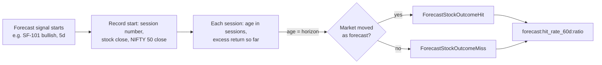

# Product Requirements Document (PRD)
# Stock Forecast Observability Engine
## Prometheus-Based Stock Performance Forecasting, Alerting, and Educational Market Analysis

**Document version:** 1.4  
**Status:** Revised — aligned with the stock-observability repository; ready for implementation planning  
**Product category:** Financial analytics, observability, educational forecasting  
**Primary users:** MBA Finance students, finance educators, market analysts, developers, and quantitative-finance learners  
**Monitoring technology:** Prometheus, PromQL, Alertmanager, Grafana, as deployed by `deploy/` (Compose, Helm chart, native installer)  
**Market and data source:** NSE equities in the exporter's core tier (NIFTY 200 + indices), Zerodha Kite historical day candles; deterministic synthetic candles from the exporter simulator (`--feed.source=sim`)  
**Benchmark:** NIFTY 50 index  
**Initial scope:** 29 forecast and market-condition alert rules (SF-101 to SF-129), 2 forecast-verdict alert rules (SF-OUT-1, SF-OUT-2) and 5 data-quality alert rules (SF-DQ-1 to SF-DQ-5)  
**Primary objective:** Explain, monitor, test, and evaluate potential stock price movements using measurable market indicators.

| Version | Change |
|---|---|
| 1.0 | Initial proposal. |
| 1.1 | Aligned with the repository: exporter-side daily indicators, repository metric and label conventions, one rule file and existing Alertmanager routes, defined mechanisms for session persistence, hysteresis and event expiry, overlap with existing intraday alerts, benchmark-relative evaluation, acceptance checklist reset to open. |
| 1.2 | Added SF-116 to SF-129: MACD, ADX, regression trend, mean reversion, volatility squeeze, cross-sectional momentum, sector-relative strength, risk-adjusted alpha, volume flow, Quant Lab and logistic model forecasts, EWMA volatility forecast, candlestick pattern in context, and signal confluence. Added the `technique` label and the signal layer (`stock:forecast_signal:value`), and extended the metric contract, evaluation methods, and risks. |
| 1.3 | Prefixed all SF alert names with `Forecast`, keeping the original `Stock…` name (for example `ForecastStockVolatilityExpansion`; data-quality alerts `ForecastStockInputsStale` and so on), added the `stock-forecast` Alertmanager receiver, the `[Forecast SF-xxx]` summary prefix, `rule_id` on data-quality alerts, and §12.5 on identifying forecast alerts. |
| 1.4 | Added live forecast verdicts (§14.10): Prometheus records the start of each forecast, tracks it session by session, and fires `ForecastStockOutcomeHit` or `ForecastStockOutcomeMiss` (SF-OUT-1/2) when the horizon is reached, with a live 60-day hit rate per rule. Added `stock_daily_session_index` and 5- and 20-session realized volatility to the metric contract, `horizon` on the signal layer, and the `layer="outcome"` and `outcome` labels. |

---

# 1. Executive Summary

The Stock Forecast Observability Engine is an educational financial analytics system that converts stock-market performance indicators into transparent, explainable forecasting signals.

Stock analysts frequently express an outlook using statements such as:

- A stock is likely to continue moving upward.
- Selling pressure is increasing.
- Bullish momentum is weakening.
- The stock may experience a correction.
- Trading volume confirms a price breakout.
- The stock is underperforming the broader market.
- Volatility is increasing, making the outlook less certain.

These statements can be translated into measurable market conditions and evaluated using rules.

The proposed system will implement 29 Prometheus alert rules that classify market behavior into trend, momentum, mean-reversion, volume-flow, volatility, relative-strength, model-based, pattern, and confluence signals. Every alert will have an explicit firing condition, recovery condition, clearance policy, explanation, and test specification.

The system will also retain sufficient historical information to evaluate whether a forecast was useful over its intended time horizon.

The objective is not to build a guaranteed stock-price prediction engine. It is to provide a practical environment in which students can investigate financial hypotheses, observe market behavior, understand technical indicators, and learn how to evaluate forecasts scientifically.

## 1.1 Product vision

Create an observable and testable financial analysis platform in which every market signal can be explained by its underlying data, mathematical conditions, alert lifecycle, and subsequent market outcome.

## 1.2 Product mission

The platform must answer five questions for every generated signal:

1. What is happening to the stock?
2. Why did the system identify this condition?
3. What does the condition suggest about potential future performance?
4. What market behavior will clear the alert?
5. Was the forecast useful when evaluated against subsequent market data?

## 1.3 Definition of success

The product succeeds when a student can select an active or recently resolved alert, inspect its triggering indicators, explain its financial meaning, identify the condition that cleared it, and compare its forecast with the actual subsequent market movement.

---

# 2. Background and Problem Statement

## 2.1 Current problem

Students learning finance encounter technical analysis concepts in isolation. They may learn moving averages, momentum, trading volume, volatility, and relative strength without understanding how those indicators can be combined into operational rules.

At the same time, market commentary often uses qualitative terms such as bullish, bearish, overbought, oversold, and potential reversal without a consistent explanation of the evidence supporting those assessments.

This creates four learning problems:

1. Students cannot easily connect financial theory with measurable market behavior.
2. Forecasting claims are difficult to reproduce and test consistently.
3. The lifecycle of a market signal is rarely studied systematically.
4. Students may confuse an indicator signal with a guaranteed future price movement.

## 2.2 Proposed solution

Use a market-data exporter to calculate financial indicators and publish them as Prometheus metrics.

Prometheus evaluates the metrics against a documented set of alert rules. Grafana displays the signals, supporting evidence, and historical outcomes.

Alertmanager can distribute notifications when configured, while the educational dashboard remains the primary interface for understanding the results.

The platform will support the complete lifecycle:

**Market data → Indicator calculation → Signal detection → Alert firing → Market observation → Alert clearance → Forecast evaluation.**

## 2.3 Educational hypothesis

Students who investigate explainable market signals and compare them with subsequent outcomes will develop a better understanding of the relationship between financial indicators, uncertainty, and observed market behavior.

The product should support this learning process rather than assume that technical indicators consistently predict prices.

## 2.4 Existing capabilities in this repository

The forecast engine extends the existing NSE pipeline (`stock_exporter` → Prometheus rules in `deploy/prometheus/rules/` → Alertmanager → Grafana and `stock_home`). It does not replace any existing rule.

| Capability | Already available | Gap closed by this PRD |
|---|---|---|
| Daily candles | `stock_exporter/internal/kite/client.go` `RefreshReference` loads one year of Kite day candles (up to the previous day) for core-tier instruments every `--kite.reference-refresh-interval` (default 6h) | Keep the full candle series (close and volume) instead of only derived levels |
| Daily moving averages | `stock_sma_50d_price`, `stock_sma_200d_price`, `stock_sma_50d_200d_cross` (reference collector) | 20-session SMA and 20/50 crossover events |
| Golden/death cross | `StockGoldenDeathCross` (50/200, `nse_reference_levels.rules.yml`) | SF-105/106 add a faster 20/50 transition; the 50/200 alert stays |
| RSI and divergence | `stock:rsi_wilder_14m:index`, `StockRSIDivergence` on 1-minute bars (`nse_momentum.rules.yml`) | Daily RSI(14) and daily divergence (SF-109) |
| Price/volume surge | `StockPriceVolumeSurge`, `Stock52WeekBreakout` (intraday) | Completed-session breakout (SF-107/108) |
| Volatility | `stock:historical_vol_20d:percent`, `StockHighVolatility`, `StockRangeExpansion` | 10/60-session regime with hysteresis (SF-112/113) |
| Relative strength | `stock:relative_strength_nifty:percent` (same-day spread vs NIFTY 50) | 20-session relative return (SF-114/115) |
| Data quality | `StockExporterDown`, `KiteSessionInvalid`, `KiteAPIErrors`, `MarketDataStale`, `StockPriceDataInvalid` (live ticks) | Daily-input freshness, history and benchmark checks (SF-DQ-1 to SF-DQ-5) |
| Effectiveness | `nse_effectiveness.rules.yml` (5m/15m/1h horizons over 5 days) | Session-horizon evaluation (§14) |
| Routing | `market-digest` route (`layer="condition"`, `condition=~".+"`, NSE session hours, holidays muted) | New `stock-forecast` receiver for `category="forecast"`, placed before `market-digest` (§11.3) |

Related documents: [deploy/prometheus/NSE_FORMULA_RULES_PROPOSAL.md](../../deploy/prometheus/NSE_FORMULA_RULES_PROPOSAL.md) (formula backlog, releases R1–R6) and [stock_observability_prometheus_rules/](stock_observability_prometheus_rules/README.md) (SO-1xx data-ingestion rules, lifecycle and testing standards that also apply here).

---

# 3. Goals, Objectives, and Non-Goals

## 3.1 Product goals

**G-01 — Explain market direction signals**

Identify conditions consistent with bullish and bearish trends.

**G-02 — Explain momentum changes**

Identify accelerating momentum, weakening momentum, and possible reversal conditions.

**G-03 — Explain trading-volume behavior**

Identify price movements accompanied by unusually high trading activity.

**G-04 — Explain market uncertainty**

Identify expansion and compression in realized volatility.

**G-05 — Compare stock performance with a benchmark**

Determine whether a stock has outperformed or underperformed its selected benchmark over a defined historical period.

**G-06 — Establish explicit alert clearance**

Ensure that each alert has a deterministic and testable resolution policy.

**G-07 — Support reproducible learning**

Make the same historical data and rule configuration produce reproducible results.

**G-08 — Evaluate forecast quality**

Compare signals with subsequent market outcomes without using future information in the original forecast.

## 3.2 Non-goals

The initial release will not:

- Guarantee the direction of a future price movement.
- Promise a specific forecast accuracy.
- Automatically execute stock purchases or sales.
- Recommend individual investments based solely on technical indicators.
- Calculate portfolio allocations or personalized investment advice.
- Depend on machine learning or generative AI for the initial signal-generation logic.
- Treat every technical indicator as an independent source of evidence.
- Interpret missing market data as evidence of bearish market conditions.
- Use Prometheus as the primary historical financial data warehouse. Retention is 90 days (about 60 NSE sessions), so any window or horizon longer than that is computed by the exporter or the offline evaluation, never by PromQL.
- Replace or retune the existing intraday alerts; SF rules are their completed-session counterparts.
- Support exchanges other than NSE or benchmarks other than NIFTY 50 in the MVP.

## 3.3 Product principles

1. Explainability takes priority over complexity.
2. Every alert must be reproducible from its input data.
3. Every alert must have a documented clearance policy.
4. Every forecast must specify its intended evaluation horizon.
5. Every missing-data condition must be distinguishable from a market signal.
6. Every accuracy claim must be supported by a defined evaluation method.
7. A signal indicates a condition, not certainty about the future.

---

# 4. Stakeholders and Personas

## 4.1 MBA Finance student

**Needs:** Understand the financial meaning of technical indicators and compare theoretical concepts with observed market behavior.

**Expected activities:**

- Review bullish and bearish alerts.
- Investigate why a particular alert fired.
- Compare moving averages, RSI, volume, and relative performance.
- Observe when signals resolve.
- Evaluate forecasts against subsequent returns.
- Prepare an analysis explaining whether a signal was useful.

## 4.2 Finance educator

**Needs:** Demonstrate financial concepts through reproducible examples.

**Expected activities:**

- Select stocks and evaluation periods.
- Demonstrate different market regimes.
- Compare strong and weak signals.
- Explain false positives and false negatives.
- Assign students historical signal-analysis exercises.

## 4.3 System developer

**Needs:** Implement and test the exporter, Prometheus rules, dashboards, and evaluation pipeline.

**Expected activities:**

- Define metric contracts.
- Implement indicator calculations.
- Maintain rule files.
- Test alert transitions.
- Validate data freshness.
- Investigate discrepancies between indicators and alert outputs.

## 4.4 Market analyst

**Needs:** Review systematic evidence supporting a market outlook.

**Expected activities:**

- Compare short-term and longer-term signals.
- Identify conflicting indicators.
- Examine relative strength and volatility.
- Review historical outcomes.
- Use alerts as a supplementary analytical input.

---

# 5. Functional Scope

The first release consists of six functional modules.

| Module | Responsibility | Repository location |
|---|---|---|
| Market data ingestion | Obtain and validate daily OHLCV candles | `stock_exporter/internal/kite` (historical day candles), `stock_exporter/internal/sim` (synthetic history) |
| Indicator calculation | Calculate returns, averages, RSI, volume ratios, volatility, trend streaks, and events | New `daily` collector and indicator package in `stock_exporter` |
| Recording rules | Ratios, relative return, hysteresis state | `deploy/prometheus/rules/nse_forecast.rules.yml` |
| Forecast alert engine | Evaluate the 29 SF alerts, the 2 verdict alerts and the 5 SF-DQ alerts | Same file |
| Alert lifecycle management | Routing, inhibition, notification timing | `deploy/alertmanager/alertmanager.yml` |
| Educational dashboard and evaluation | Explain signals and measure historical outcomes | `deploy/grafana/dashboards/nse-forecast.json`, `deploy/prometheus/tests/reference/forecastref.py` |

## 5.1 Minimum viable product

The MVP must include:

- The exporter's core-tier equities from the existing watchlist (`--stock.watchlist-file`), with NIFTY 50 as the single benchmark.
- At least 100 completed sessions of daily candles per instrument: 61 for the 60-session volatility baseline, 51 for the 20/50 crossover, and at least 100 for RSI, MACD and ADX warm-up. SF-121 needs 127 sessions. The existing one-year fetch (about 248 sessions) satisfies all of them.
- The 29 forecast rules described in this document.
- The 5 data-quality rules in §10.16.
- Synthetic daily candle history in the simulator so that every rule can fire in `make e2e` without the Kite historical-data add-on.
- Unit tests for all indicator and alert logic.
- Explicit clearance behavior for every forecast rule.
- A Grafana dashboard for current and historical signals.
- A historical evaluation report.
- Documentation explaining assumptions and limitations.

## 5.2 Recommended initial operating mode

Use daily completed-session indicators only. The latest completed session is the previous NSE trading day: Kite day candles are fetched up to the previous calendar day.

The exporter must refresh daily candles after the session close and before the next 09:15 IST open. The current interval-based refresh (`--kite.reference-refresh-interval=6h`) must be supplemented by a scheduled refresh (for example 08:30 IST) so that inputs are current at the open.

Indicator values change at most once per session. Prometheus re-evaluates them every minute, but rules must not treat repeated evaluations of the same session as new evidence.

SF alerts are not gated on `stock_market_open`: a signal stays active overnight and across holidays until the next completed session changes it. Notification timing is handled by the Alertmanager `nse_session` and `nse_holidays` time intervals.

Intraday monitoring may be introduced later, but it must use a separate, clearly defined calculation and evaluation contract. The existing intraday rules (`nse_momentum`, `nse_volatility`, `stock_alerts`) already cover it.

Daily and intraday indicators must not be mixed in one expression. In metric names, `d` always means completed trading sessions (as in `stock_sma_50d_price`) and `m` means one-minute bars (as in `stock:rsi_14m:index`).

---

# 6. Market Data Requirements

## 6.1 Required input data

The data provider must supply, at minimum:

- Trading date and timestamp.
- Exchange and symbol.
- Open price.
- High price.
- Low price.
- Close price.
- Adjusted close price, when available.
- Trading volume.
- Benchmark identifier.
- Market calendar information.
- Data retrieval status.

Adjusted prices should be used where appropriate for historical return calculations to account for splits and dividends. The project must document whether each indicator uses raw close, adjusted close, or another defined price series.

Volume data should be interpreted consistently with the selected provider and exchange.

**Repository source.** Kite day candles provide date, open, high, low, close, and volume; they have no separate adjusted-close field. The implementation must verify how Kite treats splits, bonuses, and dividends in historical candles, use the same close series for every indicator and for evaluation, and record the result in the KPI catalogue limitation field. Index candles (NIFTY 50) carry no volume, so volume indicators are published for `instrument_type="EQ"` only.

The exchange calendar comes from the exporter's market calendar (`stock_exporter/internal/market`) and the NSE holiday list already used by Alertmanager (`nse_holidays`) and `stock_home` (`holidays.yml`). These three sources must stay identical.

## 6.2 Data validation requirements

Before publishing indicators, the exporter must validate:

1. The symbol exists in the configured universe.
2. The latest expected trading-session data is available.
3. Prices are finite and positive.
4. High, low, open, and close values are logically consistent.
5. Volume is non-negative and valid.
6. Required historical observations are available.
7. The calculation window contains enough valid observations.
8. Benchmark data is available for relative-strength calculations.
9. Historical adjustments are handled consistently.
10. Data timestamps match the relevant exchange calendar.

Invalid input must result in an explicit unavailable or invalid-data state, not a fabricated indicator value.

## 6.3 Missing and stale data

The system must distinguish:

- Normal market closure.
- A holiday or non-trading session.
- An expected but missing daily market-data update.
- A failed provider request.
- An incomplete historical window.
- Invalid or inconsistent source values.
- An exporter failure.
- A Prometheus scrape failure.

The stale-data threshold must be based on the exchange calendar and expected provider delivery time, with an operational grace period.

A missing data point must not be interpreted as a price decrease, a bearish forecast, or a clearance event.

## 6.4 Data-source requirements

The implementation team must document:

- Provider name and API limits.
- Supported exchanges.
- Licensing and permitted educational use.
- Update frequency.
- Historical data coverage.
- Data adjustment policy.
- Retry and error-handling behavior.
- Data retention and reproducibility strategy.

The product must not assume that every provider offers reliable real-time data or unrestricted historical data.

For the MVP:

- **Live provider:** Zerodha Kite Connect with the historical-data add-on. Requests are rate-limited by the exporter's historical limiter, and failures are counted in `stock_kite_api_requests_total{endpoint="historical"}`. A token error aborts the refresh; other per-instrument errors skip that instrument.
- **Simulator:** `--feed.source=sim` must generate a deterministic synthetic daily history (at least 250 sessions per core instrument, seeded by symbol) that includes the scenarios in §15.3. Today the simulator fabricates the reference levels directly and has no candle series.

---

# 7. Indicator Definitions and Calculation Standards

The following definitions establish a consistent calculation contract.

## 7.1 Daily return

For price $P_t$:

$$
R_{1,t} = 100\left(\frac{P_t}{P_{t-1}}-1\right)
$$

The result is expressed in percentage points. A return of 2% is represented as `2`, not `0.02`.

The price series must be consistent and must not mix adjusted and unadjusted values.

## 7.2 Five-session return

$$
R_{5,t} = 100\left(\frac{P_t}{P_{t-5}}-1\right)
$$

This calculation uses five completed trading-session intervals, not five calendar days.

## 7.3 Twenty-session return

$$
R_{20,t} = 100\left(\frac{P_t}{P_{t-20}}-1\right)
$$

## 7.4 Simple moving averages

$$
SMA_n(t)=\frac{1}{n}\sum_{i=0}^{n-1}P_{t-i}
$$

The initial rules use 20-session and 50-session moving averages. The 50-session value is the existing `stock_sma_50d_price`; the 20-session value is new and must use the same candle series and code path.

A moving average is unavailable (absent, not zero) until the full required history is present, as the reference collector already does for the 50- and 200-session averages.

## 7.5 Relative Strength Index

RSI uses a 14-session period and Wilder smoothing: the first average gain and loss are the simple means of the first 14 changes, and each later value is $\frac{13}{14}\,prev + \frac{1}{14}\,current$. This matches the intraday `stock:rsi_wilder_14m:index`.

Wilder RSI depends on its starting point. The value is published only after at least 100 daily closes, and it is always computed from the oldest loaded candle so that every refresh produces the same value.

The value ranges from 0 to 100.

- RSI below 30: traditionally interpreted as oversold.
- RSI above 70: traditionally interpreted as overbought.
- RSI above 60: used in this prototype as a positive-momentum threshold.
- RSI below 40: used in this prototype as a negative-momentum threshold.

These are conventions, not universal laws.

## 7.6 Volume ratio

$$
VolumeRatio_{20}(t)=
\frac{Volume_t}{\frac{1}{20}\sum_{i=1}^{20}Volume_{t-i}}
$$

The baseline is the mean volume of the 20 sessions before the latest completed session. The latest session is excluded so that a large session does not dilute its own ratio. The ratio is absent when the baseline is zero or any of the 21 sessions is missing.

A volume ratio of 1.5 means trading volume is 50% above its baseline.

This daily ratio is different from the intraday `stock:relative_volume:ratio`, which compares today's volume so far with end-of-day snapshots.

## 7.7 Realized volatility

Realized volatility uses the same convention as the existing `stock:historical_vol_20d:percent`: the population standard deviation of daily log returns, multiplied by $\sqrt{252}$ and by 100 (annualised percent).

$$
\sigma_n(t)=100\sqrt{252}\;\mathrm{pstdev}\left(\ln\frac{P_{t-i}}{P_{t-i-1}}\right)_{i=0}^{n-1}
$$

The 10-session value uses 10 returns (11 closes); the 60-session baseline uses 60 returns (61 closes). Both are computed by the exporter because 61 sessions exceed what Prometheus retains.

The initial volatility signal compares 10-session realized volatility with the 60-session baseline.

## 7.8 Relative return

$$
RelativeReturn_{20,t}=
R_{20,t}^{stock}-R_{20,t}^{NIFTY\,50}
$$

The result is expressed in percentage points. Stock and benchmark returns must refer to the same completed session (equal `stock_daily_session_timestamp_seconds`); otherwise the relative return is absent.

A relative return of +3 means the stock outperformed its benchmark by three percentage points over the evaluation window.

## 7.9 Price momentum divergence

A divergence detector compares confirmed local peaks or troughs in price with corresponding peaks or troughs in RSI.

For bearish divergence, the newer price peak must exceed the previous confirmed price peak while the corresponding RSI peak is lower.

The algorithm must define:

- Pivot detection window.
- Minimum separation between pivots.
- Confirmation delay.
- Matching rules for price and RSI pivots.
- Signal expiration.
- Treatment of missing observations.

A divergence is not confirmed until the necessary observations are available. The algorithm must not use a future price peak to claim that the divergence was known earlier.

Initial parameters (prototype values, versioned with the exporter):

| Parameter | Value |
|---|---|
| Pivot high (low) | Close strictly above (below) the closes of the 3 sessions before and the 3 sessions after |
| Confirmation delay | 3 sessions; the event session is the confirmation session, not the pivot session |
| Pivot pairing | The two most recent confirmed pivots of the same kind, 5 to 40 sessions apart |
| RSI matching | RSI(14) on the pivot session itself |
| Bearish divergence | Newer pivot high close > older pivot high close and newer RSI < older RSI |
| Bullish divergence | Newer pivot low close < older pivot low close and newer RSI > older RSI |
| Invalidation | A newer confirmed pivot of the same kind that does not diverge replaces the event |
| Expiry | 5 sessions after confirmation (§10, SF-109) |
| Missing observations | Any missing close inside the pivot window means no pivot |

## 7.10 Trading-session semantics

All lookback periods and forecast horizons must use completed trading sessions unless explicitly identified as intraday.

The implementation must not substitute calendar-day offsets for trading-session offsets without validating equivalence. PromQL `offset 1d` is a calendar offset and must not be used to read the previous session; session-indexed values (streaks, event ages, previous-session comparisons) are computed by the exporter from the candle series.

---

# 8. Metric Contract

The exporter publishes the following metrics. Names follow the repository convention `stock_<name>_<unit>`, where `d` means completed sessions. Every value has a single owner: an exporter metric is never re-published by a recording rule.

| Metric | Source | Unit | Purpose |
|---|---|---|---|
| `stock_daily_close_price` | new `daily` collector | Price | Close of the latest completed session |
| `stock_daily_return_1d_percent` | `daily` | Percentage points | One-session return |
| `stock_daily_return_5d_percent` | `daily` | Percentage points | Five-session return |
| `stock_daily_return_20d_percent` | `daily` | Percentage points | Twenty-session return (EQ and NIFTY 50) |
| `stock_sma_20d_price` | `daily` | Price | Twenty-session moving average |
| `stock_sma_50d_price` | existing `reference` collector | Price | Fifty-session moving average |
| `stock_rsi_14d_index` | `daily` | 0–100 | Wilder RSI(14) on daily closes |
| `stock_daily_relative_volume_20d_ratio` | `daily` | Ratio | Latest-session volume / mean volume of the previous 20 sessions (EQ only) |
| `stock_realized_vol_10d_percent` | `daily` | Annualised percent | Short-term realized volatility |
| `stock_realized_vol_60d_percent` | `daily` | Annualised percent | Long-term volatility baseline |
| `stock_realized_vol_5d_percent` | `daily` | Annualised percent | Volatility of the last 5 sessions; verdict input for SF-112, SF-113, SF-120 and SF-127 (§14.10) |
| `stock_realized_vol_20d_percent` | `daily` | Annualised percent | Baseline recorded when SF-120 starts (§14.10) |
| `stock_daily_session_index` | `daily` | Sessions | Trading-session number of the latest loaded candle, counted by the exporter calendar from a fixed origin (2000-01-03). Lets PromQL count sessions between two points in time (§14.10) |
| `stock_daily_trend_streak_sessions{direction}` | `daily` | Sessions | Consecutive completed sessions with close > SMA20 > SMA50 (`bullish`) or close < SMA20 < SMA50 (`bearish`); absent when 0 |
| `stock_daily_signal_age_sessions{signal, direction}` | `daily` | Sessions | Sessions since the latest event of `signal` (0 = latest completed session); absent when no event exists in the loaded history |
| `stock_daily_session_timestamp_seconds` | `daily` | Unix seconds | Date (00:00 IST) of the latest completed session candle |
| `stock_daily_session_lag_sessions` | `daily` | Sessions | Trading sessions between the expected latest completed session (exporter calendar) and the loaded one; 0 = current |
| `stock_daily_history_sessions` | `daily` | Count | Valid daily candles loaded |
| `stock_daily_inputs_valid` | `daily` | 0 or 1 | 0 when candle validation (§6.2) failed; indicators of that instrument are then not published |
| `stock_daily_macd_histogram_price` | `daily` | Price | MACD(12,26) line minus its 9-session signal line on daily closes; EMAs seeded with an SMA from the oldest loaded candle, published after 100 closes |
| `stock_adx_14d_index` | `daily` | 0–100 | Wilder ADX(14) from daily high, low, close; published after 100 candles |
| `stock_di_plus_14d_index` | `daily` | 0–100 | Wilder +DI(14) |
| `stock_di_minus_14d_index` | `daily` | 0–100 | Wilder −DI(14) |
| `stock_daily_trend_slope_20d_percent` | `daily` | Annualised percent | Least-squares slope of ln(close) over the last 20 sessions × 252 × 100 |
| `stock_daily_trend_r2_20d_ratio` | `daily` | 0–1 | Coefficient of determination of that fit |
| `stock_daily_close_zscore_20d_sigma` | `daily` | Standard deviations | $(C_t - SMA_{20}) / \mathrm{pstdev}(C_{t-19..t})$; absent when the deviation is 0 |
| `stock_daily_squeeze_ratio` | `daily` | Ratio | Bollinger(20, 2) width $4\sigma_{20}$ divided by Keltner(20, 1.5) width $3 \cdot ATR_{20}$, with $ATR_{20}$ the mean true range of 20 sessions; < 1 means squeeze |
| `stock_daily_return_126_21d_percent` | `daily` | Percentage points | 6-1 momentum: $100(P_{t-21}/P_{t-126} - 1)$; needs 127 closes |
| `stock_daily_obv_slope_20d_ratio` | `daily` | Average volumes per session | Least-squares slope of on-balance volume over 20 sessions divided by the mean volume of those sessions (EQ only) |
| `stock_daily_ewma_vol_forecast_percent` | `daily` | Annualised percent | One-step EWMA volatility forecast, $\sigma^2_{t+1} = 0.94\,\sigma^2_t + 0.06\,r_t^2$ on daily log returns, seeded with the variance of the first 20 returns |
| `stock_prediction_expected_return_percent{model="ar1_daily", horizon="5d"}` | Quant Lab | Percent | AR(1) expected 5-session return (§10, SF-125) |
| `stock_prediction_volatility_percent{model="ar1_daily", horizon="5d"}` | Quant Lab | Percent | EWMA standard deviation of the 5-session return |
| `stock_forecast_model_weight{model="logit_5d", feature}` | textfile (`forecastref.py`) | Unitless | Logistic-regression weight per standardized feature (SF-126) |
| `stock_forecast_model_intercept{model="logit_5d"}` | textfile | Unitless | Logistic-regression intercept |
| `stock_forecast_model_info{model, train_start, train_end, rules_commit}` | textfile | 1 | Training window and version of the published weights |
| `stock_kite_api_requests_total{endpoint="historical"}` | existing | Counter | Provider retrieval status, by `outcome` |

`signal` values (bounded): `sma_20d_50d_cross`, `rsi_divergence`, `rsi_oversold_exit`, `rsi_overbought_exit`, `macd_cross`, `engulfing`. `direction` values: `bullish`, `bearish`. Only the latest event per signal is published, so each instrument has at most six `signal_age` series and two `trend_streak` series. A newer event of the opposite direction replaces the older one.

Event definitions:

| Signal | Event at session $t$ |
|---|---|
| `sma_20d_50d_cross` | $SMA_{20}(t-1) \le SMA_{50}(t-1)$ and $SMA_{20}(t) > SMA_{50}(t)$ (`bullish`), mirrored for `bearish`; both windows full on both sessions |
| `rsi_divergence` | Confirmation session of a divergence (§7.9) |
| `rsi_oversold_exit` (`bullish`) | $RSI(t-1) < 30$ and $RSI(t) \ge 30$ |
| `rsi_overbought_exit` (`bearish`) | $RSI(t-1) > 70$ and $RSI(t) \le 70$ |
| `macd_cross` | MACD histogram $\le 0$ at $t-1$ and $> 0$ at $t$ (`bullish`), mirrored for `bearish` |
| `engulfing` | Bullish: $C_t > O_t$, $C_{t-1} < O_{t-1}$, $O_t \le C_{t-1}$, $C_t \ge O_{t-1}$; bearish mirrored. Same definition as the intraday `stock:daily_pattern:bool{pattern="engulfing"}`, but on completed candles |

Quant Lab publishes only `exchange`, `symbol`, `model` and `horizon` labels. Its daily model reads the last 60 end-of-day log returns (`stock:session_log_return:ratio` in [nse_eod_snapshot.rules.yml](../../deploy/prometheus/rules/nse_eod_snapshot.rules.yml)) from Prometheus and runs every 30 minutes. It is silent while Quant Lab is disabled (`quantlab.enabled: false`, the chart default).

The following v1.0 metrics are dropped:

- `stock_volatility_ratio` and `stock_relative_return_20d_pct` are now recording rules.
- `stock_bearish_divergence` and `stock_bullish_divergence` are replaced by `stock_daily_signal_age_sessions{signal="rsi_divergence"}`.
- `stock_market_data_ready`, `stock_market_data_last_success_timestamp_seconds` and `stock_market_data_fetch_success` are replaced by `stock_daily_inputs_valid`, `stock_daily_session_lag_sessions`, `stock_daily_history_sessions` and the Kite API counter.

## 8.1 Labels

Use the existing instrument labels `exchange`, `symbol`, `sector`, `instrument_type`, `tier` (`stock_exporter/collector/quote.go`) plus the target labels `job` and `instance`. The daily metrics add only `direction` and `signal`.

There is no `benchmark` label. The MVP benchmark is fixed to `symbol="NIFTY 50", instrument_type="INDEX"`, as in `stock:relative_strength_nifty:percent`. Per-stock benchmarks are a later extension through an info metric `stock_benchmark_info{exchange, symbol, benchmark}` joined with `group_left`; adding the label to every series is not allowed.

Do not add unbounded labels such as trade IDs, arbitrary timestamps, unique alert-event IDs, or user-generated descriptions.

The universe is the exporter's core tier: core-tier `EQ` instruments plus the NIFTY 50 index. Broad-tier symbols have no daily candles.

## 8.2 Metric invariants

The implementation must ensure that:

- RSI stays within the valid range when available.
- Ratios have documented behavior when their denominator is zero or unavailable.
- Volatility calculations use consistent units.
- Relative returns use aligned stock and benchmark sessions.
- Missing indicators are not published as misleading zeros.
- Data readiness becomes false when any required dependency is invalid.
- Historical values used for evaluation can be reproduced from the stored source data.
- An indicator whose window is not full is absent, never 0.
- Values from stale inputs stay published with their `stock_daily_session_timestamp_seconds`. They describe the last session they were computed for, and SF-DQ-1 reports the lag.

## 8.3 Scrape and sample budget

The `stock_core` job scrapes every second and is close to its budget: about 13,000 samples per scrape against `sample_limit: 20000`, guarded by `TestCoreTierSampleBudget`. Daily metrics change once per session, so the `daily` collector must not be part of the 1-second scrape.

Expose it through a dedicated `stock_daily` scrape job (60s interval, `collect[]=daily`). At about 220 instruments and at most 35 series each, the job carries about 7,700 series.

Because `stock_sma_50d_price` comes from `stock_core` and the daily metrics from `stock_daily`, rules that combine them must match `on(exchange, symbol)`.

---

# 9. Recording Rules

Recording rules calculate reusable expressions. They do not have a firing or clearance lifecycle. Names follow `stock:<name>:<unit>`.

| Recording rule | Definition | Unit |
|---|---|---|
| `stock:sma_spread_20_50d:percent` | `(stock_sma_20d_price / on(exchange, symbol) (stock_sma_50d_price > 0) - 1) * 100`; mirrors `stock:sma_spread_50_200d:percent` | Percent |
| `stock:realized_vol_ratio_10d_60d:ratio` | `stock_realized_vol_10d_percent / (stock_realized_vol_60d_percent > 0)` | Ratio |
| `stock:relative_return_20d_nifty:percent` | EQ 20-session return minus NIFTY 50 20-session return, only when both refer to the same session | Percentage points |
| `stock:forecast_state:bool{signal}` | Hysteresis state for `vol_expansion`, `vol_compression`, `rs_outperformance`, `rs_underperformance`, `adx_trend`, `zscore_low`, `zscore_high`, `momentum_top`, `momentum_bottom`, `sector_leader`, `sector_laggard`, `alpha_high`, `prob_up_high`, `prob_up_low`, `ewma_vol_spike` (§11.2) | 1 or absent |
| `stock:momentum_6_1:percent` | `stock_daily_return_126_21d_percent{instrument_type="EQ"}` for instruments whose session is current (`stock_daily_session_lag_sessions == 0`) | Percentage points |
| `stock:sector_relative_return_20d:percent` | 20-session return minus the sector median, sectors with at least 5 current instruments | Percentage points |
| `stock:ewma_vol_forecast_ratio:ratio` | `stock_daily_ewma_vol_forecast_percent / on(exchange, symbol) (stock_realized_vol_60d_percent > 0)` | Ratio |
| `stock:daily_feature:zscore{feature}` | Cross-sectional z-score of each SF-126 feature, clamped to ±3 | Standard deviations |
| `stock:prob_up_5d:ratio` | Logistic score from the features and the published weights | 0–1 |
| `stock:forecast_signal:value{rule_id, technique, direction, horizon}` | Signal layer: the condition of each SF rule, valued with its measured value (§10.0) | Rule-specific |
| `stock:forecast_confluence:count{direction}` | Number of distinct techniques with an active directional signal per instrument (SF-129) | Count |
| `stock:forecast_activation:session` | Session number at the start of a forecast; one sample per forecast episode (§14.10) | Sessions |
| `stock:forecast_activation:price`, `stock:forecast_activation_benchmark:price` | Stock and NIFTY 50 close at the start of a forecast | Price |
| `stock:forecast_activation_baseline:percent` | Volatility baseline at the start of SF-112, SF-113, SF-120 and SF-127 | Annualised percent |
| `stock:forecast_age:sessions` | Completed sessions since the forecast started | Sessions |
| `stock:forecast_progress:excess_percent` | Return since the forecast started minus NIFTY 50's return over the same sessions | Percentage points |
| `stock:forecast_outcome:excess_percent` | Excess return at the forecast horizon | Percentage points |
| `stock:forecast_outcome:hit` | Verdict at the horizon: 1 = hit, 0 = miss | 0 or 1 |
| `stock:forecast_outcome_event:hit` | One sample per verdict, for counting | 0 or 1 |
| `forecast:outcomes_60d:count`, `forecast:hit_rate_60d:ratio` | Live verdict count and hit rate per rule, direction and horizon over 60 days | Count, ratio |

The v1.0 names `stock:return_*_pct`, `stock:trend_*` and `stock:volume_ratio_20` are dropped: they only re-published exporter values.

Recording rules live in `deploy/prometheus/rules/nse_forecast.rules.yml`, in the groups `nse_forecast` (derived values and features), `nse_forecast_state` (hysteresis), `nse_forecast_signals` (signal layer), `nse_forecast_confluence` (SF-129), `nse_forecast_outcome` (verdicts) and `nse_forecast_outcome_60d` (live hit rates) (§12.1).

Relative return:

```yaml
- record: stock:relative_return_20d_nifty:percent
  expr: |
    (
        stock_daily_return_20d_percent{instrument_type="EQ"}
      - on() group_left()
        stock_daily_return_20d_percent{instrument_type="INDEX", symbol="NIFTY 50"}
    )
    and on(exchange, symbol)
    (
        stock_daily_session_timestamp_seconds{instrument_type="EQ"}
      == on() group_left()
        stock_daily_session_timestamp_seconds{instrument_type="INDEX", symbol="NIFTY 50"}
    )
```

## 9.1 Recording-rule requirements

Each recording rule must have:

- A `# <name>` comment block with `What:`, `How:` and `Debug:` lines, as required for every rule in `deploy/prometheus/rules/`.
- An entry in `deploy/prometheus/kpi-catalog.yaml` (`make check-kpis`) and in the `kpi_info.prom` textfile.
- A documented input contract.
- A documented output unit.
- A defined evaluation interval.
- A defined missing-data behavior.
- A reproducible calculation, checked against the reference implementation (§15.2).
- Unit tests.
- An ownership and versioning policy.

## 9.2 Recording-rule failure handling

Recording rules do not require clearance policies.

However, the platform must detect when expected recorded series disappear, become stale, or contain invalid outputs. Separate data-quality alerts should monitor these conditions.

A recording rule that produces no series must not be assumed to produce a zero value.

---

# 10. Detailed Forecast Alert Specifications

This section defines the functional contract for each of the 29 forecast alerts and the 5 data-quality alerts.

The thresholds are initial prototype values. They are not empirically validated universal thresholds. They must be tested and calibrated against historical data before the platform makes any claims about forecast performance.

All forecast alerts require valid input data. An absent input produces no alert, and the data-quality alerts in §10.16 explain why.

## 10.0 Common rule contract

| Field | Value for every SF alert |
|---|---|
| File and groups | `deploy/prometheus/rules/nse_forecast.rules.yml`; signal in `nse_forecast_signals`, alert in `nse_forecast_alerts`, interval 1m |
| Universe | Core-tier equities, `instrument_type="EQ"` (SF-125 uses Quant Lab labels, which carry no `instrument_type`) |
| Signal layer | The PromQL shown for each rule is recorded as `stock:forecast_signal:value` with static labels `rule_id`, `technique`, `horizon` and, when fixed, `direction`. The value is the measured value shown in the alert. Bidirectional rules use two recording rules with the same `rule_id`. `horizon` is on the signal so that the verdict rules (§14.10) know when each forecast matures. |
| Alert expression | `stock:forecast_signal:value{rule_id="SF-1xx"}` |
| `for:` | `5m`, which skips partial results while the exporter reloads candles. Session persistence is part of the expression, not of `for:`. |
| `keep_firing_for:` | `15m`, which covers exporter restarts and scrape gaps |
| Market-hours gate | None (§5.2) |
| Labels | From the signal: `rule_id`, `technique`, `direction`, `horizon`. Added by the alert: `severity: info`, `category: forecast`, `layer: condition`, `condition` |
| Annotations | `summary`, `description`, `clearance`, `effectiveness`, `dashboard` (§12.3) |
| Comment block | `# <name>` followed by `Clearance:` (alerts), `What:`, `How:`, `Debug:` lines, on both the signal and the alert |

The signal layer lets SF-129 combine rules and lets promtool test conditions directly, since promtool has no `ALERTS` series.

`technique` groups rules by the kind of evidence they use. SF-129 counts techniques, not rules, because rules within one technique largely measure the same thing:

| `technique` | Rules |
|---|---|
| `trend` | SF-101, SF-102, SF-105, SF-106, SF-116, SF-117, SF-118 |
| `momentum` | SF-103, SF-104, SF-109 |
| `mean_reversion` | SF-110, SF-111, SF-119 |
| `flow` | SF-107, SF-108, SF-124 |
| `volatility` | SF-112, SF-113, SF-120, SF-127 |
| `relative_strength` | SF-114, SF-115, SF-121, SF-122, SF-123 |
| `model` | SF-125, SF-126 |
| `pattern` | SF-128 |
| `confluence` | SF-129 |

All forecast alerts use `severity: info` because they describe market conditions, not incidents; `warning` is reserved for data-quality alerts. Because of this, the existing inhibition rule `severity="critical", symbol=~".+"` → `severity=~"warning|info"` also applies: an instrument with a critical data alert (for example `StockPriceDataInvalid`) sends no forecast notifications.

| ID | Alert | Mechanism (§11.2) | `direction` | `horizon` | `condition` | `technique` | Related existing rule |
|---|---|---|---|---|---|---|---|
| SF-101 | `ForecastStockBullishTrendConfirmed` | State + session streak | bullish | 5d | `daily_trend` | trend | — |
| SF-102 | `ForecastStockBearishTrendConfirmed` | State + session streak | bearish | 5d | `daily_trend` | trend | — |
| SF-103 | `ForecastStockBullishMomentumSurge` | State | bullish | 3d | `daily_momentum_surge` | momentum | — |
| SF-104 | `ForecastStockBearishMomentumSurge` | State | bearish | 3d | `daily_momentum_surge` | momentum | — |
| SF-105 | `ForecastStockSMA20Over50Cross` (v1.0 GoldenCrossPotential) | Event, 5 sessions | bullish | 20d | `sma_20_50d_cross` | trend | `StockGoldenDeathCross` (50/200) |
| SF-106 | `ForecastStockSMA20Under50Cross` (v1.0 DeathCrossPotential) | Event, 5 sessions | bearish | 20d | `sma_20_50d_cross` | trend | `StockGoldenDeathCross` (50/200) |
| SF-107 | `ForecastStockVolumeBreakoutBullish` | Single-session state | bullish | 3d | `daily_volume_breakout` | flow | `StockPriceVolumeSurge` (intraday) |
| SF-108 | `ForecastStockVolumeBreakdownBearish` | Single-session state | bearish | 3d | `daily_volume_breakout` | flow | `StockPriceVolumeSurge` (intraday) |
| SF-109 | `ForecastStockDailyRSIDivergence` (v1.0 MomentumDivergenceWarning) | Event, 5 sessions | from series | 5d | `daily_rsi_divergence` | momentum | `StockRSIDivergence` (1-minute bars) |
| SF-110 | `ForecastStockOversoldReboundWatch` | Event + clear threshold | bullish | 5d | `daily_rsi_extreme_exit` | mean_reversion | — |
| SF-111 | `ForecastStockOverboughtReversalWatch` | Event + clear threshold | bearish | 5d | `daily_rsi_extreme_exit` | mean_reversion | — |
| SF-112 | `ForecastStockVolatilityExpansion` | Hysteresis | neutral | 5d | `daily_volatility_regime` | volatility | `StockHighVolatility`, `StockRangeExpansion` (intraday) |
| SF-113 | `ForecastStockVolatilityCompression` | Hysteresis | neutral | 5d | `daily_volatility_regime` | volatility | — |
| SF-114 | `ForecastStockRelativeStrengthOutperformance` | Hysteresis | bullish | 20d | `daily_relative_strength` | relative_strength | `stock:relative_strength_nifty:percent` (same day) |
| SF-115 | `ForecastStockRelativeStrengthUnderperformance` | Hysteresis | bearish | 20d | `daily_relative_strength` | relative_strength | `stock:relative_strength_nifty:percent` (same day) |
| SF-116 | `ForecastStockDailyMACDCross` | Event, 5 sessions | both | 5d | `daily_macd_cross` | trend | `stock:macd_histogram:price` (1-minute) |
| SF-117 | `ForecastStockDailyADXTrend` | Hysteresis | both | 5d | `daily_adx_trend` | trend | `stock:adx_14m:index`, trend regime (1-minute) |
| SF-118 | `ForecastStockRegressionTrend` | State | both | 5d | `daily_regression_trend` | trend | `stock:trend_slope_30m:percent_per_hour` (intraday) |
| SF-119 | `ForecastStockMeanReversionStretch` | Hysteresis | both (contrarian) | 5d | `daily_mean_reversion` | mean_reversion | `stock:price_zscore_20m:sigma` (intraday) |
| SF-120 | `ForecastStockVolatilitySqueeze` | State | neutral | 5d | `daily_volatility_squeeze` | volatility | `stock:keltner_20m:price` (intraday) |
| SF-121 | `ForecastStockMomentumRank` | Hysteresis | both | 20d | `momentum_rank` | relative_strength | — |
| SF-122 | `ForecastStockSectorRelativeStrength` | Hysteresis | both | 20d | `sector_relative_strength` | relative_strength | Sector regime (1-minute) |
| SF-123 | `ForecastStockRiskAdjustedOutperformance` | Hysteresis | bullish | 20d | `risk_adjusted_alpha` | relative_strength | `stock:alpha_20d:percent` (input) |
| SF-124 | `ForecastStockVolumeFlowDivergence` | State | both | 5d | `daily_volume_flow` | flow | `stock:obv_session:shares` (intraday) |
| SF-125 | `ForecastStockModelReturnForecast` | State | both | 5d | `model_forecast_return` | model | Quant Lab `ar1` (15 minutes) |
| SF-126 | `ForecastStockModelProbability` | Hysteresis | both | 5d | `model_prob_up` | model | `stock:prob_up:ratio` (15 minutes) |
| SF-127 | `ForecastStockVolatilityForecastSpike` | Hysteresis | neutral | 5d | `volatility_forecast` | volatility | `stock:vol_forecast:percent` (15 minutes) |
| SF-128 | `ForecastStockPatternInContext` | Single-session event | both | 3d | `daily_pattern_context` | pattern | `stock:daily_pattern:bool` (intraday) |
| SF-129 | `ForecastStockSignalConfluence` | State | both | 5d | `forecast_confluence` | confluence | — |

`horizon` is the primary evaluation horizon in completed sessions. The evaluation (§14) also reports 1d, 5d and 20d for every rule.

Rule example (SF-112), showing the signal, the alert, the comment blocks, labels and annotations:

```yaml
      # stock:forecast_signal:value {rule_id=SF-112}
      #   What:  Volatility ratio while the SF-112 hysteresis state is active (non-directional).
      #   How:   stock:realized_vol_ratio_10d_60d:ratio and on(exchange, symbol) stock:forecast_state:bool{signal="vol_expansion"}.
      #   Debug: stock_realized_vol_10d_percent, stock_realized_vol_60d_percent. Empty with fewer than 61 daily closes.
      - record: stock:forecast_signal:value
        labels: {rule_id: SF-112, technique: volatility, direction: neutral, horizon: 5d}
        expr: |
          stock:realized_vol_ratio_10d_60d:ratio{instrument_type="EQ"}
          and on(exchange, symbol) stock:forecast_state:bool{signal="vol_expansion"}

      # ForecastStockVolatilityExpansion
      #   Clearance: Volatility ratio falls below 1.5 on a completed session (hysteresis state cleared), then keep_firing_for 15m.
      #   What:  10-session realized volatility above twice its 60-session baseline (SF-112, non-directional).
      #   How:   stock:forecast_signal:value{rule_id="SF-112"}; the state enters above 2 and holds while the ratio is >= 1.5.
      #   Debug: stock:forecast_state:bool{signal="vol_expansion"}, stock_daily_session_lag_sessions.
      - alert: ForecastStockVolatilityExpansion
        expr: stock:forecast_signal:value{rule_id="SF-112"}
        for: 5m
        keep_firing_for: 15m
        labels: {severity: info, category: forecast, layer: condition, condition: daily_volatility_regime}
        annotations:
          summary: "[Forecast {{ $labels.rule_id }}] {{ $labels.symbol }} daily volatility is {{ $value | printf \"%.1f\" }}x its 60-session baseline"
          description: "10-session realized volatility of {{ $labels.exchange }}:{{ $labels.symbol }} is more than twice its 60-session baseline. This signals higher uncertainty over the next 5 sessions, not a direction. Not a recommendation."
          clearance: "Clears when the ratio falls below 1.5 on a completed session."
          effectiveness: '{{ with query "stock_forecast_eval_hit_ratio{rule_id=\"SF-112\",horizon=\"5d\",regime=\"all\"}" }}5-session hit rate: {{ . | first | value | humanizePercentage }}{{ else }}Not evaluated yet{{ end }}'
          dashboard: "/grafana/d/nse-forecast?var-symbol={{ $labels.symbol }}"
```

## SF-101 — ForecastStockBullishTrendConfirmed

**Category:** Trend analysis  
**Direction:** Bullish  
**Interpretation horizon:** Five completed trading sessions for evaluation, with the trend itself describing a longer context  
**Severity:** Info

### Objective

Identify a stock whose price and moving-average alignment are consistent with an established upward trend.

### Trigger condition

All of the following must hold on the latest completed session:

- The close is above the 20-session moving average.
- The 20-session moving average is above the 50-session moving average.
- The alignment has held for at least two consecutive completed sessions.

### PromQL

```promql
(
    stock_daily_close_price{instrument_type="EQ"}
  > on(exchange, symbol) stock_sma_20d_price
)
and on(exchange, symbol)
(
    stock_sma_20d_price
  > on(exchange, symbol) stock_sma_50d_price
)
and on(exchange, symbol)
stock_daily_trend_streak_sessions{direction="bullish"} >= 2
```

Value: the latest completed close.

### Persistence

Two completed sessions, taken from the exporter's streak counter. A wall-clock `for: 2d` is not used because it would count weekends and holidays.

### Clearance policy

The alert resolves at the first refresh in which the latest completed session breaks the alignment (the streak drops to 0), after `keep_firing_for: 15m`. Recovery persistence is one completed session: inputs change once per session, so the alert cannot flap within a session.

If inputs disappear (exporter down or candle load failed), the alert resolves after `keep_firing_for` while `StockExporterDown` or an SF-DQ alert fires. The evaluation replay records the resolution reason as `data_unavailable`, not as a bearish transition. Stale inputs (SF-DQ-1) stay published, so the alert stays active while its notifications are inhibited.

### Student explanation

The stock is trading above its shorter-term and longer-term moving averages, and the shorter-term average is higher than the longer-term average. This is consistent with a positive trend but does not guarantee future appreciation.

### Test cases

- Bullish alignment on two consecutive sessions: alert fires after `for: 5m`.
- Alignment on one session only (streak 1): no alert.
- Close falls below SMA20 on the next session: alert resolves 15 minutes after the refresh.
- SMA20 falls below SMA50: alert resolves.
- Close alternates around SMA20 every session: the streak never reaches 2 and the alert never fires.
- Inputs absent for less than 15 minutes (exporter restart): alert stays firing.
- `stock_sma_50d_price` absent (fewer than 50 candles): no alert; SF-DQ-2 fires.

---

## SF-102 — ForecastStockBearishTrendConfirmed

**Category:** Trend analysis  
**Direction:** Bearish  
**Interpretation horizon:** Five completed trading sessions for evaluation  
**Severity:** Info

### Objective

Identify a stock whose price and moving-average alignment are consistent with a sustained downward trend.

### Trigger condition

All conditions must hold on the latest completed session:

- Close is below the 20-session moving average.
- The 20-session moving average is below the 50-session moving average.
- The alignment has held for at least two consecutive completed sessions.

### PromQL

```promql
(
    stock_daily_close_price{instrument_type="EQ"}
  < on(exchange, symbol) stock_sma_20d_price
)
and on(exchange, symbol)
(
    stock_sma_20d_price
  < on(exchange, symbol) stock_sma_50d_price
)
and on(exchange, symbol)
stock_daily_trend_streak_sessions{direction="bearish"} >= 2
```

### Persistence

Two completed sessions (exporter streak counter), as in SF-101.

### Clearance policy

Resolves when the latest completed session breaks the bearish alignment, after `keep_firing_for: 15m`. Data loss is handled as in SF-101.

### Student explanation

The stock is trading below both moving averages, and the shorter-term average is below the longer-term average. The condition is consistent with downward trend pressure, not proof of a future decline.

### Test cases

- Bearish alignment on two consecutive sessions: alert fires.
- Close rises above SMA20 on the next session: alert resolves.
- The moving-average ordering changes: alert resolves.
- Input data disappears for more than 15 minutes: alert resolves while `StockExporterDown` or an SF-DQ alert fires; SF-101 does not fire.

---

## SF-103 — ForecastStockBullishMomentumSurge

**Category:** Momentum  
**Direction:** Bullish  
**Interpretation horizon:** Next one to three completed trading sessions  
**Severity:** Info

### Objective

Identify unusually positive short-term price momentum supported by a positive RSI reading.

### Trigger condition

- Five-session return exceeds +3%.
- RSI exceeds 60.

Both conditions must hold on the same completed session.

### PromQL

```promql
stock_daily_return_5d_percent{instrument_type="EQ"} > 3
and on(exchange, symbol) stock_rsi_14d_index > 60
```

Value: the five-session return.

### Clearance policy

Resolves when a later completed session has a five-session return at or below +3% or RSI at or below 60, after `keep_firing_for: 15m`. The MVP uses a single threshold. If Dashboard C shows frequent re-firing across consecutive sessions, the calibration phase adds hysteresis with the §11.2 pattern.

### Student explanation

The stock has gained more than the prototype's five-session return threshold and exhibits relatively strong momentum.

The condition may indicate continuation, but it can also occur late in a short-term move. The alert is not a price target.

### Test cases

- Return is +3.5% and RSI is 65: alert fires.
- Return is exactly +3.0% and RSI is 65: alert does not fire.
- Return is +2.8% and RSI is 65: alert does not fire.
- Return is +3.5% and RSI is 58: alert does not fire.
- Either condition fails on the next session: alert resolves.

---

## SF-104 — ForecastStockBearishMomentumSurge

**Category:** Momentum  
**Direction:** Bearish  
**Interpretation horizon:** Next one to three completed trading sessions  
**Severity:** Info

### Objective

Identify strong negative short-term price momentum accompanied by a weak RSI reading.

### Trigger condition

- Five-session return is below -3%.
- RSI is below 40.

### PromQL

```promql
stock_daily_return_5d_percent{instrument_type="EQ"} < -3
and on(exchange, symbol) stock_rsi_14d_index < 40
```

### Clearance policy

Resolves when a later completed session fails either condition, after `keep_firing_for: 15m`.

### Student explanation

The stock has experienced a substantial recent decline, and the RSI indicates weak momentum.

The condition does not establish that the stock will continue to decline. A sharp fall can also be followed by a rebound.

### Test cases

- Return is -4% and RSI is 35: alert fires.
- Return is -2.5% and RSI is 35: alert does not fire.
- Return is -4% and RSI is 45: alert does not fire.
- RSI absent (fewer than 100 candles): no alert; SF-DQ-2 fires.

---

## SF-105 — ForecastStockSMA20Over50Cross

**Category:** Trend transition  
**Direction:** Bullish trend-transition signal  
**Interpretation horizon:** Five to twenty completed trading sessions  
**Severity:** Info

### Objective

Detect a transition in which the 20-session moving average crosses above the 50-session moving average.

The v1.0 name GoldenCrossPotential is dropped: "golden cross" conventionally means the 50/200 crossover, which the existing `StockGoldenDeathCross` already reports. SF-105 is the faster 20/50 version.

### Trigger condition

The exporter emits a `sma_20d_50d_cross` event with `direction="bullish"` on session $t$ when:

- $SMA_{20}(t-1) \le SMA_{50}(t-1)$, and
- $SMA_{20}(t) > SMA_{50}(t)$,

with both windows full on both sessions.

### PromQL

```promql
stock_daily_signal_age_sessions{signal="sma_20d_50d_cross", direction="bullish", instrument_type="EQ"} <= 4
```

Value: sessions since the cross (0 = latest completed session).

### Clearance policy

This is an event alert with a 5-session window. It resolves when the event age exceeds 4, or when a newer bearish cross replaces the event (the bullish series disappears and SF-106 fires). Continued bullish alignment after the window does not keep it active.

### Student explanation

The shorter-term moving average has crossed above the longer-term moving average. Some technical-analysis approaches interpret this as a positive change in trend structure.

### Test cases

- Previous short average below the long average, current short average above it: event age 0, alert fires.
- The averages stay ordered without a new crossing: no new event; the existing event ages out.
- Fewer than 51 candles: no event is claimed.
- Event age reaches 5: alert resolves.
- A bearish cross two sessions later: SF-105 resolves and SF-106 fires.

---

## SF-106 — ForecastStockSMA20Under50Cross

**Category:** Trend transition  
**Direction:** Bearish trend-transition signal  
**Interpretation horizon:** Five to twenty completed trading sessions  
**Severity:** Info

### Objective

Detect a transition in which the 20-session moving average crosses below the 50-session moving average.

### Trigger condition

The exporter emits a `sma_20d_50d_cross` event with `direction="bearish"` on session $t$ when:

- $SMA_{20}(t-1) \ge SMA_{50}(t-1)$, and
- $SMA_{20}(t) < SMA_{50}(t)$.

### PromQL

```promql
stock_daily_signal_age_sessions{signal="sma_20d_50d_cross", direction="bearish", instrument_type="EQ"} <= 4
```

### Clearance policy

Event alert with a 5-session window, as in SF-105. The alert must not remain active only because the averages remain in bearish alignment.

### Student explanation

The shorter-term average has moved below the longer-term average. This is consistent with weakening trend structure, but it may occur after a substantial portion of a decline has already happened.

### Test cases

- Valid downward crossover: event is emitted and the alert fires.
- Averages remain ordered: no repeated crossover event.
- Missing prior observations: event is not fabricated.
- Event age reaches 5: alert resolves.

---

## SF-107 — ForecastStockVolumeBreakoutBullish

**Category:** Price and volume confirmation  
**Direction:** Bullish  
**Interpretation horizon:** Next one to three completed trading sessions  
**Severity:** Info

### Objective

Identify a positive daily price move accompanied by unusually high trading volume.

### Trigger condition

On the latest completed session:

- One-session return exceeds +2%.
- Volume ratio exceeds 1.5.

### PromQL

```promql
stock_daily_return_1d_percent{instrument_type="EQ"} > 2
and on(exchange, symbol) stock_daily_relative_volume_20d_ratio > 1.5
```

### Clearance policy

Both inputs describe only the latest completed session, so the alert is a bounded one-session event. It resolves at the next refresh (plus `keep_firing_for: 15m`) unless the next session qualifies again. Each qualifying session is a separate event for evaluation. The 3-session horizon is the evaluation horizon, not the alert duration.

### Student explanation

The stock has risen significantly during the completed session, and trading volume is substantially above its recent baseline.

The volume condition may indicate greater participation in the move, but it does not establish that the move will continue.

### Test cases

- Return +2.5%, volume ratio 1.8: alert fires.
- Return +1.5%, volume ratio 1.8: no alert.
- Return +2.5%, volume ratio 1.2: no alert.
- Next session does not qualify: alert resolves.
- Volume baseline zero (new listing): ratio absent, no alert.

---

## SF-108 — ForecastStockVolumeBreakdownBearish

**Category:** Price and volume confirmation  
**Direction:** Bearish  
**Interpretation horizon:** Next one to three completed trading sessions  
**Severity:** Info

### Objective

Identify a negative daily price move accompanied by unusually high trading volume.

### Trigger condition

On the latest completed session:

- One-session return is below -2%.
- Volume ratio exceeds 1.5.

### PromQL

```promql
stock_daily_return_1d_percent{instrument_type="EQ"} < -2
and on(exchange, symbol) stock_daily_relative_volume_20d_ratio > 1.5
```

### Clearance policy

One-session event, as in SF-107.

### Student explanation

The stock has declined significantly during the completed session with above-average trading activity. This can be consistent with strong selling pressure, although volume alone cannot identify the motivation of market participants.

### Test cases

- Return -2.7%, volume ratio 1.9: alert fires.
- Return -1.4%, volume ratio 1.9: no alert.
- Return -2.7%, volume ratio 1.1: no alert.
- Next session does not qualify: alert resolves.

---

## SF-109 — ForecastStockDailyRSIDivergence

**Category:** Momentum divergence  
**Direction:** Potential bearish reversal (`direction="bearish"`) or potential bullish reversal (`direction="bullish"`)  
**Interpretation horizon:** Next one to five completed trading sessions  
**Severity:** Info

### Objective

Identify a possible weakening of momentum when price makes a higher peak that RSI does not confirm, or a lower trough that RSI does not confirm.

v1.0 defined `stock_bullish_divergence` but no rule used it. SF-109 now covers both directions, like the intraday `StockRSIDivergence`.

### Trigger condition

The exporter emits an `rsi_divergence` event on the confirmation session of a divergence, using the §7.9 algorithm:

- Bearish: two confirmed pivot highs, the newer close is higher, and the newer RSI is lower.
- Bullish: two confirmed pivot lows, the newer close is lower, and the newer RSI is higher.

### PromQL

```promql
stock_daily_signal_age_sessions{signal="rsi_divergence", instrument_type="EQ"} <= 4
```

`direction` comes from the series.

### Clearance policy

Event alert with a 5-session window, counted from the confirmation session. It resolves when the event age exceeds 4, or when a newer confirmed pivot of the same kind invalidates the event.

### Student explanation

Price has reached a higher high (or lower low), but the momentum indicator has not confirmed the same strength. This may indicate that the move is losing momentum.

The condition does not guarantee a price reversal.

### Test cases

- Higher price peak and lower RSI peak: bearish event, alert fires with `direction="bearish"`.
- Lower price trough and higher RSI trough: bullish event, alert fires with `direction="bullish"`.
- Price and RSI both reach higher peaks: no event.
- Only one confirmed pivot: no event.
- Pivot not yet confirmed (fewer than 3 later sessions): no event; the replay proves that the event session is never earlier than the confirmation session.
- Event age reaches 5: alert resolves.

---

## SF-110 — ForecastStockOversoldReboundWatch

**Category:** Reversal watch  
**Direction:** Potential bullish rebound  
**Interpretation horizon:** Next one to five completed trading sessions  
**Severity:** Info

### Objective

Identify a possible rebound-watch condition after RSI recovers from an oversold region.

### Trigger condition

- The exporter emitted an `rsi_oversold_exit` event ($RSI(t-1) < 30$ and $RSI(t) \ge 30$) within the last 5 sessions.
- RSI is still between 30 and 40.

### PromQL

```promql
stock_daily_signal_age_sessions{signal="rsi_oversold_exit", instrument_type="EQ"} <= 4
and on(exchange, symbol) (stock_rsi_14d_index >= 30) <= 40
```

### Clearance policy

The watch resolves when RSI rises above 40 (rebound under way), RSI falls back below 30 (rebound failed), or the event age exceeds 4.

This rule is an event-based rebound watch, not a permanent state that remains active throughout the recovery.

### Student explanation

RSI has recovered from a traditionally oversold region. The move may be consistent with improving momentum, but it does not establish that a lasting upward trend has begun.

### Test cases

- RSI moves from 28 to 32: alert fires.
- RSI stays below 30: no event.
- RSI above 30 without a previous session below 30: no event.
- RSI rises to 41: alert resolves.
- RSI falls back to 29: alert resolves.
- Event age reaches 5 with RSI at 35: alert resolves.

---

## SF-111 — ForecastStockOverboughtReversalWatch

**Category:** Reversal watch  
**Direction:** Potential bearish correction  
**Interpretation horizon:** Next one to five completed trading sessions  
**Severity:** Info

### Objective

Identify a possible weakening in momentum after RSI falls from an overbought region.

### Trigger condition

- The exporter emitted an `rsi_overbought_exit` event ($RSI(t-1) > 70$ and $RSI(t) \le 70$) within the last 5 sessions.
- RSI is still between 60 and 70.

### PromQL

```promql
stock_daily_signal_age_sessions{signal="rsi_overbought_exit", instrument_type="EQ"} <= 4
and on(exchange, symbol) (stock_rsi_14d_index >= 60) <= 70
```

### Clearance policy

Resolves when RSI falls below 60, RSI rises back above 70, or the event age exceeds 4.

### Student explanation

RSI has retreated from a traditionally overbought region. This can indicate cooling momentum but does not establish that a major decline will follow.

### Test cases

- RSI moves from 72 to 68: alert fires.
- RSI remains above 70: no event.
- RSI falls to 59: alert resolves.
- RSI rises back to 71: alert resolves.
- No valid previous RSI: no event is fabricated.

---

## SF-112 — ForecastStockVolatilityExpansion

**Category:** Market risk  
**Direction:** Non-directional (`direction="neutral"`)  
**Interpretation horizon:** Current risk regime and next one to five sessions  
**Severity:** Info

### Objective

Identify a substantial increase in short-term realized volatility relative to a longer-term baseline.

### Trigger condition

- Volatility ratio `stock:realized_vol_ratio_10d_60d:ratio` is above 2.
- The 60-session baseline is positive (enforced by the recording rule's `> 0` guard).

### PromQL

Hysteresis state (group `nse_forecast_state`):

```yaml
- record: stock:forecast_state:bool
  labels: {signal: vol_expansion}
  expr: |
      (stock:realized_vol_ratio_10d_60d:ratio > 2) * 0 + 1
    or
      (
          (stock:realized_vol_ratio_10d_60d:ratio >= 1.5) * 0 + 1
        and on(exchange, symbol)
          last_over_time(stock:forecast_state:bool{signal="vol_expansion"}[30m])
      )
```

Alert (value = ratio): see the example in §10.0.

### Clearance policy

The alert resolves when a completed session has a ratio below 1.5. The clearance threshold differs from the firing threshold to avoid flapping. Recovery persistence is one completed session.

### Student explanation

Recent price fluctuations are substantially larger than the longer-term baseline. This suggests increased uncertainty and risk of large price movements.

The alert does not predict whether the next move will be upward or downward.

### Test cases

- Ratio 2.2: alert fires.
- Ratio 1.7 on the next session: alert stays active.
- Ratio exactly 1.5: alert stays active.
- Ratio 1.4: alert resolves.
- Ratio 1.7 without an earlier ratio above 2: no alert.
- Baseline zero or absent: ratio absent, no alert.

---

## SF-113 — ForecastStockVolatilityCompression

**Category:** Market risk  
**Direction:** Non-directional (`direction="neutral"`)  
**Interpretation horizon:** Current regime and subsequent sessions  
**Severity:** Info

### Objective

Identify a substantial reduction in short-term realized volatility relative to its long-term baseline.

### Trigger condition

- Volatility ratio below 0.5.
- Baseline positive.

### PromQL

```yaml
- record: stock:forecast_state:bool
  labels: {signal: vol_compression}
  expr: |
      (stock:realized_vol_ratio_10d_60d:ratio < 0.5) * 0 + 1
    or
      (
          (stock:realized_vol_ratio_10d_60d:ratio <= 0.7) * 0 + 1
        and on(exchange, symbol)
          last_over_time(stock:forecast_state:bool{signal="vol_compression"}[30m])
      )
```

```promql
stock:realized_vol_ratio_10d_60d:ratio{instrument_type="EQ"}
and on(exchange, symbol) stock:forecast_state:bool{signal="vol_compression"}
```

### Clearance policy

Resolves when a completed session has a ratio above 0.7.

### Student explanation

Recent price movements have become smaller relative to the longer-term baseline. This may indicate a quieter market regime.

Compression alone does not indicate the direction of a subsequent breakout.

### Test cases

- Ratio 0.4: alert fires.
- Ratio 0.6 on the next session: alert stays active.
- Ratio 0.75: alert resolves.
- Invalid baseline: no volatility-compression conclusion is generated.

---

## SF-114 — ForecastStockRelativeStrengthOutperformance

**Category:** Relative performance  
**Direction:** Relative bullishness  
**Interpretation horizon:** Five to twenty completed sessions  
**Severity:** Info

### Objective

Identify a stock whose recent return exceeds the return of NIFTY 50.

### Trigger condition

- `stock:relative_return_20d_nifty:percent` is above +3 percentage points.
- Stock and benchmark refer to the same completed session (enforced by the recording rule).

### PromQL

```yaml
- record: stock:forecast_state:bool
  labels: {signal: rs_outperformance}
  expr: |
      (stock:relative_return_20d_nifty:percent > 3) * 0 + 1
    or
      (
          (stock:relative_return_20d_nifty:percent >= 1) * 0 + 1
        and on(exchange, symbol)
          last_over_time(stock:forecast_state:bool{signal="rs_outperformance"}[30m])
      )
```

```promql
stock:relative_return_20d_nifty:percent
and on(exchange, symbol) stock:forecast_state:bool{signal="rs_outperformance"}
```

### Clearance policy

Resolves when a completed session has a relative return below +1 percentage point.

### Student explanation

The stock has outperformed its benchmark over the measurement period. This is evidence of relative strength, not necessarily positive absolute performance.

For example, a stock that falls 2% while its benchmark falls 7% has outperformed the benchmark despite delivering a negative return.

### Test cases

- Stock return +5%, benchmark return +1%: relative return +4 percentage points; alert fires.
- Stock return +2%, benchmark return +1%: relative return +1 percentage point; no new alert, but an active alert stays active.
- Relative return falls to +0.5 percentage points: alert resolves.
- Benchmark session older than the stock session: relative return absent, no alert; SF-DQ-4 fires.

---

## SF-115 — ForecastStockRelativeStrengthUnderperformance

**Category:** Relative performance  
**Direction:** Relative bearishness  
**Interpretation horizon:** Five to twenty completed sessions  
**Severity:** Info

### Objective

Identify a stock whose recent return materially trails NIFTY 50.

### Trigger condition

- Relative return below -3 percentage points.
- Stock and benchmark sessions aligned.

### PromQL

```yaml
- record: stock:forecast_state:bool
  labels: {signal: rs_underperformance}
  expr: |
      (stock:relative_return_20d_nifty:percent < -3) * 0 + 1
    or
      (
          (stock:relative_return_20d_nifty:percent <= -1) * 0 + 1
        and on(exchange, symbol)
          last_over_time(stock:forecast_state:bool{signal="rs_underperformance"}[30m])
      )
```

```promql
stock:relative_return_20d_nifty:percent
and on(exchange, symbol) stock:forecast_state:bool{signal="rs_underperformance"}
```

### Clearance policy

Resolves when a completed session has a relative return above -1 percentage point.

### Student explanation

The stock is underperforming its benchmark. The signal identifies relative weakness but does not necessarily indicate a negative absolute return.

### Test cases

- Stock return -5%, benchmark return -1%: relative return -4 percentage points; alert fires.
- Relative return -2: alert stays active.
- Relative return improves to -0.5 percentage points: alert resolves.
- Benchmark data is missing: no relative-performance conclusion is produced.

---

## SF-116 — ForecastStockDailyMACDCross

**Category:** Trend transition  
**Direction:** Bullish or bearish (from the event)  
**Interpretation horizon:** Next five completed trading sessions  
**Severity:** Info  
**Technique:** `trend`; inputs from the exporter

### Objective

Detect a change in daily trend momentum when the MACD line crosses its signal line.

### Trigger condition

- The exporter emitted a `macd_cross` event within the last 5 sessions (§8): the histogram moved from $\le 0$ to $> 0$ (bullish) or from $\ge 0$ to $< 0$ (bearish).
- The histogram still has the sign of the event.

### PromQL

```promql
# direction="bullish"
stock_daily_signal_age_sessions{signal="macd_cross", direction="bullish", instrument_type="EQ"} <= 4
and on(exchange, symbol) stock_daily_macd_histogram_price > 0

# direction="bearish"
stock_daily_signal_age_sessions{signal="macd_cross", direction="bearish", instrument_type="EQ"} <= 4
and on(exchange, symbol) stock_daily_macd_histogram_price < 0
```

Value: sessions since the cross.

### Clearance policy

The alert resolves when the event age exceeds 4, the histogram changes sign again (failed cross), or an opposite cross replaces the event.

### Student explanation

MACD is the gap between a 12-session and a 26-session exponential moving average. When it crosses above its own 9-session average, short-term trend momentum has turned up; a cross below means it has turned down. MACD lags price and gives many false crosses in sideways markets.

### Test cases

- Histogram −0.4, then +0.3: bullish event age 0; alert fires.
- Histogram stays positive for 6 sessions: alert resolves at age 5.
- Histogram returns to −0.1 at age 2: alert resolves.
- Fewer than 100 closes: histogram absent; no event.
- Histogram +0.2, then −0.1: alert fires with `direction="bearish"`.

---

## SF-117 — ForecastStockDailyADXTrend

**Category:** Trend strength  
**Direction:** Bullish (+DI above −DI) or bearish (−DI above +DI)  
**Interpretation horizon:** Next five completed trading sessions  
**Severity:** Info  
**Technique:** `trend`; inputs from the exporter

### Objective

Identify a strong trend with Wilder's directional movement system, independent of moving averages.

### Trigger condition

- ADX(14) above 25 enters the strong-trend state, which holds while ADX is at least 20.
- Direction: bullish when +DI > −DI, bearish when −DI > +DI.

### PromQL

```yaml
- record: stock:forecast_state:bool
  labels: {signal: adx_trend}
  expr: |
      (stock_adx_14d_index{instrument_type="EQ"} > 25) * 0 + 1
    or
      (
          (stock_adx_14d_index{instrument_type="EQ"} >= 20) * 0 + 1
        and on(exchange, symbol)
          last_over_time(stock:forecast_state:bool{signal="adx_trend"}[30m])
      )
```

```promql
# direction="bullish"
stock_adx_14d_index{instrument_type="EQ"}
and on(exchange, symbol) stock:forecast_state:bool{signal="adx_trend"}
and on(exchange, symbol) (stock_di_plus_14d_index > stock_di_minus_14d_index)

# direction="bearish"
stock_adx_14d_index{instrument_type="EQ"}
and on(exchange, symbol) stock:forecast_state:bool{signal="adx_trend"}
and on(exchange, symbol) (stock_di_plus_14d_index < stock_di_minus_14d_index)
```

Value: ADX.

### Clearance policy

Resolves when ADX falls below 20 on a completed session. If the DI lines cross while ADX stays high, the alert for one direction resolves and the other fires.

### Student explanation

ADX measures how strongly the price is trending, not in which direction; the +DI and −DI lines show which side dominates. By convention, ADX above 25 marks a strong trend. ADX is smoothed over many sessions, so it can stay high late in a trend that is already ending.

### Test cases

- ADX 28, +DI 30, −DI 15: bullish alert fires.
- ADX 22 on the next session: alert stays active.
- ADX 22 without an earlier value above 25: no alert.
- ADX 19: alert resolves.
- ADX 27 and +DI falls below −DI: bullish resolves, bearish fires.

---

## SF-118 — ForecastStockRegressionTrend

**Category:** Trend (statistical fit)  
**Direction:** Bullish or bearish  
**Interpretation horizon:** Next five completed trading sessions  
**Severity:** Info  
**Technique:** `trend`; inputs from the exporter

### Objective

Describe a trend as a fitted straight line: how steep it is and how well it fits.

### Trigger condition

- The least-squares slope of ln(close) over 20 sessions, annualised, is at least +30% (bullish) or at most −30% (bearish).
- $R^2$ of the fit is at least 0.7.

### PromQL

```promql
# direction="bullish"
stock_daily_trend_slope_20d_percent{instrument_type="EQ"} >= 30
and on(exchange, symbol) stock_daily_trend_r2_20d_ratio >= 0.7

# direction="bearish"
stock_daily_trend_slope_20d_percent{instrument_type="EQ"} <= -30
and on(exchange, symbol) stock_daily_trend_r2_20d_ratio >= 0.7
```

Value: annualised slope.

### Clearance policy

Resolves when a later completed session has a slope magnitude below 30 or $R^2$ below 0.7. The MVP uses a single threshold.

### Student explanation

A slope of 30 means the fitted line rises at a pace equivalent to 30% a year. $R^2 = 0.7$ means the line explains 70% of the variation in the log price over 20 sessions, so the trend is orderly rather than noisy. A fitted line describes the past; extending it into the future assumes the trend continues.

### Test cases

- Closes rise 0.2% per session with small noise (slope ≈ 50, $R^2$ 0.9): bullish alert fires.
- Same slope with large noise ($R^2$ 0.4): no alert.
- Slope 20, $R^2$ 0.9: no alert.
- Slope −45, $R^2$ 0.8: bearish alert fires.
- Fewer than 20 closes: inputs absent; no alert.

---

## SF-119 — ForecastStockMeanReversionStretch

**Category:** Mean reversion  
**Direction:** Contrarian: bullish when the close is far below its average, bearish when far above  
**Interpretation horizon:** Next five completed trading sessions  
**Severity:** Info  
**Technique:** `mean_reversion`; inputs from the exporter

### Objective

Identify a close that is unusually far from its 20-session average, a gap that mean-reversion approaches expect to narrow.

### Trigger condition

- $z = (C_t - SMA_{20}) / \sigma_{20}$ is at most −2 (bullish) or at least +2 (bearish), which is outside the Bollinger(20, 2) band.
- The state holds while $|z| > 1$.

### PromQL

```yaml
- record: stock:forecast_state:bool
  labels: {signal: zscore_low}
  expr: |
      (stock_daily_close_zscore_20d_sigma{instrument_type="EQ"} <= -2) * 0 + 1
    or
      (
          (stock_daily_close_zscore_20d_sigma{instrument_type="EQ"} < -1) * 0 + 1
        and on(exchange, symbol)
          last_over_time(stock:forecast_state:bool{signal="zscore_low"}[30m])
      )
- record: stock:forecast_state:bool
  labels: {signal: zscore_high}
  expr: |
      (stock_daily_close_zscore_20d_sigma{instrument_type="EQ"} >= 2) * 0 + 1
    or
      (
          (stock_daily_close_zscore_20d_sigma{instrument_type="EQ"} > 1) * 0 + 1
        and on(exchange, symbol)
          last_over_time(stock:forecast_state:bool{signal="zscore_high"}[30m])
      )
```

```promql
# direction="bullish"
stock_daily_close_zscore_20d_sigma{instrument_type="EQ"}
and on(exchange, symbol) stock:forecast_state:bool{signal="zscore_low"}

# direction="bearish"
stock_daily_close_zscore_20d_sigma{instrument_type="EQ"}
and on(exchange, symbol) stock:forecast_state:bool{signal="zscore_high"}
```

Value: z.

### Clearance policy

Resolves when $|z|$ falls to 1 or below on a completed session.

### Student explanation

The close is more than two standard deviations away from its 20-session average. Mean reversion expects the gap to shrink, so this rule points against the recent move. A trend-following rule (SF-101/SF-102) can point the other way on the same stock at the same time; comparing the two in §14 shows which approach worked in which market regime. Strong trends can stay stretched for many sessions.

### Test cases

- z −2.3: bullish alert fires.
- z −1.5 on the next session: alert stays active.
- z −0.8: alert resolves.
- z −1.5 without an earlier value at or below −2: no alert.
- z +2.1 while SF-101 is active: bearish SF-119 fires alongside the bullish SF-101.
- Twenty identical closes ($\sigma_{20} = 0$): z absent; no alert.

---

## SF-120 — ForecastStockVolatilitySqueeze

**Category:** Market risk  
**Direction:** Non-directional (`direction="neutral"`)  
**Interpretation horizon:** Next five completed trading sessions  
**Severity:** Info  
**Technique:** `volatility`; inputs from the exporter

### Objective

Identify unusually tight closes relative to the daily trading range (Bollinger bands inside Keltner channels, known as a "TTM squeeze"), which often comes before a larger move.

### Trigger condition

- `stock_daily_squeeze_ratio` is below 1.

### PromQL

```promql
stock_daily_squeeze_ratio{instrument_type="EQ"} < 1
```

Value: squeeze ratio.

### Clearance policy

Resolves when a later completed session has a ratio of 1 or more (the squeeze is released). The MVP uses a single threshold.

### Student explanation

Bollinger width follows how much closes vary; Keltner width follows the average daily range. When the Bollinger bands fit inside the Keltner channel, closes have become unusually tight compared with intraday movement. SF-113 compares 10-session with 60-session volatility; this rule compares two measures over the same 20 sessions. Neither says which way the next move goes.

### Test cases

- Ratio 0.85: alert fires.
- Ratio 1.05 on a later session: alert resolves.
- Average true range 0: ratio absent; no alert.
- Fewer than 21 candles: ratio absent; no alert.

---

## SF-121 — ForecastStockMomentumRank

**Category:** Cross-sectional momentum  
**Direction:** Bullish (top of the universe) or bearish (bottom)  
**Interpretation horizon:** Next twenty completed trading sessions  
**Severity:** Info  
**Technique:** `relative_strength`; return from the exporter, ranking in PromQL

### Objective

Rank stocks against each other by 6-1 momentum: the return over the last six months, excluding the most recent month.

### Trigger condition

- The stock is in the top 10% (bullish) or bottom 10% (bearish) of current core equities by `stock_daily_return_126_21d_percent`.
- The state holds while the stock stays in the top or bottom 20%.
- At least 50 stocks are ranked.

### PromQL

```yaml
- record: stock:momentum_6_1:percent
  expr: |
    stock_daily_return_126_21d_percent{instrument_type="EQ"}
    and on(exchange, symbol) stock_daily_session_lag_sessions == 0
- record: stock:forecast_state:bool
  labels: {signal: momentum_top}
  expr: |
      (stock:momentum_6_1:percent > on() group_left() quantile(0.9, stock:momentum_6_1:percent)) * 0 + 1
    or
      (
          (stock:momentum_6_1:percent > on() group_left() quantile(0.8, stock:momentum_6_1:percent)) * 0 + 1
        and on(exchange, symbol)
          last_over_time(stock:forecast_state:bool{signal="momentum_top"}[30m])
      )
- record: stock:forecast_state:bool
  labels: {signal: momentum_bottom}
  expr: |
      (stock:momentum_6_1:percent < on() group_left() quantile(0.1, stock:momentum_6_1:percent)) * 0 + 1
    or
      (
          (stock:momentum_6_1:percent < on() group_left() quantile(0.2, stock:momentum_6_1:percent)) * 0 + 1
        and on(exchange, symbol)
          last_over_time(stock:forecast_state:bool{signal="momentum_bottom"}[30m])
      )
```

```promql
# direction="bullish"
stock:momentum_6_1:percent
and on(exchange, symbol) stock:forecast_state:bool{signal="momentum_top"}
and on() count(stock:momentum_6_1:percent) >= 50

# direction="bearish"
stock:momentum_6_1:percent
and on(exchange, symbol) stock:forecast_state:bool{signal="momentum_bottom"}
and on() count(stock:momentum_6_1:percent) >= 50
```

Value: 6-1 momentum in percent.

### Clearance policy

Resolves when the stock leaves the top (or bottom) 20%, or when fewer than 50 stocks can be ranked.

### Student explanation

In many markets, stocks with the strongest returns over the past 6–12 months have, on average, kept outperforming for a few more months. The most recent month is skipped because very short-term returns tend to reverse. The rank is relative: a top-decile stock can still be falling in a falling market. Whether the effect holds for NSE in the evaluation period is measured in §14.

### Test cases

- 100 ranked stocks; the stock is at the 95th percentile: bullish alert fires.
- It drops to the 85th percentile: alert stays active.
- It drops to the 75th percentile: alert resolves.
- Only 40 stocks have a current session: no alert.
- A stock with `stock_daily_session_lag_sessions` 1 is not ranked.
- Fewer than 127 closes: return absent; the stock is not ranked.

---

## SF-122 — ForecastStockSectorRelativeStrength

**Category:** Relative performance within the sector  
**Direction:** Bullish (sector leader) or bearish (sector laggard)  
**Interpretation horizon:** Next twenty completed trading sessions  
**Severity:** Info  
**Technique:** `relative_strength`; PromQL on exporter metrics

### Objective

Compare a stock with peers in its own sector instead of the whole market.

### Trigger condition

- The 20-session return minus the sector median is above +3 percentage points (bullish) or below −3 (bearish).
- The sector has at least 5 instruments with a current session and a non-empty `sector` label.
- The state holds while the difference stays at or beyond ±1.

### PromQL

```yaml
- record: stock:sector_relative_return_20d:percent
  expr: |
    (
        stock_daily_return_20d_percent{instrument_type="EQ", sector!=""}
      - on(sector) group_left()
        quantile by (sector) (0.5,
            stock_daily_return_20d_percent{instrument_type="EQ", sector!=""}
          and on(exchange, symbol) stock_daily_session_lag_sessions == 0
        )
    )
    and on(exchange, symbol) stock_daily_session_lag_sessions == 0
    and on(sector)
      count by (sector) (
          stock_daily_return_20d_percent{instrument_type="EQ", sector!=""}
        and on(exchange, symbol) stock_daily_session_lag_sessions == 0
      ) >= 5
- record: stock:forecast_state:bool
  labels: {signal: sector_leader}
  expr: |
      (stock:sector_relative_return_20d:percent > 3) * 0 + 1
    or
      (
          (stock:sector_relative_return_20d:percent >= 1) * 0 + 1
        and on(exchange, symbol)
          last_over_time(stock:forecast_state:bool{signal="sector_leader"}[30m])
      )
# sector_laggard: < -3 to enter, <= -1 to hold
```

```promql
# direction="bullish"
stock:sector_relative_return_20d:percent
and on(exchange, symbol) stock:forecast_state:bool{signal="sector_leader"}

# direction="bearish"
stock:sector_relative_return_20d:percent
and on(exchange, symbol) stock:forecast_state:bool{signal="sector_laggard"}
```

Value: percentage points above or below the sector median.

### Clearance policy

Resolves when the difference returns inside ±1 percentage point, or the sector falls below 5 current instruments.

### Student explanation

The stock has beaten (or trailed) the typical stock in its own sector. This separates stock-specific strength from sector rotation: in a strong sector, many stocks beat NIFTY 50 (SF-114) without being sector leaders. The existing sector regime rules compare whole sectors with NIFTY 50.

### Test cases

- Sector of 6 with median +2%; stock +6%: +4 pp; bullish alert fires.
- Sector of 4: no value; no alert.
- Difference +2 after firing: alert stays active; +0.5: alert resolves.
- Stock −5% with sector median 0%: bearish alert fires.
- Instruments with an empty `sector` label are excluded.

---

## SF-123 — ForecastStockRiskAdjustedOutperformance

**Category:** Risk-adjusted relative performance  
**Direction:** Bullish  
**Interpretation horizon:** Next twenty completed trading sessions  
**Severity:** Info  
**Technique:** `relative_strength`; existing PromQL metric on end-of-day snapshots

### Objective

Identify a stock whose return exceeds what its exposure to the market (beta) explains.

### Trigger condition

- Annualised 20-session Jensen's alpha, the existing `stock:alpha_20d:percent`, is above 30.
- The state holds while alpha is at least 10.
- Beta's 15-session minimum (from `stock:beta_nifty_20d:ratio`) applies.

### PromQL

`stock:alpha_20d:percent` is written every 30 minutes (group `nse_risk_daily`), so it is read with `last_over_time(...[35m])`. An instant selector would find it only within the 5-minute lookback.

```yaml
- record: stock:forecast_state:bool
  labels: {signal: alpha_high}
  expr: |
      (last_over_time(stock:alpha_20d:percent{instrument_type="EQ"}[35m]) > 30) * 0 + 1
    or
      (
          (last_over_time(stock:alpha_20d:percent{instrument_type="EQ"}[35m]) >= 10) * 0 + 1
        and on(exchange, symbol)
          last_over_time(stock:forecast_state:bool{signal="alpha_high"}[30m])
      )
```

```promql
last_over_time(stock:alpha_20d:percent{instrument_type="EQ"}[35m])
and on(exchange, symbol) stock:forecast_state:bool{signal="alpha_high"}
```

Value: alpha in percent per year.

### Clearance policy

Resolves when alpha falls below 10.

Source note: alpha uses end-of-day snapshot returns (the last traded price at 15:30–16:00), not Kite candles. It updates the same evening rather than the next morning, needs Prometheus to have run for at least 15 sessions, and needs the `risk_free_rate.prom` textfile.

### Student explanation

Alpha is the return left after accounting for the risk-free rate and how much the stock usually moves with the market (beta). Example: a stock with beta 1.5 that rises 15% while NIFTY 50 rises 10% has about zero alpha, yet SF-114 would fire. Alpha over 20 sessions is noisy, and annualising it makes the numbers look large.

### Test cases

- Alpha 35: alert fires.
- Alpha 15 after firing: alert stays active.
- Alpha 8: alert resolves.
- Beta absent (fewer than 15 sessions): no alert.
- `risk_free_rate.prom` missing: alpha absent; no alert.
- 25 minutes since the last 30-minute evaluation: `last_over_time` keeps the value; alert stays active.

---

## SF-124 — ForecastStockVolumeFlowDivergence

**Category:** Volume flow  
**Direction:** Bullish (accumulation) or bearish (distribution)  
**Interpretation horizon:** Next five completed trading sessions  
**Severity:** Info  
**Technique:** `flow`; inputs from the exporter

### Objective

Identify volume flowing consistently in one direction while the price moves sideways.

### Trigger condition

- The 20-session OBV slope is above +0.1 average volumes per session (bullish) or below −0.1 (bearish).
- The 20-session return is within ±2%.

### PromQL

```promql
# direction="bullish"
stock_daily_obv_slope_20d_ratio{instrument_type="EQ"} > 0.1
and on(exchange, symbol) abs(stock_daily_return_20d_percent) <= 2

# direction="bearish"
stock_daily_obv_slope_20d_ratio{instrument_type="EQ"} < -0.1
and on(exchange, symbol) abs(stock_daily_return_20d_percent) <= 2
```

Value: OBV slope.

### Clearance policy

Resolves when the slope returns inside ±0.1, or the price leaves the ±2% range (a breakout, which SF-107/SF-108 may report).

### Student explanation

On-balance volume adds the session's volume when the close rises and subtracts it when the close falls. Rising OBV with a flat price suggests more volume on up days than on down days, which some analysts read as accumulation. Classifying a whole session's volume by the direction of its close is crude, and one heavy session can dominate.

### Test cases

- Price +0.5% over 20 sessions, OBV slope 0.15: bullish alert fires.
- Price +4%: no alert.
- OBV slope 0.05: no alert.
- OBV slope −0.2, price −1%: bearish alert fires.
- Zero average volume: slope absent; no alert.

---

## SF-125 — ForecastStockModelReturnForecast

**Category:** Time-series model  
**Direction:** Bullish or bearish  
**Interpretation horizon:** Next five completed trading sessions  
**Severity:** Info  
**Technique:** `model`; Quant Lab

### Objective

Report when a simple time-series model forecasts a 5-session return that is large relative to its own uncertainty.

### Trigger condition

- Quant Lab model `ar1_daily` fits AR(1) on the last 60 end-of-day log returns, using the same closed form as the existing 15-minute `ar1` model with a horizon of 5 sessions. The forecast standard deviation uses EWMA variance (λ = 0.94).
- Signal-to-noise $t = E[R_5] / \sigma_5$ is above 1 (bullish) or below −1 (bearish).

### PromQL

```promql
# direction="bullish"
stock_prediction_expected_return_percent{model="ar1_daily", horizon="5d"}
  / (stock_prediction_volatility_percent{model="ar1_daily", horizon="5d"} > 0) > 1

# direction="bearish"
stock_prediction_expected_return_percent{model="ar1_daily", horizon="5d"}
  / (stock_prediction_volatility_percent{model="ar1_daily", horizon="5d"} > 0) < -1
```

Value: t.

### Clearance policy

Resolves when $|t| \le 1$ after a later model run.

`StockPredictorStale` inhibits SF-125 (§11.3). Its 5-minute age limit must not apply to `ar1_daily`, which runs every 30 minutes; use a 40-minute limit for that model.

### Student explanation

AR(1) assumes that part of the latest return carries into the next one. Daily stock returns have very little autocorrelation, so the expected return is usually small and $t$ rarely exceeds 1. The rule shows how weak such forecasts usually are. §14 compares it with the naive zero-return forecast, as `nse_predict.rules.yml` already does for 15 minutes.

### Test cases

- Expected +1.2%, σ 1.0%: t = 1.2; bullish alert fires.
- Expected +0.5%, σ 1.0%: no alert.
- σ 0: ratio absent; no alert.
- Quant Lab disabled: no series; no alert.
- Expected −1.5%, σ 1.2%: bearish alert fires.

---

## SF-126 — ForecastStockModelProbability

**Category:** Statistical model  
**Direction:** Bullish (high probability of beating NIFTY 50) or bearish (low probability)  
**Interpretation horizon:** Next five completed trading sessions  
**Severity:** Info  
**Technique:** `model`; PromQL with weights from the offline replay

### Objective

Combine several daily indicators into one probability that the stock beats NIFTY 50 over the next 5 sessions, using weights fitted on history.

### Trigger condition

- Five features, each standardized across current core equities in the same session and clamped to ±3:

  | `feature` | Input |
  |---|---|
  | `return_5d` | `stock_daily_return_5d_percent` |
  | `rsi_14d` | `stock_rsi_14d_index` |
  | `relative_volume_20d` | `stock_daily_relative_volume_20d_ratio` |
  | `vol_ratio_10d_60d` | `stock:realized_vol_ratio_10d_60d:ratio` |
  | `relative_return_20d` | `stock:relative_return_20d_nifty:percent` |

- $p = 1 / (1 + e^{-(b + \sum_f w_f z_f)})$, with weights $w_f$ and intercept $b$ fitted by `forecastref.py`: logistic regression with target $X_5 > 0$ and walk-forward training (§14.9).
- p above 0.6 enters the bullish state, which holds while p is at least 0.55. p below 0.4 enters the bearish state, which holds while p is at most 0.45.
- All five features must be present.

### PromQL

```yaml
- record: stock:daily_feature:zscore
  labels: {feature: return_5d}
  expr: |
    clamp(
        (
            stock_daily_return_5d_percent{instrument_type="EQ"}
          - on() group_left()
            avg(stock_daily_return_5d_percent{instrument_type="EQ"} and on(exchange, symbol) stock_daily_session_lag_sessions == 0)
        )
      / on() group_left()
        (stddev(stock_daily_return_5d_percent{instrument_type="EQ"} and on(exchange, symbol) stock_daily_session_lag_sessions == 0) > 0),
      -3, 3
    )
    and on(exchange, symbol) stock_daily_session_lag_sessions == 0
# one rule per feature, same shape
- record: stock:prob_up_5d:ratio
  expr: |
    1 / (1 + exp(-(
        sum by (exchange, symbol, sector, instrument_type, tier) (
            stock:daily_feature:zscore
          * on(feature) group_left() max by (feature) (stock_forecast_model_weight{model="logit_5d"})
        )
      + on() group_left() max(stock_forecast_model_intercept{model="logit_5d"})
    )))
    and on(exchange, symbol) count by (exchange, symbol) (stock:daily_feature:zscore) == 5
- record: stock:forecast_state:bool
  labels: {signal: prob_up_high}
  expr: |
      (stock:prob_up_5d:ratio > 0.6) * 0 + 1
    or
      (
          (stock:prob_up_5d:ratio >= 0.55) * 0 + 1
        and on(exchange, symbol)
          last_over_time(stock:forecast_state:bool{signal="prob_up_high"}[30m])
      )
# prob_up_low: < 0.4 to enter, <= 0.45 to hold
```

`max by (feature)` protects against duplicate weight series if more than one scrape job exposes the textfile.

```promql
# direction="bullish"
stock:prob_up_5d:ratio and on(exchange, symbol) stock:forecast_state:bool{signal="prob_up_high"}

# direction="bearish"
stock:prob_up_5d:ratio and on(exchange, symbol) stock:forecast_state:bool{signal="prob_up_low"}
```

Value: p.

### Clearance policy

Resolves when p crosses its hold threshold, any feature is missing, or the published weights are removed. Dashboard B shows each feature's contribution $w_f z_f$, so the probability stays explainable.

### Student explanation

The model weighs indicators that other rules use one at a time, according to how they related to later outperformance in the training period. If the model is well calibrated, p = 0.62 means that in the training data, stocks with similar indicator values beat NIFTY 50 over the next 5 sessions about 62% of the time. §14 checks calibration out of sample. Relationships between indicators and returns change over time, so the weights are refitted and versioned.

### Test cases

- Weights `return_5d` 0.5, others 0, intercept 0; the stock's `return_5d` z = 1: p = 0.622; bullish alert fires.
- p 0.57 after firing: alert stays active; p 0.54: alert resolves.
- Benchmark stale: `relative_return_20d` absent; only 4 features; no p; no alert.
- Weights textfile missing: no p; no alert.
- All stocks have the same 5-session return: standard deviation 0; feature absent; no p.

---

## SF-127 — ForecastStockVolatilityForecastSpike

**Category:** Market risk (forecast)  
**Direction:** Non-directional (`direction="neutral"`)  
**Interpretation horizon:** Next five completed trading sessions  
**Severity:** Info  
**Technique:** `volatility`; inputs from the exporter

### Objective

Flag a jump in the forecast volatility for the next session relative to the long-term baseline.

### Trigger condition

- `stock:ewma_vol_forecast_ratio:ratio` (EWMA forecast / 60-session realized volatility) above 1.5 enters the state, which holds while the ratio is at least 1.2.

### PromQL

```yaml
- record: stock:ewma_vol_forecast_ratio:ratio
  expr: |
    stock_daily_ewma_vol_forecast_percent{instrument_type="EQ"}
    / on(exchange, symbol) (stock_realized_vol_60d_percent > 0)
- record: stock:forecast_state:bool
  labels: {signal: ewma_vol_spike}
  expr: |
      (stock:ewma_vol_forecast_ratio:ratio > 1.5) * 0 + 1
    or
      (
          (stock:ewma_vol_forecast_ratio:ratio >= 1.2) * 0 + 1
        and on(exchange, symbol)
          last_over_time(stock:forecast_state:bool{signal="ewma_vol_spike"}[30m])
      )
```

```promql
stock:ewma_vol_forecast_ratio:ratio
and on(exchange, symbol) stock:forecast_state:bool{signal="ewma_vol_spike"}
```

Value: ratio.

### Clearance policy

Resolves when the ratio falls below 1.2.

### Student explanation

EWMA volatility (the RiskMetrics method) gives the latest session 6% of the weight, so a single large move raises the forecast immediately. The 10-session average in SF-112 reacts more slowly. The forecast says how much the price may move, not in which direction.

### Test cases

- A −8% session after a quiet period with 60-session volatility of 25%: ratio about 1.6; alert fires, typically before SF-112.
- Ratio 1.3 on the following sessions: alert stays active.
- Ratio 1.1: alert resolves.
- 60-session baseline 0: ratio absent; no alert.

---

## SF-128 — ForecastStockPatternInContext

**Category:** Candlestick pattern  
**Direction:** Bullish (bullish engulfing after weakness) or bearish (bearish engulfing after strength)  
**Interpretation horizon:** Next three completed trading sessions  
**Severity:** Info  
**Technique:** `pattern`; inputs from the exporter

### Objective

Report a reversal candlestick pattern only when the trend and volume context support it.

### Trigger condition

- Bullish: a bullish engulfing candle on the latest completed session, SMA20 below SMA50 (prior downtrend), and volume ratio above 1.2.
- Bearish: a bearish engulfing candle, SMA20 above SMA50, and volume ratio above 1.2.

### PromQL

```promql
# direction="bullish"
stock_daily_signal_age_sessions{signal="engulfing", direction="bullish", instrument_type="EQ"} == 0
and on(exchange, symbol) (stock_sma_20d_price < on(exchange, symbol) stock_sma_50d_price)
and on(exchange, symbol) stock_daily_relative_volume_20d_ratio > 1.2

# direction="bearish"
stock_daily_signal_age_sessions{signal="engulfing", direction="bearish", instrument_type="EQ"} == 0
and on(exchange, symbol) (stock_sma_20d_price > on(exchange, symbol) stock_sma_50d_price)
and on(exchange, symbol) stock_daily_relative_volume_20d_ratio > 1.2
```

### Clearance policy

One-session event: resolves at the next refresh (event age 1), after `keep_firing_for: 15m`.

### Student explanation

An engulfing candle's body covers the whole body of the previous candle in the opposite direction. The intraday `stock:daily_pattern:bool` shows the shape while it forms. This rule waits for the completed session and also requires a prior opposite trend and above-average volume, which is how pattern analysts usually qualify the signal. Evidence that candlestick patterns predict returns is weak, and §14 measures it for this universe.

### Test cases

- Bullish engulfing, SMA20 < SMA50, volume ratio 1.5: alert fires.
- Same, but SMA20 > SMA50: no alert.
- Volume ratio 1.0: no alert.
- Next session: event age 1; alert resolves.
- Bearish engulfing in an uptrend with volume ratio 1.3: bearish alert fires.

---

## SF-129 — ForecastStockSignalConfluence

**Category:** Signal confluence  
**Direction:** Bullish or bearish  
**Interpretation horizon:** Next five completed trading sessions  
**Severity:** Info  
**Technique:** `confluence`; PromQL on the signal layer

### Objective

Identify stocks where several independent kinds of evidence agree.

### Trigger condition

- At least 3 distinct techniques among `trend`, `momentum`, `mean_reversion`, `flow`, `relative_strength`, `model`, `pattern` have an active signal in the same direction.
- None of those techniques has an active signal in the opposite direction.
- `volatility` signals are non-directional and are not counted.

### PromQL

Group `nse_forecast_confluence`, evaluated after `nse_forecast_signals`:

```yaml
- record: stock:forecast_confluence:count
  labels: {direction: bullish}
  expr: |
    count by (exchange, symbol) (
      count by (exchange, symbol, technique) (
        stock:forecast_signal:value{direction="bullish", technique!~"volatility|confluence"}
      )
    )
# direction: bearish, same shape
```

```promql
# direction="bullish"
stock:forecast_confluence:count{direction="bullish"} >= 3
unless on(exchange, symbol)
  stock:forecast_signal:value{direction="bearish", technique!~"volatility|confluence"}

# direction="bearish"
stock:forecast_confluence:count{direction="bearish"} >= 3
unless on(exchange, symbol)
  stock:forecast_signal:value{direction="bullish", technique!~"volatility|confluence"}
```

Value: number of agreeing techniques. Grouping uses only `exchange` and `symbol`, because Quant Lab signals carry fewer labels than exporter signals.

### Clearance policy

Resolves when fewer than 3 techniques agree, or an opposite signal appears.

### Student explanation

Agreement between different kinds of evidence is more informative than several versions of the same evidence, so three trend rules count as one technique. All techniques still use the same price history and stay correlated, so agreement does not make the outcome certain. §14 compares this rule's results with those of the individual rules.

### Test cases

- SF-101 (trend), SF-103 (momentum) and SF-114 (relative_strength) bullish: count 3; alert fires.
- SF-101, SF-116, SF-118 (all trend) and SF-103: count 2; no alert.
- Bullish count 3 plus SF-119 bearish on the same stock: no alert, or resolves if active.
- SF-112 active: not counted.
- Bullish SF-125 (Quant Lab labels only) counts with exporter-based signals on the same `exchange` and `symbol`.

---

## 10.16 Data-quality alerts

These rules live in group `nse_forecast_quality` (interval 1m). They use `layer: incident` with an `incident` label, so the existing `market-incident` route delivers them. They carry `rule_id` (`SF-DQ-1` to `SF-DQ-5`) but never a `direction`.

| ID | Alert | Expression | `for:` | Labels |
|---|---|---|---|---|
| SF-DQ-1 | `ForecastStockInputsStale` | `stock_daily_session_lag_sessions{instrument_type="EQ"} > 0` | 15m | `severity: warning`, `category: quality`, `incident: forecast_inputs` |
| SF-DQ-2 | `ForecastStockHistoryInsufficient` | `stock_daily_history_sessions{instrument_type="EQ"} < 100` | 30m | `severity: info`, `category: quality`, `incident: forecast_history` |
| SF-DQ-3 | `ForecastStockInputsInvalid` | `stock_daily_inputs_valid == 0` | 5m | `severity: warning`, `category: quality`, `incident: forecast_inputs` |
| SF-DQ-4 | `ForecastStockBenchmarkMissing` | `absent(stock_daily_return_20d_percent{symbol="NIFTY 50"}) or stock_daily_session_lag_sessions{symbol="NIFTY 50"} > 0` | 15m | `severity: warning`, `category: quality`, `incident: forecast_benchmark` |
| SF-DQ-5 | `ForecastStockCoverageLow` | `(count(stock_daily_close_price{instrument_type="EQ"}) or vector(0)) / count(stock_tick_age_seconds{tier="core", instrument_type="EQ"}) < 0.9` | 30m | `severity: warning`, `category: quality`, `incident: forecast_coverage` |

SF-DQ-1 relies on the exporter's calendar: a session is expected 18 hours after its close (09:30 IST on the next calendar day, configurable), so the scheduled pre-open refresh has time to finish.

SF-DQ-5 detects a failed candle load for the whole universe, for example when the Kite historical-data add-on is missing. The cause is visible in `stock_kite_api_requests_total{endpoint="historical"}` and the existing `KiteAPIErrors` alert.

---

# 11. Alert Lifecycle and Clearance Architecture

Every alert must have a complete lifecycle contract.

## 11.1 Standard lifecycle

**Inactive → Pending → Firing → Resolved**

- **Inactive:** The trigger expression is false.
- **Pending:** The trigger expression is true but the persistence requirement has not elapsed.
- **Firing:** The condition has persisted long enough to qualify.
- **Resolved:** The alert no longer qualifies, or its bounded event window expires.

The dashboard may show an additional **Data Unavailable** status. This is a product-level status, not a standard Prometheus alert state.

## 11.2 Clearance mechanisms

Each rule uses exactly one of the following mechanisms (see the table in §10.0).

### State-based alerts (SF-101 to SF-104, SF-107, SF-108, SF-118, SF-120, SF-124, SF-125, SF-129)

The alert expression is the condition on the latest completed session. Inputs change once per session, so the alert cannot flap within a session, and recovery persistence is one completed session.

Persistence across sessions is never expressed with `for:`, because `for:` counts wall-clock time including nights, weekends, and holidays. When a rule needs N consecutive sessions, the exporter publishes a session counter (`stock_daily_trend_streak_sessions`) and the expression compares it with N.

### Hysteresis-based alerts (SF-112 to SF-115, SF-117, SF-119, SF-121 to SF-123, SF-126, SF-127)

Prometheus does not implement recovery thresholds on its own. A `for` clause only controls how long the alert expression must remain true before firing.

The repository already uses stateful recording rules that read their own previous value (Wilder RSI in `nse_momentum.rules.yml`). The forecast rules use the same pattern:

$$
state_t = [x_t \text{ beyond fire threshold}] \lor \left([x_t \text{ within clear threshold}] \land state_{t-1}\right)
$$

- `stock:forecast_state:bool{signal}` is 1 or absent, in group `nse_forecast_state`.
- The previous state is read with `last_over_time(...[30m])`. 30 minutes is longer than an exporter restart with candle reload and much shorter than the gap between two sessions, so a cleared state cannot be revived by an old sample.
- If Prometheus itself is down for more than 30 minutes, the state restarts from the fire threshold, which is conservative: an alert inside the band does not fire again until the fire threshold is crossed. The offline replay (§14) is the authoritative record.

### Event-based alerts (SF-105, SF-106, SF-109 to SF-111, SF-116, SF-128)

The exporter detects events on the candle series and publishes `stock_daily_signal_age_sessions{signal, direction}`. The alert fires while the age is at most 4, which gives a 5-session window, plus any extra clear threshold. Only the latest event per signal is published, so an opposite event replaces an older one.

A historical event cannot remain active indefinitely because its age keeps growing.

### Data-quality transitions

If required input data becomes invalid, the platform must expose the signal as unavailable. It must not interpret missing data as proof that the market condition has reversed.

- **Stale inputs** (SF-DQ-1): values stay published, so active alerts stay active and their notifications are inhibited (§11.3).
- **Absent inputs** (exporter down, invalid candles): the alert resolves after `keep_firing_for: 15m`. Prometheus cannot hold an alert without inputs. `StockExporterDown` or SF-DQ-3 fires at the same time, and the evaluation records the resolution reason `data_unavailable`.

### Market hours

Forecast alerts are not gated on `stock_market_open`. A gate would resolve every daily signal at 15:30 and fire it again at 09:15, which creates a false lifecycle and false evaluation events. This differs from `StockGoldenDeathCross`, which is gated and fires again each session.

## 11.3 Alertmanager behavior

Alertmanager handles notification grouping, routing, inhibition, and silencing.

**Routing.** Forecast signals get their own receiver, `stock-forecast`, so that they appear separately from intraday condition alerts in the Alertmanager UI and can later go to their own notification channel. Add this route to `deploy/alertmanager/alertmanager.yml` after `stock-prediction` and before `market-digest` (routes are matched in order, and `market-digest` would otherwise take `layer="condition"` alerts):

```yaml
    # Daily forecast signals (SF-1xx) and their verdicts (SF-OUT): change at most once per session.
    - receiver: stock-forecast
      matchers: ['category="forecast"']
      group_by: [condition, direction, outcome]
      group_wait: 1m
      group_interval: 15m
      repeat_interval: 24h
      active_time_intervals: [nse_session]
      mute_time_intervals: [nse_holidays]
```

Also add `- name: stock-forecast` under `receivers:`. Notifications are sent only during `nse_session` with `nse_holidays` muted, so an alert that fires overnight notifies at the next session start. `repeat_interval: 24h` matches inputs that change once per session. Grouping by `outcome` keeps verdict notifications (§14.10) apart from forecast notifications, and hits apart from misses. Data-quality alerts stay on `market-incident` (`layer="incident"`, `incident=~".+"`), because they are operational problems rather than market signals.

**Inhibition.** Add to `deploy/alertmanager/alertmanager.yml`:

```yaml
  # Daily forecast inputs are stale or invalid: hold forecast notifications for that instrument.
  - source_matchers: ['alertname=~"ForecastStockInputsStale|ForecastStockInputsInvalid"']
    target_matchers: ['category="forecast"']
    equal: [exchange, symbol]
  - source_matchers: ['alertname="ForecastStockBenchmarkMissing"']
    target_matchers: ['rule_id=~"SF-11[45]"']
  - source_matchers: ['alertname=~"StockExporterDown|KiteSessionInvalid"']
    target_matchers: ['category="forecast"']
  # Quant Lab down or ar1_daily stale: hold model-based return forecasts.
  - source_matchers: ['alertname="StockPredictorStale"', 'model=~"all|ar1_daily"']
    target_matchers: ['rule_id="SF-125"']
```

`forecast` is deliberately not added to the existing `MarketDataStale` inhibition: live-tick staleness does not affect daily candle inputs.

Silencing an alert does not clear the underlying market condition.

The receivers have no notification integrations yet. When they are added, resolved notifications must be distinguishable from firing notifications. The dashboard should retain sufficient event history to support educational investigation even after Prometheus resolves the active alert.

## 11.4 Clearance acceptance requirements

For every alert:

- The recovery expression or state transition is documented.
- Recovery persistence is defined.
- Event expiration is defined where applicable.
- Missing-data behavior is documented.
- A test demonstrates successful firing.
- A test demonstrates successful resolution.
- A test demonstrates behavior near the recovery threshold.
- The alert does not flap indefinitely around a threshold.
- A data outage does not masquerade as a bullish or bearish reversal.

---

# 12. Rule Configuration and Implementation Standards

## 12.1 Rule file organization

All forecast rules live in one file, following the `nse_*.rules.yml` convention:

| Group | Interval | Content |
|---|---|---|
| `nse_forecast` | 1m | Recording rules (§9), including SF-126 features and probability |
| `nse_forecast_state` | 1m | Stateful hysteresis rules |
| `nse_forecast_signals` | 1m | Signal layer `stock:forecast_signal:value` for SF-101 to SF-128 |
| `nse_forecast_confluence` | 1m | SF-129 count and signal |
| `nse_forecast_alerts` | 1m | SF-101 to SF-129 |
| `nse_forecast_outcome` | 1m | Verdict recording rules and SF-OUT-1/2 (§14.10) |
| `nse_forecast_outcome_60d` | 15m | Live 60-day verdict counts and hit rates |
| `nse_forecast_quality` | 1m | SF-DQ-1 to SF-DQ-5 |

File: `deploy/prometheus/rules/nse_forecast.rules.yml`. The Helm chart picks it up through the `deploy/charts/stock-observability/files/prometheus-rules` directory symlink, and the native installer and Compose stacks load `*.rules.yml` from the same directory.

Tests: `deploy/prometheus/tests/nse_forecast_test.yml` (hand-written lifecycle tests) and generated reference tests (§15.2).

## 12.2 Alert labels

Each forecast alert uses the repository's controlled vocabulary:

| Label | Values |
|---|---|
| `severity` | `info` (forecast), `warning` or `info` (data quality) |
| `category` | `forecast` (new value), `quality` |
| `layer` | `condition` (forecast), `outcome` (verdict, §14.10), `incident` (data quality) |
| `outcome` | `hit`, `miss` (verdict alerts only) |
| `condition` | See §10.0 |
| `direction` | `bullish`, `bearish`, `neutral` (replaces the v1.0 `forecast` label, as in existing rules) |
| `horizon` | `3d`, `5d`, `20d` (completed sessions) |
| `technique` | `trend`, `momentum`, `mean_reversion`, `flow`, `volatility`, `relative_strength`, `model`, `pattern`, `confluence` (§10.0) |
| `rule_id` | `SF-101` to `SF-129`, `SF-DQ-1` to `SF-DQ-5`. Verdict alerts (SF-OUT-1/2) carry the `rule_id` of the forecast they judge. |

The instrument labels (`exchange`, `symbol`, `sector`, `instrument_type`, `tier`) come from the input series.

## 12.3 Alert annotations

Each alert must include:

- `summary`: a concise summary with the measured value, starting with `[Forecast {{ $labels.rule_id }}]` so that forecast notifications are recognisable in any channel.
- `description`: the measured condition, the threshold, the evaluation horizon, and a statement that the signal is not a guarantee or a recommendation.
- `clearance`: what will clear the alert. This is the same text as the `Clearance:` comment line.
- `effectiveness`: the latest evaluated hit rate for the rule (§14.8), or "Not evaluated yet". It may also show the live 60-day hit rate `forecast:hit_rate_60d:ratio` (§14.10), labelled as live.
- `dashboard`: a link to the investigation dashboard for the symbol.

Annotations must not imply certainty or present a technical signal as an instruction to buy or sell.

## 12.4 Versioning

Changes to thresholds, indicators, calculation methods, and clearance logic must be version-controlled. The rule version is the Git commit of `nse_forecast.rules.yml` and of the exporter build (`stock_exporter_build_info`); the reference implementation must change in the same commit.

A threshold change must include:

1. The reason for the change.
2. The historical period used for evaluation.
3. The before-and-after results.
4. The impact on firing frequency.
5. The impact on false-signal rate.
6. The impact on alert resolution.
7. Updated unit tests and documentation.

## 12.5 Identifying forecast alerts

Forecast alerts must be distinguishable from all other alerts in Prometheus, Alertmanager, Grafana and `stock_home`.

| Mechanism | Forecast signals (SF-101 to SF-129) | Forecast verdicts (SF-OUT-1, SF-OUT-2) | Forecast data quality (SF-DQ-1 to SF-DQ-5) |
|---|---|---|---|
| Alert name prefix | `Forecast` + the original `Stock…` name (for example `ForecastStockVolatilityExpansion`) | `ForecastStockOutcomeHit`, `ForecastStockOutcomeMiss` | `ForecastStock…` (for example `ForecastStockInputsStale`) |
| Labels | `category="forecast"`, `layer="condition"`, `rule_id=~"SF-1.+"`, `technique` | `category="forecast"`, `layer="outcome"`, `outcome=~"hit\|miss"`, `rule_id` of the judged forecast | `category="quality"`, `incident=~"forecast_.+"`, `rule_id=~"SF-DQ-.+"` |
| Prometheus rule groups | `nse_forecast_signals`, `nse_forecast_alerts` | `nse_forecast_outcome` | `nse_forecast_quality` |
| Alertmanager receiver | `stock-forecast` | `stock-forecast` | `market-incident` |
| Notification summary | Starts with `[Forecast SF-1xx]` | Starts with `[Forecast SF-1xx outcome]` | Starts with `[Forecast SF-DQ-x]` |

Existing per-stock alerts start with `Stock` and market-wide alerts with `Market`, so no existing name starts with `Forecast`. Forecast alert names add `Forecast` in front and keep `Stock`, so they still read as per-stock alerts. New rules in this family must follow the same pattern. Signals and data-quality alerts share the `ForecastStock` prefix and are told apart by `category` and `rule_id`.

The name prefix is for people reading lists. Routing, inhibition, dashboards and filters must use labels (`category="forecast"`, `rule_id=~"SF-.+"`), not `alertname=~"Forecast.*"`, so that a future unrelated alert name cannot change their behaviour.

| Tool | How to show only forecast alerts |
|---|---|
| Prometheus Alerts page | Rule group `nse_forecast_alerts`, or search `Forecast` |
| PromQL / Grafana | `ALERTS{category="forecast"}`; conditions before `for:` with `stock:forecast_signal:value` |
| Alertmanager UI | Receiver `stock-forecast`, or filter `{category="forecast"}` |
| amtool | `amtool alert query category=forecast` |
| `stock_home` Alerts page | Filter on the `category` label |

To show only forecasts, add `layer="condition"`; to show only verdicts, add `layer="outcome"` (for example `amtool alert query category=forecast layer=outcome outcome=miss`).

The intraday effectiveness ledger excludes forecast alerts (`category!="forecast"`, §14.8); the forecast evaluation selects them with `rule_id=~"SF-1.+"`.

---

# 13. Dashboard Requirements

The Grafana implementation must make the system useful for both learning and debugging.

All four views are rows of one provisioned dashboard, `deploy/grafana/dashboards/nse-forecast.json` (uid `nse-forecast`, variable `symbol`), with its copy in `deploy/charts/stock-observability/files/grafana-dashboards/`. Lifecycle panels read `ALERTS` and `ALERTS_FOR_STATE`, which are limited to the 90-day retention. Evaluation panels read the evaluation metrics of §14.8.

## 13.1 Dashboard A — Market Overview

**Purpose:** Provide a high-level view of the monitored universe.

Required panels:

- Number of monitored stocks.
- Number of bullish signals.
- Number of bearish signals.
- Number of non-directional volatility signals.
- Number of mixed-outlook cases.
- Current data readiness.
- Latest market-data session.
- Active data-quality alerts.

A bullish or bearish count must not be presented as a count of profitable trading opportunities.

## 13.2 Dashboard B — Stock Signal Investigation

**Purpose:** Explain why a signal fired for a selected symbol.

Required panels:

- Price history.
- Twenty-session and 50-session moving averages.
- RSI.
- Volume and volume ratio.
- Realized volatility.
- Relative performance versus benchmark.
- Current alert state.
- Alert firing time.
- Alert resolution time.
- Triggering threshold and actual metric value.
- Historical signal events.

The user must be able to inspect a single symbol without losing the context of its benchmark.

## 13.3 Dashboard C — Alert Lifecycle

**Purpose:** Investigate the complete lifecycle of a signal.

Required panels:

- Pending, firing, and resolved transitions.
- Duration of active alerts.
- Number of firings per rule.
- Number of resolutions per rule.
- Repeated triggering near thresholds.
- Missing-data and stale-data incidents.
- Alert frequency by symbol and category.

## 13.4 Dashboard D — Forecast Evaluation

**Purpose:** Compare forecast signals with subsequent market outcomes.

Required panels:

- Directional accuracy by rule.
- Forecast coverage.
- False-signal rate.
- Number of evaluated events.
- Average and distribution of subsequent returns.
- Results by evaluation horizon.
- Results by market regime.
- Comparison against a simple baseline.
- Results for resolved and unresolved evaluation windows.
- Open forecasts: `stock:forecast_age:sessions` against the horizon, and `stock:forecast_progress:excess_percent` (on track or off track before the verdict).
- Live verdicts: `ForecastStockOutcomeHit` and `ForecastStockOutcomeMiss` of the last 20 sessions, with the excess return of each.
- Live scoreboard: `forecast:hit_rate_60d:ratio` and `forecast:outcomes_60d:count` per rule, next to the offline `stock_forecast_eval_hit_ratio`.

Evaluation panels must distinguish completed evaluation windows from observations that have not yet matured.

## 13.5 Educational explanations

Each alert detail view should answer:

- What financial concept does this rule represent?
- What condition triggered it?
- Which indicators support the interpretation?
- Which indicators contradict it?
- What is the relevant forecast horizon?
- What event or threshold will clear the alert?
- How did similar historical events perform?

---

# 14. Historical Evaluation and Backtesting

## 14.1 Objective

Determine whether the alerts provide useful and reproducible information about subsequent market behavior.

Historical evaluation is not an optional enhancement if the product intends to discuss forecast quality.

## 14.2 Event record

For each forecast event, retain:

- Symbol and exchange.
- Rule ID and rule version.
- Event timestamp.
- Input data timestamp.
- Indicator values at signal time.
- Triggering threshold.
- Forecast category.
- Forecast horizon.
- Reference price.
- Subsequent realized return.
- Evaluation status.
- Alert resolution timestamp.
- Resolution reason.
- Relevant market regime.

The evaluation store should be separate from the live alert series where appropriate. Prometheus should not be used as the only permanent record of every historical forecast event.

## 14.3 Forecast outcome definitions

For a directional signal evaluated over horizon $h$ completed sessions:

$$
R_h=100\left(\frac{P_{t+h}}{P_t}-1\right),\qquad
X_h=R_h^{stock}-R_h^{NIFTY\,50}
$$

$P_t$ is the close of the event session. The offsets $t+h$ count sessions in the candle series, not calendar days.

The primary success criterion uses the benchmark-relative return $X_h$, because a raw-return criterion scores well for every bullish rule in a rising market:

| Rules | Success over horizon $h$ |
|---|---|
| Bullish (SF-101, 103, 105, 107, 110, 114, 123; bullish side of 109, 116 to 119, 121, 122, 124 to 126, 128, 129) | $X_h > 0$ |
| Bearish (SF-102, 104, 106, 108, 111, 115; bearish side of 109, 116 to 119, 121, 122, 124 to 126, 128, 129) | $X_h < 0$ |
| SF-112 volatility expansion, SF-127 volatility forecast spike | Realized volatility over the next $h$ sessions above the 60-session baseline at signal time |
| SF-113 volatility compression | Realized volatility over the next $h$ sessions below the 60-session baseline at signal time |
| SF-120 volatility squeeze | Realized volatility over the next $h$ sessions above the 20-session realized volatility at signal time (the squeeze was released) |

SF-119 is contrarian: its bullish side expects a rebound after a stretch down, so it uses the same bullish criterion.

The raw-return hit rate ($R_h$ sign) is reported as a secondary metric.

Counting unit: one evaluated event per alert episode, at the first session of the episode. A state alert that stays active for ten sessions is one event, not ten. Per-session-weighted results may be shown as a secondary view and must be labelled as overlapping.

The evaluation must define its price reference, treatment of dividends and splits, and exact session horizon. The MVP uses the same Kite close series as the indicators (§6.1).

A forecast that does not meet the expected direction is not automatically evidence that the underlying financial theory is invalid. It is evidence that the signal did not predict that particular outcome over that particular horizon.

## 14.4 Required evaluation metrics

### Directional accuracy

The fraction of completed directional forecasts that meet the success criterion, reported with the sample size and a 95% Wilson confidence interval.

### Base rate

The fraction of all eligible symbol-sessions in the same period whose $X_h$ has the expected sign. A rule shows a possible edge only when the lower bound of its confidence interval exceeds the base rate.

### Precision by rule

The proportion of positive outcomes among the events generated by a specific rule, using a documented definition of a positive outcome.

### Coverage

The proportion of eligible symbol-session observations for which the rule emits a forecast.

### False-signal rate

The frequency with which a signal is followed by an outcome that fails its predefined success criterion.

### Signal frequency

The number of events emitted per symbol and evaluation period.

### Lead time

The time between a signal and a separately defined event of interest, where such an event is part of the evaluation.

### Regime sensitivity

Performance broken down by a documented classification of rising, falling, sideways, and high-volatility markets.

### Technique-specific metrics

| Rules | Additional metric | Definition |
|---|---|---|
| SF-125, SF-126 | Brier score | Mean of $(p - o)^2$, where $o = 1$ when $X_5 > 0$. For SF-125, $p = \Phi(t)$. Compared with the Brier score of the base rate. |
| SF-126 | Calibration | Observed frequency of $X_5 > 0$ in probability bins 0.4–0.45, …, 0.6–0.65; a calibrated model follows the diagonal |
| SF-125 | Forecast error vs naive | RMSE of the 5-session return forecast divided by the RMSE of a zero-return forecast (Theil's U, as in `nse_predict.rules.yml`) |
| SF-121, SF-122 | Information coefficient | Per session, the Spearman rank correlation between the ranking score and the next $X_h$ across all ranked stocks; reported as mean, standard deviation and t-statistic over sessions |
| SF-121, SF-122 | Long-short spread | Mean $X_h$ of the top group minus the bottom group per session |
| SF-129 | Confluence gain | SF-129 hit rate minus the mean hit rate of the individual signals active at its activation |
| All | Per-technique results | Results grouped by `technique`, so trend-following and mean-reversion rules can be compared across regimes |

## 14.5 Baselines

Compare the rules against simple baselines, such as:

- Always predicting the historical majority direction.
- Predicting no directional change.
- Using a simple moving-average direction signal.
- Using the broad benchmark's observed direction.

Baselines must use the same evaluation windows and the same eligible observations.

## 14.6 Bias prevention

The backtesting pipeline must address:

- Look-ahead bias.
- Survivorship bias.
- Corporate actions.
- Missing or delayed observations.
- Repeated overlapping signals.
- Selection of thresholds after inspecting the test period.
- Benchmark alignment.
- Unresolved events near the end of the dataset.
- Transaction costs if any trading-strategy interpretation is introduced.
- Multiple testing. 29 rules × 2 directions × 3 horizons × 5 regimes give several hundred hit rates, and some will look good by chance. A rule is reported as having a possible edge only when, on the out-of-sample period, the lower 95% bound of its hit rate exceeds the base rate and the result survives a Benjamini–Hochberg correction at a false-discovery rate of 10% across all rule-direction-horizon combinations.
- Fitted parameters. SF-126 weights and any calibrated threshold must be fitted only on data that precedes the period used to report results (§14.9).

The MVP should report forecast accuracy rather than profitability. A later trading simulation would require separate assumptions for execution, transaction costs, slippage, and portfolio constraints.

## 14.7 Acceptance criteria

The historical evaluation module is accepted when:

- Each rule has a defined success criterion.
- Each horizon uses completed future observations.
- No forecast uses information that was unavailable at the signal time.
- Incomplete outcomes are not counted as completed successes or failures.
- Metrics can be reproduced from the saved event data.
- Results are separated by rule, horizon, and market regime.
- Reports include sample size and uncertainty rather than a single unsupported accuracy percentage.

## 14.8 Implementation in this repository

**Reference replay.** `deploy/prometheus/tests/reference/forecastref.py` is a standard-library Python implementation of §7 and the SF rules, following the existing `kpiref.py`. It replays a daily candle series (Kite export or simulator) and:

1. Writes event records (§14.2) as JSON Lines, one file per run, named with the rule and exporter versions.
2. Generates the promtool reference tests (§15.2).
3. Computes the §14.4 metrics and writes them as a Prometheus textfile.

Because the replay works from candles, backtests are not limited by Prometheus retention. The Kite one-year window is the limit, and longer histories can be stored by the evaluation run.

**Evaluation metrics.** The replay writes `stock_forecast_eval.prom` into the exporter's textfile directory (`deploy/stock_exporter/textfile/`), next to `kpi_info.prom`:

| Metric | Labels |
|---|---|
| `stock_forecast_eval_events` | `rule_id`, `direction`, `horizon`, `regime` |
| `stock_forecast_eval_hit_ratio` | same |
| `stock_forecast_eval_hit_ratio_lower95` | same |
| `stock_forecast_eval_base_rate_ratio` | same |
| `stock_forecast_eval_mean_excess_return_percent` | same |
| `stock_forecast_eval_brier_score` | `rule_id`, `direction`, `horizon` (SF-125, SF-126) |
| `stock_forecast_eval_information_coefficient` | `rule_id`, `horizon` (SF-121, SF-122) |
| `stock_forecast_eval_long_short_spread_percent` | `rule_id`, `horizon` (SF-121, SF-122) |
| `stock_forecast_eval_info` | `rules_commit`, `period_start`, `period_end`, `out_of_sample` |

The labels are bounded: 29 rules × 2 directions × 3 horizons × 5 regimes (`all`, `rising`, `falling`, `sideways`, `high_vol`).

**Live parity.** A test compares firing episodes in `ALERTS{category="forecast"}` over the last 60 sessions with the replay of the same candles. Any mismatch is a defect in the rules, the exporter, or the reference implementation.

**Intraday effectiveness ledger.** `stock:alert_activation:bool` in `nse_effectiveness.rules.yml` counts every `layer="condition"` alert at 5m/15m/1h horizons gated on market hours. These horizons do not apply to daily signals, so add `category!="forecast"` to its `ALERTS` selectors.

## 14.9 Model training (SF-126)

`forecastref.py` fits the SF-126 logistic regression with the standard library (gradient descent with L2 regularization, λ chosen on the training window only):

1. **Walk-forward:** fit on an expanding window that ends 5 sessions before each monthly refit date, so no training target overlaps the following month. Reported results use only predictions made after each fit date.
2. **Publication:** each refit writes `stock_forecast_model_weight`, `stock_forecast_model_intercept` and `stock_forecast_model_info` to the exporter textfile directory, and commits the weights file with the rules version.
3. **Guardrails:** weights are not published when the training window has fewer than 120 sessions, or when the out-of-sample Brier score of the previous fit is worse than that of the base rate. In that case the previous weights stay in place, and the evaluation report states why.

SF-125 needs no offline training: Quant Lab refits AR(1) on every run from the last 60 sessions.

## 14.10 Live forecast verdicts (SF-OUT-1, SF-OUT-2)

Users must be able to see, in Alertmanager and `stock_home`, whether each forecast turned out right. Prometheus therefore judges every forecast itself when its horizon is reached, using the success criteria of §14.3. The offline replay (§14.8) stays the authoritative record; the live verdicts make results visible as they happen.



### Step 1 — Record the start of each forecast

A forecast starts when its `stock:forecast_signal:value` series appears. The start is written once per episode: a signal that disappears and reappears in the same session (for example after an exporter restart) is not recorded again.

```yaml
# stock:forecast_activation:session
#   What:  Session number at the start of a forecast; one sample per forecast episode.
#   How:   First minute of a stock:forecast_signal:value series, valued with stock_daily_session_index;
#          skipped when an activation for the same rule, direction and symbol already exists for this session.
#   Debug: stock:forecast_signal:value and stock_daily_session_index for the symbol.
- record: stock:forecast_activation:session
  expr: |
    (
        (stock:forecast_signal:value unless stock:forecast_signal:value offset 1m) * 0
      + on(exchange, symbol) group_left() stock_daily_session_index
    )
    unless on(exchange, symbol, rule_id, direction)
      (
          last_over_time(stock:forecast_activation:session[35d])
        == on(exchange, symbol) group_left() stock_daily_session_index
      )
- record: stock:forecast_activation:price
  expr: stock:forecast_activation:session * 0 + on(exchange, symbol) group_left() stock_daily_close_price
- record: stock:forecast_activation_benchmark:price
  expr: stock:forecast_activation:session * 0 + on() group_left() max(stock_daily_close_price{symbol="NIFTY 50"})
- record: stock:forecast_activation_baseline:percent
  expr: |
      stock:forecast_activation:session{rule_id=~"SF-112|SF-113|SF-127"} * 0
    + on(exchange, symbol) group_left() stock_realized_vol_60d_percent
- record: stock:forecast_activation_baseline:percent
  expr: |
      stock:forecast_activation:session{rule_id="SF-120"} * 0
    + on(exchange, symbol) group_left() stock_realized_vol_20d_percent
```

These are single samples stored in the Prometheus database. Later rules read them with `last_over_time(...[35d])`, which covers 20 sessions plus weekends and holidays, so a Prometheus restart does not lose them. Rules in one group run in order, so the price and baseline rules see the activation written in the same evaluation.

### Step 2 — Track open forecasts

```yaml
- record: stock:forecast_age:sessions
  expr: |
    stock_daily_session_index
    - on(exchange, symbol) group_right()
      last_over_time(stock:forecast_activation:session[35d])
- record: stock:forecast_progress:excess_percent
  expr: |
      (
          stock_daily_close_price{instrument_type="EQ"}
        / on(exchange, symbol) group_right() last_over_time(stock:forecast_activation:price[35d])
        - 1
      ) * 100
    - (
          max(stock_daily_close_price{symbol="NIFTY 50"})
        / on() group_right() last_over_time(stock:forecast_activation_benchmark:price[35d])
        - 1
      ) * 100
```

`stock:forecast_progress:excess_percent` is $X$ so far: the stock's return since the forecast started minus NIFTY 50's return over the same sessions.

### Step 3 — Verdict at the horizon

One excess-return rule per horizon (`3d` → 3, `5d` → 5, `20d` → 20); the 5-session rule is shown:

```yaml
- record: stock:forecast_outcome:excess_percent
  expr: |
    stock:forecast_progress:excess_percent{horizon="5d"}
    and stock:forecast_age:sessions{horizon="5d"} == 5
# same for horizon="3d" (== 3) and horizon="20d" (== 20)
- record: stock:forecast_outcome:hit
  expr: |
      (stock:forecast_outcome:excess_percent{direction="bullish"} > bool 0)
    or
      (stock:forecast_outcome:excess_percent{direction="bearish"} < bool 0)
- record: stock:forecast_outcome:hit
  expr: |
    (
        stock_realized_vol_5d_percent
      > bool on(exchange, symbol) group_right()
        last_over_time(stock:forecast_activation_baseline:percent{rule_id=~"SF-112|SF-120|SF-127"}[35d])
    )
    and stock:forecast_age:sessions{horizon="5d"} == 5
- record: stock:forecast_outcome:hit
  expr: |
    (
        stock_realized_vol_5d_percent
      < bool on(exchange, symbol) group_right()
        last_over_time(stock:forecast_activation_baseline:percent{rule_id="SF-113"}[35d])
    )
    and stock:forecast_age:sessions{horizon="5d"} == 5
```

| Rules | Hit when, at the horizon |
|---|---|
| Directional (`direction="bullish"`) | Excess return vs NIFTY 50 > 0 |
| Directional (`direction="bearish"`) | Excess return vs NIFTY 50 < 0 |
| SF-112, SF-127 | 5-session realized volatility above the 60-session volatility at the start |
| SF-113 | 5-session realized volatility below the 60-session volatility at the start |
| SF-120 | 5-session realized volatility above the 20-session volatility at the start |

The verdict exists for the whole maturity session, until the next candle refresh moves the age past the horizon. When `stock:forecast_age:sessions` is exactly the horizon, `stock_realized_vol_5d_percent` covers precisely the 5 sessions after the start.

### Step 4 — Verdict alerts

```yaml
# ForecastStockOutcomeHit
#   Clearance: Lasts one session; clears at the next candle refresh, when the forecast age passes its horizon.
#   What:  A forecast reached its horizon and the market moved as forecast (SF-OUT-1).
#   How:   stock:forecast_outcome:hit == 1; the excess return is in stock:forecast_outcome:excess_percent.
#   Debug: stock:forecast_age:sessions and stock:forecast_activation:price for the symbol and rule_id.
- alert: ForecastStockOutcomeHit
  expr: stock:forecast_outcome:hit == 1
  labels: {severity: info, category: forecast, layer: outcome, outcome: hit}
  annotations:
    summary: "[Forecast {{ $labels.rule_id }} outcome] {{ $labels.symbol }} {{ $labels.direction }} {{ $labels.horizon }}: HIT"
    description: '{{ with printf `stock:forecast_outcome:excess_percent{symbol=%q,rule_id=%q,direction=%q}` $labels.symbol $labels.rule_id $labels.direction | query }}Return vs NIFTY 50 since the forecast started: {{ . | first | value | printf "%+.2f" }} percentage points. {{ end }}One outcome does not show that the rule works; see the hit rate over many forecasts.'
    dashboard: "/grafana/d/nse-forecast?var-symbol={{ $labels.symbol }}"
# ForecastStockOutcomeMiss
#   Clearance: Lasts one session; clears at the next candle refresh, when the forecast age passes its horizon.
#   What:  A forecast reached its horizon and the market did not move as forecast (SF-OUT-2).
#   How:   stock:forecast_outcome:hit == 0.
#   Debug: as ForecastStockOutcomeHit.
- alert: ForecastStockOutcomeMiss
  expr: stock:forecast_outcome:hit == 0
  labels: {severity: info, category: forecast, layer: outcome, outcome: miss}
  annotations:
    summary: "[Forecast {{ $labels.rule_id }} outcome] {{ $labels.symbol }} {{ $labels.direction }} {{ $labels.horizon }}: MISS"
    description: '{{ with printf `stock:forecast_outcome:excess_percent{symbol=%q,rule_id=%q,direction=%q}` $labels.symbol $labels.rule_id $labels.direction | query }}Return vs NIFTY 50 since the forecast started: {{ . | first | value | printf "%+.2f" }} percentage points. {{ end }}A single miss does not show that the rule is wrong; see the hit rate over many forecasts.'
    dashboard: "/grafana/d/nse-forecast?var-symbol={{ $labels.symbol }}"
```

The verdict alerts have no `for:` and no `keep_firing_for:`. They carry the `rule_id`, `technique`, `direction` and `horizon` of the forecast they judge, use `layer="outcome"`, and are delivered by the `stock-forecast` receiver (§11.3). They are not signals, so SF-129 does not count them.

For volatility rules the description shows no excess return; the verdict compares volatility as in the table above.

### Step 5 — Live hit rate

```yaml
- record: stock:forecast_outcome_event:hit
  expr: stock:forecast_outcome:hit unless stock:forecast_outcome:hit offset 1m
# group nse_forecast_outcome_60d, interval 15m
- record: forecast:outcomes_60d:count
  expr: sum by (rule_id, direction, horizon) (count_over_time(stock:forecast_outcome_event:hit[60d]))
- record: forecast:hit_rate_60d:ratio
  expr: |
      sum by (rule_id, direction, horizon) (sum_over_time(stock:forecast_outcome_event:hit[60d]))
    / (forecast:outcomes_60d:count >= 5)
```

The `>= 5` guard follows the existing `alert:hit_rate_5d:ratio`. The live hit rate uses the absolute criterion of the verdict table and is not corrected for the base rate or for multiple testing; Dashboard D shows it next to the offline result, and it must not be quoted as evidence that a rule works (§14.6).

### Limitations

| Limitation | Effect | Mitigation |
|---|---|---|
| One open forecast per rule, direction and symbol | A new activation within 35 days replaces the reference of the previous one, so the earlier verdict is lost | The offline replay scores every episode |
| Exporter down for the whole maturity session | The age skips the horizon and no verdict is written | The offline replay scores it |
| Inputs stale (SF-DQ-1) | The age does not advance, so the verdict waits; notifications are inhibited | Verdict follows once candles are current |
| Signal shorter than `for: 5m` | It is recorded as a forecast although no alert fired | Rare, because inputs change once per session; the replay uses alert episodes |
| 90-day retention | Activation samples older than 35 days are not read; 60-day hit rates use at most 60 days | Sufficient for horizons up to 20 sessions |

---

# 15. Testing Strategy

## 15.1 Unit tests

Test each indicator independently in the exporter (Go, `go test -race`), with fixtures shared with `forecastref.py` so that both implementations agree to `rel_tol=1e-8`.

Examples:

- Moving average calculations use the correct session window.
- RSI follows the selected smoothing convention.
- Returns use the correct price series.
- Volume ratios handle missing and zero baselines.
- Relative returns align stock and benchmark sessions.
- Volatility calculations use consistent units.
- Divergence detection does not use future information.

## 15.2 Prometheus rule tests

Use `promtool check rules` to validate rule-file syntax.

Use `promtool test rules` for deterministic alert and recording-rule tests. Run them with `cd deploy && make check test-rules`, `make check-kpis`, `make reference-tests` and `make check-reference`.

Known promtool constraints in this repository:

- promtool evaluates every group at the test file's `evaluation_interval`. Use `1m` to match the forecast groups.
- Groups from different files run in random order at the same timestamp. The state and alert groups depend on the recording group, so set `group_eval_order` (as in `kpiref.py` `GROUP_ORDER`).
- Stateful self-reading rules work with a 1m evaluation interval and 1m input samples.
- Sparse inputs disappear after the 5-minute lookback. Daily values must therefore be provided as 1m series that repeat the session value.
- There is no `ALERTS` series in promtool; test alerts with `alert_rule_test`.
- Verdict tests (§14.10) need 1m input series that span the horizon in calendar time (about 7 days for 5 sessions), with `stock_daily_session_index` stepping once per simulated session. The 20-session horizon is tested in the replay only.

Tests must cover:

- Alert activation.
- Pending-to-firing transition.
- Recovery and resolution.
- Recovery thresholds.
- Event expiration.
- Missing data.
- Stale data.
- Insufficient history.
- Conflicting signals.
- Multiple monitored symbols.
- Expected labels and annotations.
- Verdicts: a bullish forecast that beats NIFTY 50 at its horizon gives `ForecastStockOutcomeHit`; one that trails gives `ForecastStockOutcomeMiss`; a signal that restarts in the same session writes one activation; a stale session index produces no verdict.

## 15.3 Synthetic market scenarios

Create controlled time series for the following scenarios:

1. Steady upward trend.
2. Steady downward trend.
3. Sideways price movement.
4. Sharp upward breakout with elevated volume.
5. Sharp downward breakdown with elevated volume.
6. Positive trend with weakening RSI.
7. Negative trend followed by RSI recovery.
8. Increasing volatility.
9. Decreasing volatility.
10. Strong relative outperformance.
11. Strong relative underperformance.
12. Missing benchmark observations.
13. Market closure and holiday.
14. Abrupt data-provider failure.
15. A stock with insufficient historical data.
16. MACD cross followed by a failed cross two sessions later.
17. Strong ADX trend that fades below 20.
18. Price stretched 2.5 standard deviations below its 20-session average while SF-102 is active.
19. Bollinger-inside-Keltner squeeze followed by a release.
20. A universe of at least 50 stocks with known 6-1 momentum ranks, and a sector with fewer than 5 stocks.
21. Flat price with steadily rising on-balance volume.
22. A single −8% session after a quiet period (EWMA spike).
23. Bullish engulfing candle in a downtrend with and without elevated volume.
24. Three techniques agreeing, then an opposite signal appearing.

SF-123 (end-of-day snapshots), SF-125 (Quant Lab) and SF-126 (published weights) need their own fixtures: snapshot series, Quant Lab output, and a weights textfile.

Expected alert behavior must be documented for every scenario.

The simulator generates these scenarios as deterministic daily candle histories, assigned to fixed core symbols by seed, so `make e2e` can verify that each SF rule fires and resolves.

## 15.4 Integration tests

Validate the complete path from source data through exporter metrics, Prometheus evaluation, Alertmanager routing, and Grafana visualization, using the simulator stack (`make e2e`).

Integration tests must demonstrate that the same synthetic dataset produces consistent alert outcomes across repeated runs.

---

# 16. Non-Functional Requirements

## 16.1 Reliability

The exporter must expose health and data-quality metrics.

A provider failure must not silently produce stale indicators that appear current.

The system must distinguish unavailable data from a genuine market-condition change.

## 16.2 Performance

The MVP should support the configured educational stock universe without requiring complex distributed infrastructure.

The team must establish a benchmark using the intended number of symbols and the final evaluation interval.

Budget for the MVP: about 7,700 additional series in the `stock_daily` job at a 60-second scrape interval (§8.3), about 9,000 series in recording rules (signal layer, states, features), up to about 6,000 open-forecast series in the verdict rules, and eight rule groups. Each group must evaluate in less than 1 second, as the existing e2e check requires. The 1-second `stock_core` scrape must stay within `TestCoreTierSampleBudget`.

Performance testing should measure scrape duration, exporter calculation time, Prometheus rule-evaluation duration, and dashboard query latency.

## 16.3 Scalability

The architecture should support adding symbols and rules through configuration.

The implementation must avoid unbounded metric-label cardinality.

The team must define the expected symbol count, retention period, scrape interval, and evaluation interval before making production-scale capacity commitments.

## 16.4 Security

The initial system should:

- Keep API credentials outside source control.
- Use environment-specific configuration or a secrets manager.
- Restrict access to administrative endpoints.
- Protect dashboards where necessary.
- Avoid exposing provider credentials in logs or annotations.
- Document permitted uses of third-party financial data.

## 16.5 Maintainability

Every alert rule must be readable, version-controlled, tested, and documented.

Complex indicator calculations should be implemented in the exporter or an appropriate analytics component rather than buried in difficult-to-maintain PromQL expressions.

## 16.6 Explainability

Every alert must provide enough information for a student to reproduce the interpretation from the underlying metrics.

The platform should not generate an unexplained numerical confidence score in the initial release.

---

# 17. Failure Scenarios and Recovery

| Failure scenario | Required behavior | Mechanism |
|---|---|---|
| Market-data provider unavailable | Expose provider failure and data freshness status | `KiteAPIErrors`, SF-DQ-1, SF-DQ-5 |
| Exporter unavailable | Raise an exporter or scrape-health alert | `StockExporterDown`, inhibits forecast notifications |
| Benchmark missing | Mark relative-strength signals unavailable | SF-DQ-4; relative return absent |
| Insufficient history | Suppress dependent signals and expose readiness status | Indicators absent; SF-DQ-2 |
| Invalid volatility baseline | Suppress volatility-ratio conclusions | `> 0` guard in the ratio |
| RSI calculation invalid | Suppress RSI-dependent signals | RSI absent before 100 candles or on invalid input; SF-DQ-3 |
| Market closed | Do not report an outage merely because no new session has occurred | Exporter calendar in SF-DQ-1; no market-hours gate on forecasts |
| Prometheus rule evaluation failure | Surface monitoring-system health separately from market signals | `prometheus_rule_evaluation_failures_total` |
| Alertmanager notification failure | Preserve alert state and expose notification-delivery problems where observable | `alertmanager_notifications_failed_total` |
| Grafana unavailable | Keep the underlying exporter and Prometheus evaluation independent of dashboard availability | Independent services |
| Historical evaluation incomplete | Mark the outcome pending rather than assigning a success or failure | Replay status `pending` |

The system must not convert an operational failure into a market forecast.

---

# 18. Governance and Financial-Education Safeguards

The platform is intended to support financial education and systematic analysis.

The interface must clearly state that:

- Technical indicators are imperfect and may produce false signals.
- Historical performance does not guarantee future performance.
- Alerts are not personalized investment recommendations.
- Bullish and bearish labels describe indicator conditions, not certainty.
- Volatility alerts are non-directional unless a separate directional signal exists.
- Multiple alerts can reflect the same underlying price movement.
- Forecast quality must be evaluated independently of the number of alerts generated.

Any published accuracy claim must include the rule version, dataset, evaluation horizon, sample size, and methodology.

---

# 19. Delivery Plan and Milestones

## Phase 1 — Requirements and metric contract

**Deliverables:**

- This revised PRD (indicator definitions, metric names and units, universe, data-source contract, session semantics, alert and clearance specifications).
- KPI catalogue entries for the new recording rules (`deploy/prometheus/kpi-catalog.yaml`).
- Verified Kite treatment of corporate actions in day candles (§6.1).

**Exit criteria:** Every rule has approved dependencies, firing logic, recovery logic, and test cases.

## Phase 2 — Market-data exporter

**Deliverables:**

- Keep the full daily candle series (close and volume) from `RefreshReference`, plus a scheduled pre-open refresh.
- New `daily` collector and indicator package (§8), excluded from the 1-second core scrape; new `stock_daily` scrape job in Compose, Helm and native configurations.
- Exporter calendar for `stock_daily_session_lag_sessions`.
- Synthetic daily history and §15.3 scenarios in the simulator.
- Go unit tests and fixtures shared with `forecastref.py`.

**Exit criteria:** Synthetic and sample historical data produce correct, reproducible indicators, and the sample-budget test passes.

## Phase 3 — Prometheus rule implementation

**Deliverables:**

- `deploy/prometheus/rules/nse_forecast.rules.yml` with recording, state, signal, confluence, alert, verdict, and quality groups.
- Alertmanager inhibition rules (§11.3) and the `category!="forecast"` filter in the intraday effectiveness ledger.
- `deploy/prometheus/tests/nse_forecast_test.yml` and generated reference tests.

**Exit criteria:** `make check test-rules check-kpis check-reference` passes, and `make e2e` shows every SF rule firing and resolving on simulator data.

## Phase 4 — Grafana educational dashboards

**Deliverables:**

- `deploy/grafana/dashboards/nse-forecast.json` with the market overview, stock signal investigation, alert lifecycle, and forecast evaluation rows.

**Exit criteria:** A student can inspect an alert, identify its triggering condition, understand its recovery, and examine its historical outcome.

## Phase 5 — Backtesting and calibration

**Deliverables:**

- `forecastref.py` replay, event records, and evaluation textfile (§14.8).
- Rule-by-rule evaluation report.
- Baseline comparison.
- Threshold calibration report.
- Limitations and known failure modes.

**Exit criteria:** Results are reproducible, evaluation windows are properly defined, and no unsupported accuracy claim is presented.

## Phase 6 — Educational pilot

**Deliverables:**

- Student exercises.
- Instructor guidance.
- Sample market scenarios.
- Documentation.
- Pilot feedback report.

**Exit criteria:** Students can explain the indicators, alert lifecycle, and distinction between signal detection and forecast accuracy.

---

# 20. Acceptance Criteria for the Complete Product

The product is ready for its first educational release when all of the following are satisfied.

- [ ] All 29 forecast rules and 5 data-quality rules are implemented in `nse_forecast.rules.yml`, each alert reading its `stock:forecast_signal:value` series.
- [ ] Every rule has a documented financial interpretation.
- [ ] Every rule has a defined firing condition.
- [ ] Every rule has a defined clearance condition.
- [ ] Every rule has an appropriate recovery persistence or event-expiration policy.
- [ ] Every rule has the `# <name>` comment block with `Clearance:`, `What:`, `How:`, `Debug:` lines.
- [ ] All metric names, units, labels, and data dependencies are documented, and new recording rules are in the KPI catalogue.
- [ ] Recording rules are tested independently of alert lifecycle behavior.
- [ ] Missing data cannot create a false bullish or bearish conclusion.
- [ ] Market closures and holidays are handled correctly.
- [ ] `make check test-rules check-kpis check-reference` passes, and `make e2e` passes on simulator data.
- [ ] The core-tier sample budget test still passes.
- [ ] Grafana displays current signals and their supporting evidence.
- [ ] Resolved alerts remain available for the required historical investigation.
- [ ] Forecast evaluation distinguishes completed and incomplete outcomes.
- [ ] Historical evaluation avoids look-ahead bias.
- [ ] Results can be reproduced using versioned rules and saved data, and live firing episodes match the replay.
- [ ] Educational explanations are available for all alert rules.
- [ ] No unsupported forecast-accuracy claim is made.
- [ ] SF-126 weights are fitted walk-forward and published with their training window; model rules report Brier score and calibration.
- [ ] Reported edges survive the out-of-sample and multiple-testing checks in §14.6.
- [ ] Every forecast that reaches its horizon produces `ForecastStockOutcomeHit` or `ForecastStockOutcomeMiss`, and live verdicts match the replay for the same candles.

---

# 21. Risks, Assumptions, and Open Decisions

## 21.1 Key risks

**Threshold sensitivity:** Different stocks and market regimes may require different thresholds. A single threshold can generate too many or too few alerts.

**Correlated signals:** Moving averages, RSI, returns, and volume often reflect related market behavior. Counting all alerts as independent confirmation would exaggerate the evidence. SF-101, SF-105, SF-116, SF-117 and SF-118 all measure trend; SF-129 counts techniques rather than rules for this reason, but techniques remain correlated because they share one price history.

**Conflicting signals:** Mean-reversion rules (SF-110, SF-111, SF-119) are designed to point against trend rules. Dashboards and notifications must show the `technique` label so that conflicting alerts are read as competing hypotheses, not as errors.

**Multiple testing:** With 29 rules, several horizons and regimes, some rules will appear to work by chance. §14.6 requires out-of-sample results and a false-discovery-rate correction before any edge is reported.

**Model drift and leakage:** SF-126 weights fitted on one period can lose value in the next, and fitting on the reporting period overstates results. Walk-forward training and the publication guardrails in §14.9 address this.

**Cross-sectional dependence:** SF-121, SF-122 and SF-126 depend on the whole universe being current. Stale instruments are excluded, so a partial candle load changes ranks and z-scores of other stocks; SF-DQ-5 detects low coverage.

**Mixed data sources:** SF-123 (end-of-day snapshots) and SF-125 (Quant Lab on snapshot returns) use the last traded price at 15:30–16:00 and update the same evening, while candle-based rules use the official close and update the next morning. The two can disagree for a few hours.

**Optional components:** SF-125 needs Quant Lab (`quantlab.enabled`, default false), and SF-123 needs the risk-free-rate textfile. Without them those rules stay silent.

**Data quality:** Historical adjustments, missing observations, and benchmark mismatches can materially alter signals.

**Event lifecycle complexity:** Crossovers and divergence alerts require explicit event handling rather than a simple persistent threshold expression.

**Evaluation bias:** Tuning rules on the same historical period used to report performance can make results appear better than they are.

**Hysteresis state loss:** A Prometheus outage longer than 30 minutes resets the hysteresis state (§11.2). The offline replay remains authoritative.

**Misread verdicts:** Students may treat a single `ForecastStockOutcomeHit` or `Miss` as proof that a rule works or fails. Verdict descriptions say otherwise, and dashboards show verdicts next to the hit rate over many forecasts. Live verdicts can also miss episodes (§14.10 limitations), so only the replay is used for reported results.

**Kite dependency:** Live daily inputs require the Kite historical-data add-on and a valid daily access token. Without them, the MVP runs on simulator data only.

## 21.2 Initial assumptions

- The first implementation uses daily completed-session indicators.
- The initial scope contains 29 forecast and market-condition rules and 5 data-quality rules.
- The exporter calculates indicators, session counters, and events; Prometheus evaluates thresholds, relative return, cross-sectional ranks, the logistic score, and hysteresis; Quant Lab provides the AR(1) daily forecast; `forecastref.py` fits the logistic weights.
- Grafana is the primary student interface.
- The initial product is educational and does not execute trades.
- The forecast thresholds are prototypes until historical validation is complete.

## 21.3 Decisions

Resolved in this revision:

| # | Decision | Resolution |
|---|---|---|
| 1 | Exchanges and symbols | NSE, exporter core tier (core-tier EQ instruments and indices) |
| 2 | Market-data provider | Zerodha Kite historical day candles; simulator for development and CI |
| 3 | NSE, US, or both | NSE only |
| 4 | Benchmark per stock | NIFTY 50 for all; per-stock benchmarks later through `stock_benchmark_info` |
| 8 | Event state for crossovers and divergence | Exporter (`stock_daily_signal_age_sessions`) |
| 10 | Recovery persistence for daily alerts | One completed session; hysteresis per §11.2; no wall-clock `for:` for session persistence |
| 11 | Backtesting mode | Batch replay (`forecastref.py`) plus live parity check |
| — | Threshold form | Fixed thresholds in the MVP; volatility-scaled thresholds (multiples of $\sigma_{60}$) are evaluated in the calibration phase |
| — | 20/50 crossover naming | Separate SF-105/106 alerts named `ForecastStockSMA20Over50Cross` / `ForecastStockSMA20Under50Cross`; `StockGoldenDeathCross` keeps the 50/200 meaning |
| — | Forecast alert identity | Every SF alert name is `Forecast` + the original `Stock…` name, every SF alert carries `rule_id=~"SF-.+"`, and forecast signals use their own `stock-forecast` receiver (§12.5) |
| — | Combining rules | Signal layer `stock:forecast_signal:value` with a `technique` label; SF-129 counts techniques, not rules |
| — | Model-based rules | AR(1) in Quant Lab (online, no training) and a logistic scorecard in PromQL with offline walk-forward weights; no machine-learning service in the MVP |
| — | Cross-sectional universe | Current core-tier equities only (`stock_daily_session_lag_sessions == 0`), minimum 50 stocks for ranks and 5 per sector |
| — | How users learn whether a forecast was right | Live verdict alerts `ForecastStockOutcomeHit` / `ForecastStockOutcomeMiss` at each forecast's horizon and a live 60-day hit rate (§14.10); the offline replay stays authoritative |

Still open:

- **Q5.** Which historical period will be used for development and which for out-of-sample evaluation? The Kite fetch is one year, so out-of-sample testing needs stored candle history.
- **Q6.** Will the universe stay at the core tier, or will broad-tier symbols get daily candles (Kite rate limits and refresh time)?
- **Q7.** What is the exact refresh schedule and the SF-DQ-1 grace period?
- **Q9.** How long should event records and evaluation results be retained?
- **Q12.** What acceptance thresholds, if any, will be required before presenting the system as educationally useful?
- **Q13.** Which thresholds of SF-116 to SF-128 (ADX 25/20, slope 30, z ±2/±1, alpha 30/10, OBV 0.1, p 0.6/0.55, EWMA 1.5/1.2) are calibrated first, and on which period?
- **Q14.** How often are SF-126 weights refitted (monthly is the default), and who approves publication?
- **Q15.** Should alpha (SF-123) move from end-of-day snapshots into the exporter, so that all daily rules share the candle close?

These decisions must be recorded in the implementation specification rather than silently assumed.

---

# 22. Final Recommendation

Implement the Stock Forecast Observability Engine as an explainable, rules-based educational forecasting system.

The initial product should prioritize:

1. Reliable financial indicator calculations.
2. Twenty-nine clearly defined alert rules across nine techniques.
3. Explicit and testable clearance policies.
4. Strong data-quality handling.
5. Transparent dashboards.
6. Reproducible historical evaluation.

The primary learning outcome is not that students receive a correct prediction every time. It is that they learn to evaluate a market hypothesis, identify the evidence behind it, understand its limitations, observe how the condition changes, and determine whether the signal was useful.

The combination of financial indicators, Prometheus rule evaluation, explicit alert clearance, and historical validation provides a practical bridge between MBA Finance concepts and software-based financial observability.

**Product success should be measured by explainability, reproducibility, data integrity, and the quality of the learning experience—not by an assumed forecast accuracy.**